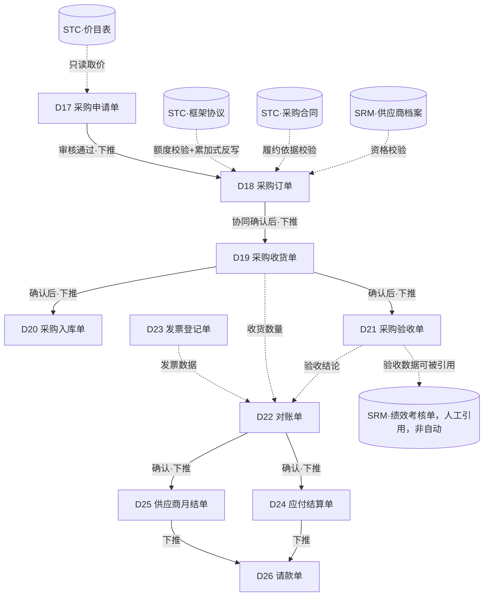

# PTP模块技术方案设计文档

版本：V1.0　日期：2026-09-17　范围：PTP 采购到付款 · 第三阶段

> 本文档延续 01/04号文档的设计范式（列表+单据[单头+分录]、BOTP下推、反写）。PTP 是链路最长的模块——从采购申请一路到付款——并且是**唯一同时依赖 SRM 和 STC 两个上游模块**的模块：下单前要查SRM确认供应商资格，取价/额度要查STC的价目表与框架协议，其中"引用框架协议下单"还会**反过来修改STC的数据**（BPA已用额度累加），这是本项目里第一次出现的"跨服务写操作"，需要格外小心地设计，本文档第7章专门说明，详细协作规则见《11-PTP与SRM及STC模块协作说明.md》。
>
> 配套文档：
> - 《09-PTP数据模型设计.md》—— 表结构与字段字典
> - 《10-PTP接口清单.md》—— 接口清单
> - 《11-PTP与SRM及STC模块协作说明.md》—— **PTP如何同时协作两个上游模块，必读**
> - 《00-技术架构与技术栈说明.md》—— 技术栈、`ptp-service`端口与部署说明

---

## 0. 设计范式延续说明

- 单据编号规则、单头/分录结构、通用状态机、下推控制策略、反写策略类型，沿用01号文档第0章。
- PTP专属规则：**任何单据引用供应商时，创建/提交环节需实时校验SRM档案状态非FROZEN/BLACKLIST**；**任何单据引用STC合同/价目表/框架协议时，需校验其状态为有效（EFFECTIVE/APPROVED）且未过期**。校验时机、失败处理见第7章与11号文档。
- 与 TMS（资金）、BMS（预算）、BTS（税务）、ECS（费用报销）等**企业外部系统**的对接，本阶段**仅做字段与接口预留（Mock）**，不实现真实对接——这些是原业务蓝图里提到的外部系统，不在SRM/STC/PTP三个内部微服务的开发范围内，属于后续集成阶段的工作。本文档中所有涉及这些系统的字段都会明确标注"预留"。

---

## 1. PTP模块单据清单与关系全景

### 1.1 单据清单（10张）

| 编号 | 单据名称 | 英文标识 | 说明 |
|---|---|---|---|
| D17 | 采购申请单 | PurchaseRequisitionBill | 需求发起、自动取价、审批，合并了业务蓝图中"采购需求管理""取价""采购申请审批"三个环节 |
| D18 | 采购订单 | PurchaseOrderBill | 正式订单及供应商协同确认，合并了"采购订单(PO)""采购门户PO/协同采购订单" |
| D19 | 采购收货单 | GoodsReceiptBill | 实物到货登记 |
| D20 | 采购入库单 | StockInBill | 库存记账 |
| D21 | 采购验收单 | AcceptanceBill | 质量检验与整改 |
| D22 | 对账单 | ReconciliationBill | 订单-收货-发票三单匹配 |
| D23 | 发票登记单 | InvoiceBill | 供应商发票登记与税务验真（预留对接BTS） |
| D24 | 应付结算单 | PayableSettlementBill | 应付账款核销 |
| D25 | 供应商月结单 | SupplierMonthlySettlementBill | 高频供应商按月汇总结算（与D24并列的可选路径） |
| D26 | 请款单 | PaymentRequestBill | 付款申请，含无PO请款场景（预留对接TMS/BMS/ECS） |

### 1.2 单据关系图

### 1.3 与SRM、STC的依赖关系摘要（详见11号文档）

| 依赖对象 | 交互性质 | 发生在哪个单据/动作 |
|---|---|---|
| SRM 供应商档案 | 只读查询，强校验 | D18创建/审核时校验供应商资格 |
| STC 采购合同 | 只读查询，校验有效性 | D18的price_source_type=CONTRACT场景 |
| STC 价目表 | 只读查询，取价 | D17"提交取价"动作 |
| STC 框架协议BPA | **读+写**：查询额度余量、审核通过后累加式反写已用额度 | D18的price_source_type=BPA场景，本模块唯一的跨服务写操作 |
| SRM 绩效考核单 | 反向的人工引用（PTP暴露查询接口，SRM侧人工创建绩效单时选择引用），非自动化联动 | D21验收单产出的数据 |

---

## 2. 单据详细设计

### D17 采购申请单
- **编号规则**：`PTP-PR-YYYYMMDD-####`
- **单头要点**：申请人、申请部门、申请日期、期望到货日期、预算科目（`budget_code`，**预留字段**，对接BMS预算校验，本阶段不做真实占用校验，仅记录）。
- **分录**：申请明细分录——品类编码、物料编码/名称、数量、建议供应商（可空）、单价（取价后填充）、金额、**取价来源**（`PRICELIST`价目表 / `BPA`框架协议 / `MANUAL`人工 / `NONE`暂无）、取价来源单号（STC价目表或BPA的单号）。
- **状态机**：`草稿 DRAFT → 已取价 PRICED → 已提交 SUBMITTED → 已审核 APPROVED（可下推） / 已驳回 REJECTED`。
- **操作按钮**：新增、编辑、**提交取价**（触发远程查询STC价目表/BPA自动填充单价）、提交审批、审核、驳回、下推生成采购订单。
- **业务规则**：取价优先级 —— 先查是否有指定供应商的有效BPA框架协议且额度充足，再查价目表，都没有则标记`MANUAL`人工取价（此时不阻断流程，允许人工临时填价，但建议提示"可发起STC询价流程正式定价"）。审批环节按金额分级（大额需多级审批，本阶段先实现单级）。

### D18 采购订单
- **编号规则**：`PTP-PO-YYYYMMDD-####`
- **单头要点**：来源采购申请单号、供应商编码、订单日期、订单总金额、**取价来源类型**（`PRICELIST`/`BPA`/`CONTRACT`/`MANUAL`）、取价来源单号、关联合同单号（可空）。
- **分录**：订单明细分录——品类编码、物料编码、数量、单价、金额、期望到货日期、**已收货数量**（`received_quantity`，累加式反写字段，由D19反写）、收货状态（未收货/部分收货/已收货，系统按received_quantity与订单数量比较自动判断）。
- **状态机**：`草稿 DRAFT → 已提交 SUBMITTED → 已确认 CONFIRMED（供应商协同确认） → 部分收货 PARTIALLY_RECEIVED → 已收货 RECEIVED → 已结案 CLOSED`。
- **操作按钮**：新增（通常由D17下推）、编辑、提交、**供应商协同确认**（模拟供应商门户确认动作，本阶段无真实供应商门户，用一个内部按钮模拟）、查询收货进度、关闭。
- **业务规则**（本模块最关键的一组规则，详见第7章与11号文档）：
  1. 提交时必须实时校验供应商 `cert_status` 非 FROZEN/BLACKLIST（同步查询SRM，强阻断）。
  2. `price_source_type=CONTRACT` 时，需校验引用的STC合同状态为APPROVED且未过期。
  3. `price_source_type=BPA` 时，需校验引用的STC框架协议状态为EFFECTIVE、未过期、且 `total_quota_amount - used_quota_amount ≥ 本单订单总金额`；**审核通过后需调用STC接口对该框架协议做已用额度累加式反写**，这是跨服务写操作，必须保证事务性（详见第7章"跨服务写操作的一致性处理"）。

### D19 采购收货单
- **编号规则**：`PTP-GR-YYYYMMDD-####`
- **单头要点**：来源采购订单号、供应商编码、收货日期、收货人。
- **分录**：收货明细分录——物料编码、订单数量（只读引用）、本次收货数量、是否超收（系统按容差规则自动判断，默认容差±5%可配置）、批次号。
- **状态机**：`草稿 DRAFT → 已提交 SUBMITTED → 已确认 CONFIRMED（触发反写与下推）`。
- **操作按钮**：新增、编辑、提交确认、下推生成入库单、下推生成验收单（两者在确认后可分别触发，互不依赖）。
- **业务规则**：一个订单可对应多次收货单（分批到货），每次确认后累加式反写订单分录的 `received_quantity`；全部到齐后订单状态自动置为 `RECEIVED`。

### D20 采购入库单
- **编号规则**：`PTP-SI-YYYYMMDD-####`
- **单头要点**：来源收货单号、仓库编码、入库日期。
- **分录**：入库明细分录——物料编码、数量、批次号、库位编码（可空）。
- **状态机**：`草稿 DRAFT → 已确认 CONFIRMED`。
- **操作按钮**：新增（通常由D19下推）、编辑、确认。
- **业务规则**：入库数量默认等于对应收货单的收货数量，人工可调整（如发现收货后盘点差异），调整需留痕原因。

### D21 采购验收单
- **编号规则**：`PTP-ACC-YYYYMMDD-####`
- **单头要点**：来源收货单号、验收人、验收日期、验收结论（`QUALIFIED`合格 / `UNQUALIFIED`不合格 / `PARTIAL`部分合格）。
- **分录**：验收明细分录——物料编码、数量、合格数量、不合格数量、不合格描述（可空）、是否需整改。
- **状态机**：`草稿 DRAFT → 已提交 SUBMITTED → 已审核 APPROVED`。
- **操作按钮**：新增（通常由D19下推）、编辑、提交、审核、发起质量整改（`rework_required=true`的行，生成整改跟踪记录，本阶段简化为分录内的状态字段，不单独建整改单）。
- **业务规则**：验收结论用于对账单的三单匹配依据；**验收单据可被SRM侧的供应商绩效考核单人工引用**（SRM D8分录的`source_bill_no`字段填写本单号），但这是人工查询后手动填写，PTP不需要主动推送数据给SRM，只需保证 `GET /api/ptp/acceptances` 系列查询接口可被SRM侧的前端页面调用展示（跨服务只读查询，方向与之前相反：这次是SRM查PTP）。

### D22 对账单
- **编号规则**：`PTP-REC-YYYYMMDD-####`
- **单头要点**：供应商编码、对账期间、三单匹配状态（`MATCHED`匹配一致 / `DIFF`存在差异 / `PENDING`待处理）。
- **分录**：对账明细分录——关联订单号、物料编码、订单数量、收货数量、发票数量、订单金额、发票金额、差异金额（系统计算：发票金额-订单金额）、差异说明。
- **状态机**：`草稿 DRAFT → 已提交 SUBMITTED → 已确认 CONFIRMED（可下推）`。
- **操作按钮**：新增（可人工创建或"生成对账单"按钮按供应商+期间自动汇总关联的收货/验收/发票数据）、编辑、提交、确认、下推生成应付结算单或供应商月结单。
- **业务规则**：差异金额超过容差阈值（默认±1%或绝对值100元，可配置）时，`match_status` 自动标记为 `DIFF`，需人工填写差异说明才能确认。

### D23 发票登记单
- **编号规则**：`PTP-INV-YYYYMMDD-####`
- **单头要点**：供应商编码、发票号码、开票日期、发票金额、税额、发票类型（增值税专票/普票）、**税务验真状态**（`PENDING`/`PASSED`/`FAILED`，**预留字段**，对接BTS税务系统，本阶段用Mock接口返回固定PASSED，不做真实验真）。
- **分录**：发票明细分录——物料编码、数量、单价、金额、税率。
- **状态机**：`草稿 DRAFT → 已提交 SUBMITTED → 已确认 CONFIRMED`。
- **操作按钮**：新增、编辑、提交、**发起税务验真**（调用Mock的BTS接口）、确认。
- **业务规则**：发票金额与税额的税率关系需校验（`tax_amount ≈ invoice_amount × tax_rate`，容差±0.01）。

### D24 应付结算单
- **编号规则**：`PTP-PS-YYYYMMDD-####`
- **单头要点**：供应商编码、来源对账单号、结算金额、账期条款。
- **分录**：结算明细分录——关联订单号、关联发票号、金额。
- **状态机**：`草稿 DRAFT → 已确认 CONFIRMED（可下推）`。
- **操作按钮**：新增（通常由D22下推）、编辑、确认、下推生成请款单。

### D25 供应商月结单
- **编号规则**：`PTP-MS-YYYYMMDD-####`
- **单头要点**：供应商编码、结算周期（如"2026-09"）、汇总总金额。
- **分录**：月结汇总分录——关联对账单号、金额。
- **状态机**：`草稿 DRAFT → 已确认 CONFIRMED（可下推）`。
- **操作按钮**：新增（按供应商+周期汇总多张已确认对账单生成）、编辑、确认、下推生成请款单。
- **业务规则**：与D24是**并列的可选路径**——高频交易供应商走月结汇总，普通供应商走单次对账后直接结算，二者互斥（同一张对账单不能同时被D24和D25引用）。

### D26 请款单
- **编号规则**：`PTP-PAY-YYYYMMDD-####`
- **单头要点**：供应商编码、来源类型（`NORMAL`正常有PO请款 / `NO_PO`无PO请款）、来源应付结算单号或月结单号（`NORMAL`场景必填）、**来源ECS费用报销单号**（`NO_PO`场景必填，**预留字段**，对接ECS费用报销系统，本阶段用Mock接口）、请款金额、期望支付日期、**请款额度校验状态**（预留字段，对接BMS预算系统）、**支付结果**（预留字段，对接TMS资金系统回传）。
- **分录**：请款明细分录——关联结算/月结/ECS单号、金额。
- **状态机**：`草稿 DRAFT → 已提交 SUBMITTED → 已审核 APPROVED → 已支付 PAID`（`PAID` 状态本阶段由人工模拟触发，真实场景由TMS回传支付结果驱动）。
- **操作按钮**：新增（通常由D24/D25下推，`NO_PO`场景可人工直接创建）、编辑、提交、审核、**模拟支付完成**（Mock TMS回调，本阶段用手动按钮代替真实资金系统对接）。

---

## 3. 编号规则汇总表

| 单据 | 编号前缀 | 示例 |
|---|---|---|
| 采购申请单 | PTP-PR | PTP-PR-20260917-0001 |
| 采购订单 | PTP-PO | PTP-PO-20260917-0001 |
| 采购收货单 | PTP-GR | PTP-GR-20260917-0001 |
| 采购入库单 | PTP-SI | PTP-SI-20260917-0001 |
| 采购验收单 | PTP-ACC | PTP-ACC-20260917-0001 |
| 对账单 | PTP-REC | PTP-REC-20260917-0001 |
| 发票登记单 | PTP-INV | PTP-INV-20260917-0001 |
| 应付结算单 | PTP-PS | PTP-PS-20260917-0001 |
| 供应商月结单 | PTP-MS | PTP-MS-20260917-0001 |
| 请款单 | PTP-PAY | PTP-PAY-20260917-0001 |

---

## 4. 状态枚举字典

| 枚举分组 | 取值 | 使用单据 |
|---|---|---|
| 采购申请单状态 PRStatus | DRAFT / PRICED / SUBMITTED / APPROVED / REJECTED / CONVERTED | D17 |
| 取价来源 PriceSource | PRICELIST / BPA / CONTRACT / MANUAL / NONE | D17, D18 |
| 采购订单状态 POStatus | DRAFT / SUBMITTED / CONFIRMED / PARTIALLY_RECEIVED / RECEIVED / CLOSED | D18 |
| 收货单状态 GRStatus | DRAFT / SUBMITTED / CONFIRMED | D19 |
| 入库单状态 StockInStatus | DRAFT / CONFIRMED | D20 |
| 验收结论 AcceptanceConclusion | QUALIFIED / UNQUALIFIED / PARTIAL | D21 |
| 验收单状态 AcceptanceStatus | DRAFT / SUBMITTED / APPROVED | D21 |
| 三单匹配状态 MatchStatus | MATCHED / DIFF / PENDING | D22 |
| 对账单状态 ReconciliationStatus | DRAFT / SUBMITTED / CONFIRMED | D22 |
| 发票类型 InvoiceType | VAT_SPECIAL 增值税专票 / VAT_NORMAL 普票 | D23 |
| 税务验真状态 VerifyStatus | PENDING / PASSED / FAILED | D23（预留对接BTS） |
| 请款来源类型 PaymentSourceType | NORMAL / NO_PO | D26 |
| 请款单状态 PaymentStatus | DRAFT / SUBMITTED / APPROVED / PAID | D26 |

---

## 5. 单据转换（下推）规则设计矩阵

| 序号 | 源单据 | 目标单据 | 触发方式 | 触发条件 | 携带字段映射 | 下推后源单状态 | 下推控制 |
|---|---|---|---|---|---|---|---|
| P1 | D17 采购申请单 | D18 采购订单 | 手动 | D17.status=APPROVED | 申请明细分录→订单明细分录（含单价、取价来源）；D17单号→来源单号 | CONVERTED | 一张PR可分批下推多张PO（部分下单场景），不强制一次性全部下推 |
| P2 | D18 采购订单 | D19 采购收货单 | 手动 | D18.status=CONFIRMED及之后 | 订单明细分录→收货明细分录（po_quantity只读引用） | 不变（由D19反写received_quantity/status） | 允许多次下推（分批收货） |
| P3 | D19 采购收货单 | D20 采购入库单 | 手动，确认后可选 | D19.status=CONFIRMED | 收货明细分录→入库明细分录 | 不变 | 一张收货单可下推一次入库单 |
| P4 | D19 采购收货单 | D21 采购验收单 | 手动，确认后可选，与P3并行 | D19.status=CONFIRMED | 收货明细分录→验收明细分录（初始合格数量=收货数量，待人工修正） | 不变 | 一张收货单可下推一次验收单 |
| P5 | D22 对账单 | D24 应付结算单 | 手动（可选路径之一） | D22.status=CONFIRMED且未走月结路径 | 对账明细分录→结算明细分录 | 不变 | 一张对账单只能走D24或D25其中一条路径 |
| P6 | D22 对账单 | D25 供应商月结单 | 手动（可选路径之二） | D22.status=CONFIRMED且供应商标记为高频结算 | 多张对账单汇总→月结汇总分录 | 不变 | 同P5互斥 |
| P7 | D24 应付结算单 | D26 请款单 | 手动 | D24.status=CONFIRMED | 结算明细分录→请款明细分录 | 不变 | 允许多次下推（分次请款） |
| P8 | D25 供应商月结单 | D26 请款单 | 手动 | D25.status=CONFIRMED | 月结汇总分录→请款明细分录 | 不变 | 同P7 |

---

## 6. 反写规则设计矩阵

| 序号 | 触发单据 | 触发动作 | 反写目标 | 反写字段 | 反写策略 | 触发条件 |
|---|---|---|---|---|---|---|
| Q1 | D19 采购收货单 | 确认 | D18 采购订单（分录） | received_quantity | 累加式；全部到齐后单头status→RECEIVED（状态触发式） | status→CONFIRMED |
| Q2 | D18 采购订单 | 审核通过，且price_source_type=BPA | **STC框架协议**（跨服务） | used_quota_amount | 累加式，**通过Feign调用STC接口执行**，非本地反写 | status→APPROVED（或CONFIRMED，取决于是否设计单独审核节点） |
| Q3 | D26 请款单 | 模拟支付完成 | D24/D25（来源结算单/月结单） | status | 状态触发式 → 标记为"已支付完成"（本阶段用一个简单的`paid_flag`字段，不单独建状态机） | status→PAID |

> Q2 是本模块唯一的**跨服务反写**，详见第7章与11号文档，实现时要格外注意事务边界——不能出现"PTP订单审核成功了，但STC额度没扣成功"的数据不一致。

---

## 7. 跨服务写操作的一致性处理（重点章节）

D18 采购订单引用STC框架协议（BPA）下单，审核通过后需要调用 STC 的 `POST /api/stc/bpas/{id}/accumulate-usage` 接口做额度累加。这是本项目至今唯一的"服务A的写操作需要联动服务B也发生写操作"的场景，比之前SRM/STC之间的"只读查询"复杂得多，必须明确设计失败处理策略：

- **不使用分布式事务（如Seata/2PC）**——对个人demo项目过重，不建议引入。
- **采用"先决校验 + 失败补偿"的轻量方案**：
  1. D18审核动作开始时，先同步调用STC的BPA详情查询接口，**在本地内存中二次确认**额度充足（审核提交到STC写入之间可能有极短的时间差，做二次确认降低竞态风险，但不追求100%杜绝并发问题，demo规模可接受）。
  2. 调用STC的 `accumulate-usage` 接口执行额度累加。
  3. **如果该接口调用失败或超时**：D18订单的审核动作**整体失败并回滚**（本地事务回滚，订单状态保持SUBMITTED不变），返回错误提示"框架协议额度更新失败，请重试"。即：**必须等STC额度累加成功，PTP订单才能审核通过**，二者在业务语义上是同一个原子操作，只是物理上分成两次网络调用。
  4. **如果PTP订单审核成功、但后续发现STC额度记录异常**（如网络分区导致的极端情况）：本阶段不做自动化的分布式补偿事务，而是设计一个人工对账工具（`GET /api/ptp/orders?priceSourceType=BPA` 与 STC的 `GET /api/stc/bpas/{id}/usage-log` 对照核查），发现不一致时人工修正。这是有意的简化，作为待确认事项列入11号文档。
- **命名约定**：涉及跨服务写操作的方法在代码里额外标注 `@CrossServiceWrite` 自定义注解（仅用于代码可读性和日志埋点，不是真实的分布式事务框架），方便AI和后续维护者一眼识别这类"高风险"调用点。
