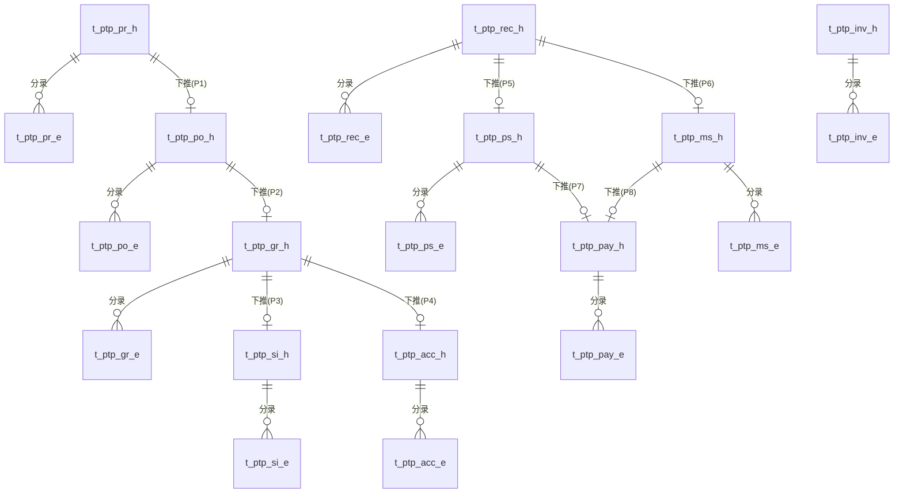

# PTP模块数据模型设计

版本：V1.0　日期：2026-09-17

> 与《08-PTP技术方案设计文档.md》的单据（D17~D26）严格一一对应。命名规则、审计字段约定与02/05号文档一致。
> **跨模块外键**：`supplier_code` 逻辑关联SRM档案；`price_source_bill_no`（当来源为PRICELIST/BPA/CONTRACT时）逻辑关联STC对应单据编号。均不建物理外键，由接口层做存在性与状态校验（详见11号文档）。
> **数据库落地说明**：类型映射同02号文档说明——`bigint 自增`→`BIGSERIAL`，`decimal(p,s)`→`NUMERIC(p,s)`，`datetime`→`TIMESTAMP`。

---

## 0. 总体 ER 关系图

---

## 1. D17 采购申请单

### 1.1 t_ptp_pr_h（单头）

| 字段名 | 中文名 | 类型 | 长度 | 必填 | 默认值 | 说明 |
|---|---|---|---|---|---|---|
| id | 主键 | bigint | - | 是 | 自增 | |
| bill_no | 单据编号 | varchar | 32 | 是 | - | 唯一 |
| applicant | 申请人 | varchar | 50 | 是 | - | |
| department | 申请部门 | varchar | 50 | 否 | - | |
| apply_date | 申请日期 | date | - | 是 | 当天 | |
| expect_delivery_date | 期望到货日期 | date | - | 否 | - | |
| budget_code | 预算科目 | varchar | 32 | 否 | - | **预留**，对接BMS，本阶段不做真实占用校验 |
| status | 单据状态 | varchar | 20 | 是 | DRAFT | 枚举：DRAFT/PRICED/SUBMITTED/APPROVED/REJECTED/CONVERTED |

### 1.2 t_ptp_pr_e（申请明细分录）

| 字段名 | 中文名 | 类型 | 长度 | 必填 | 默认值 | 说明 |
|---|---|---|---|---|---|---|
| id | 主键 | bigint | - | 是 | 自增 | |
| header_id | 单头ID | bigint | - | 是 | - | FK → t_ptp_pr_h.id |
| seq | 行号 | int | - | 是 | - | |
| category_code | 品类编码 | varchar | 32 | 是 | - | |
| item_code | 物料编码 | varchar | 32 | 是 | - | |
| item_name | 物料名称 | varchar | 100 | 是 | - | |
| quantity | 数量 | decimal | 14,4 | 是 | - | |
| suggested_supplier_code | 建议供应商编码 | varchar | 32 | 否 | - | 逻辑关联SRM档案 |
| unit_price | 单价 | decimal | 14,4 | 否 | - | 取价后填充 |
| amount | 金额 | decimal | 14,2 | 否 | - | = quantity × unit_price |
| price_source | 取价来源 | varchar | 20 | 否 | NONE | 枚举：PRICELIST/BPA/MANUAL/NONE |
| price_source_bill_no | 取价来源单号 | varchar | 32 | 否 | - | STC价目表或BPA单号 |

---

## 2. D18 采购订单

### 2.1 t_ptp_po_h（单头）

| 字段名 | 中文名 | 类型 | 长度 | 必填 | 默认值 | 说明 |
|---|---|---|---|---|---|---|
| id | 主键 | bigint | - | 是 | 自增 | |
| bill_no | 单据编号 | varchar | 32 | 是 | - | 唯一 |
| source_pr_bill_no | 来源采购申请单号 | varchar | 32 | 否 | - | |
| supplier_code | 供应商编码 | varchar | 32 | 是 | - | 逻辑关联SRM档案 |
| order_date | 订单日期 | date | - | 是 | 当天 | |
| total_amount | 订单总金额 | decimal | 14,2 | 是 | - | = Σ分录金额 |
| price_source_type | 取价来源类型 | varchar | 20 | 是 | MANUAL | 枚举：PRICELIST/BPA/CONTRACT/MANUAL |
| price_source_bill_no | 取价来源单号 | varchar | 32 | 否 | - | 逻辑关联STC价目表/BPA/合同单号 |
| contract_bill_no | 关联合同单号 | varchar | 32 | 否 | - | |
| status | 单据状态 | varchar | 20 | 是 | DRAFT | 枚举：DRAFT/SUBMITTED/CONFIRMED/PARTIALLY_RECEIVED/RECEIVED/CLOSED |
| approved_at | 审核通过时间 | datetime | - | 否 | - | |

### 2.2 t_ptp_po_e（订单明细分录）

| 字段名 | 中文名 | 类型 | 长度 | 必填 | 默认值 | 说明 |
|---|---|---|---|---|---|---|
| id | 主键 | bigint | - | 是 | 自增 | |
| header_id | 单头ID | bigint | - | 是 | - | FK → t_ptp_po_h.id |
| seq | 行号 | int | - | 是 | - | |
| category_code | 品类编码 | varchar | 32 | 是 | - | |
| item_code | 物料编码 | varchar | 32 | 是 | - | |
| quantity | 订单数量 | decimal | 14,4 | 是 | - | |
| unit_price | 单价 | decimal | 14,4 | 是 | - | |
| amount | 金额 | decimal | 14,2 | 是 | - | |
| expect_delivery_date | 期望到货日期 | date | - | 否 | - | |
| received_quantity | 已收货数量 | decimal | 14,4 | 是 | 0 | 由D19确认累加式反写（Q1） |
| receive_status | 收货状态 | varchar | 20 | 是 | NOT_RECEIVED | 枚举：NOT_RECEIVED/PARTIAL/RECEIVED，系统按received_quantity自动计算 |

---

## 3. D19 采购收货单

### 3.1 t_ptp_gr_h（单头）

| 字段名 | 中文名 | 类型 | 长度 | 必填 | 默认值 | 说明 |
|---|---|---|---|---|---|---|
| id | 主键 | bigint | - | 是 | 自增 | |
| bill_no | 单据编号 | varchar | 32 | 是 | - | 唯一 |
| source_po_bill_no | 来源采购订单号 | varchar | 32 | 是 | - | |
| supplier_code | 供应商编码 | varchar | 32 | 是 | - | |
| receive_date | 收货日期 | date | - | 是 | 当天 | |
| receiver | 收货人 | varchar | 50 | 是 | - | |
| status | 单据状态 | varchar | 20 | 是 | DRAFT | 枚举：DRAFT/SUBMITTED/CONFIRMED |

### 3.2 t_ptp_gr_e（收货明细分录）

| 字段名 | 中文名 | 类型 | 长度 | 必填 | 默认值 | 说明 |
|---|---|---|---|---|---|---|
| id | 主键 | bigint | - | 是 | 自增 | |
| header_id | 单头ID | bigint | - | 是 | - | FK → t_ptp_gr_h.id |
| seq | 行号 | int | - | 是 | - | |
| item_code | 物料编码 | varchar | 32 | 是 | - | |
| po_quantity | 订单数量 | decimal | 14,4 | 是 | - | 只读引用D18 |
| received_quantity | 本次收货数量 | decimal | 14,4 | 是 | - | |
| over_tolerance_flag | 是否超收 | boolean | - | 是 | false | 系统按容差规则自动判断 |
| batch_no | 批次号 | varchar | 50 | 否 | - | |

---

## 4. D20 采购入库单

### 4.1 t_ptp_si_h（单头）

| 字段名 | 中文名 | 类型 | 长度 | 必填 | 默认值 | 说明 |
|---|---|---|---|---|---|---|
| id | 主键 | bigint | - | 是 | 自增 | |
| bill_no | 单据编号 | varchar | 32 | 是 | - | 唯一 |
| source_gr_bill_no | 来源收货单号 | varchar | 32 | 是 | - | |
| warehouse_code | 仓库编码 | varchar | 32 | 是 | - | |
| stock_in_date | 入库日期 | date | - | 是 | 当天 | |
| status | 单据状态 | varchar | 20 | 是 | DRAFT | 枚举：DRAFT/CONFIRMED |

### 4.2 t_ptp_si_e（入库明细分录）

| 字段名 | 中文名 | 类型 | 长度 | 必填 | 默认值 | 说明 |
|---|---|---|---|---|---|---|
| id | 主键 | bigint | - | 是 | 自增 | |
| header_id | 单头ID | bigint | - | 是 | - | FK → t_ptp_si_h.id |
| seq | 行号 | int | - | 是 | - | |
| item_code | 物料编码 | varchar | 32 | 是 | - | |
| quantity | 数量 | decimal | 14,4 | 是 | - | |
| batch_no | 批次号 | varchar | 50 | 否 | - | |
| location_code | 库位编码 | varchar | 32 | 否 | - | |

---

## 5. D21 采购验收单

### 5.1 t_ptp_acc_h（单头）

| 字段名 | 中文名 | 类型 | 长度 | 必填 | 默认值 | 说明 |
|---|---|---|---|---|---|---|
| id | 主键 | bigint | - | 是 | 自增 | |
| bill_no | 单据编号 | varchar | 32 | 是 | - | 唯一 |
| source_gr_bill_no | 来源收货单号 | varchar | 32 | 是 | - | |
| inspector | 验收人 | varchar | 50 | 是 | - | |
| inspect_date | 验收日期 | date | - | 是 | 当天 | |
| conclusion | 验收结论 | varchar | 20 | 否 | - | 枚举：QUALIFIED/UNQUALIFIED/PARTIAL |
| status | 单据状态 | varchar | 20 | 是 | DRAFT | 枚举：DRAFT/SUBMITTED/APPROVED |

### 5.2 t_ptp_acc_e（验收明细分录）

| 字段名 | 中文名 | 类型 | 长度 | 必填 | 默认值 | 说明 |
|---|---|---|---|---|---|---|
| id | 主键 | bigint | - | 是 | 自增 | |
| header_id | 单头ID | bigint | - | 是 | - | FK → t_ptp_acc_h.id |
| seq | 行号 | int | - | 是 | - | |
| item_code | 物料编码 | varchar | 32 | 是 | - | |
| quantity | 数量 | decimal | 14,4 | 是 | - | |
| qualified_quantity | 合格数量 | decimal | 14,4 | 是 | - | |
| unqualified_quantity | 不合格数量 | decimal | 14,4 | 是 | 0 | |
| defect_desc | 不合格描述 | varchar | 300 | 否 | - | |
| rework_required | 是否需整改 | boolean | - | 是 | false | |

---

## 6. D22 对账单

### 6.1 t_ptp_rec_h（单头）

| 字段名 | 中文名 | 类型 | 长度 | 必填 | 默认值 | 说明 |
|---|---|---|---|---|---|---|
| id | 主键 | bigint | - | 是 | 自增 | |
| bill_no | 单据编号 | varchar | 32 | 是 | - | 唯一 |
| supplier_code | 供应商编码 | varchar | 32 | 是 | - | |
| period | 对账期间 | varchar | 20 | 是 | - | 如"2026-09" |
| match_status | 三单匹配状态 | varchar | 10 | 是 | PENDING | 枚举：MATCHED/DIFF/PENDING |
| status | 单据状态 | varchar | 20 | 是 | DRAFT | 枚举：DRAFT/SUBMITTED/CONFIRMED |

### 6.2 t_ptp_rec_e（对账明细分录）

| 字段名 | 中文名 | 类型 | 长度 | 必填 | 默认值 | 说明 |
|---|---|---|---|---|---|---|
| id | 主键 | bigint | - | 是 | 自增 | |
| header_id | 单头ID | bigint | - | 是 | - | FK → t_ptp_rec_h.id |
| seq | 行号 | int | - | 是 | - | |
| po_bill_no | 关联订单号 | varchar | 32 | 是 | - | |
| item_code | 物料编码 | varchar | 32 | 是 | - | |
| po_quantity | 订单数量 | decimal | 14,4 | 否 | - | |
| receive_quantity | 收货数量 | decimal | 14,4 | 否 | - | |
| invoice_quantity | 发票数量 | decimal | 14,4 | 否 | - | |
| po_amount | 订单金额 | decimal | 14,2 | 否 | - | |
| invoice_amount | 发票金额 | decimal | 14,2 | 否 | - | |
| diff_amount | 差异金额 | decimal | 14,2 | 否 | - | 系统计算 = invoice_amount - po_amount |
| diff_reason | 差异说明 | varchar | 200 | 否 | - | diff_amount超阈值时必填 |

---

## 7. D23 发票登记单

### 7.1 t_ptp_inv_h（单头）

| 字段名 | 中文名 | 类型 | 长度 | 必填 | 默认值 | 说明 |
|---|---|---|---|---|---|---|
| id | 主键 | bigint | - | 是 | 自增 | |
| bill_no | 单据编号 | varchar | 32 | 是 | - | 唯一 |
| supplier_code | 供应商编码 | varchar | 32 | 是 | - | |
| invoice_no | 发票号码 | varchar | 50 | 是 | - | |
| invoice_date | 开票日期 | date | - | 是 | - | |
| invoice_amount | 发票金额 | decimal | 14,2 | 是 | - | |
| tax_amount | 税额 | decimal | 14,2 | 否 | - | |
| invoice_type | 发票类型 | varchar | 20 | 是 | VAT_NORMAL | 枚举：VAT_SPECIAL/VAT_NORMAL |
| verify_status | 税务验真状态 | varchar | 10 | 是 | PENDING | 枚举：PENDING/PASSED/FAILED，**预留对接BTS，本阶段Mock固定返回PASSED** |
| status | 单据状态 | varchar | 20 | 是 | DRAFT | 枚举：DRAFT/SUBMITTED/CONFIRMED |

### 7.2 t_ptp_inv_e（发票明细分录）

| 字段名 | 中文名 | 类型 | 长度 | 必填 | 默认值 | 说明 |
|---|---|---|---|---|---|---|
| id | 主键 | bigint | - | 是 | 自增 | |
| header_id | 单头ID | bigint | - | 是 | - | FK → t_ptp_inv_h.id |
| seq | 行号 | int | - | 是 | - | |
| item_code | 物料编码 | varchar | 32 | 是 | - | |
| quantity | 数量 | decimal | 14,4 | 是 | - | |
| unit_price | 单价 | decimal | 14,4 | 是 | - | |
| amount | 金额 | decimal | 14,2 | 是 | - | |
| tax_rate | 税率(%) | decimal | 5,2 | 是 | 13 | |

---

## 8. D24 应付结算单

### 8.1 t_ptp_ps_h（单头）

| 字段名 | 中文名 | 类型 | 长度 | 必填 | 默认值 | 说明 |
|---|---|---|---|---|---|---|
| id | 主键 | bigint | - | 是 | 自增 | |
| bill_no | 单据编号 | varchar | 32 | 是 | - | 唯一 |
| supplier_code | 供应商编码 | varchar | 32 | 是 | - | |
| source_reconciliation_bill_no | 来源对账单号 | varchar | 32 | 是 | - | |
| settle_amount | 结算金额 | decimal | 14,2 | 是 | - | |
| payment_terms | 账期条款 | varchar | 50 | 否 | - | 如"月结30天" |
| status | 单据状态 | varchar | 20 | 是 | DRAFT | 枚举：DRAFT/CONFIRMED |
| paid_flag | 已支付标记 | boolean | - | 是 | false | 由D26支付完成反写（Q3） |

### 8.2 t_ptp_ps_e（结算明细分录）

| 字段名 | 中文名 | 类型 | 长度 | 必填 | 默认值 | 说明 |
|---|---|---|---|---|---|---|
| id | 主键 | bigint | - | 是 | 自增 | |
| header_id | 单头ID | bigint | - | 是 | - | FK → t_ptp_ps_h.id |
| seq | 行号 | int | - | 是 | - | |
| po_bill_no | 关联订单号 | varchar | 32 | 否 | - | |
| invoice_bill_no | 关联发票号 | varchar | 32 | 否 | - | |
| amount | 金额 | decimal | 14,2 | 是 | - | |

---

## 9. D25 供应商月结单

### 9.1 t_ptp_ms_h（单头）

| 字段名 | 中文名 | 类型 | 长度 | 必填 | 默认值 | 说明 |
|---|---|---|---|---|---|---|
| id | 主键 | bigint | - | 是 | 自增 | |
| bill_no | 单据编号 | varchar | 32 | 是 | - | 唯一 |
| supplier_code | 供应商编码 | varchar | 32 | 是 | - | |
| settle_period | 结算周期 | varchar | 20 | 是 | - | 如"2026-09" |
| total_amount | 汇总总金额 | decimal | 14,2 | 是 | - | = Σ分录金额 |
| status | 单据状态 | varchar | 20 | 是 | DRAFT | 枚举：DRAFT/CONFIRMED |
| paid_flag | 已支付标记 | boolean | - | 是 | false | 由D26支付完成反写（Q3） |

### 9.2 t_ptp_ms_e（月结汇总分录）

| 字段名 | 中文名 | 类型 | 长度 | 必填 | 默认值 | 说明 |
|---|---|---|---|---|---|---|
| id | 主键 | bigint | - | 是 | 自增 | |
| header_id | 单头ID | bigint | - | 是 | - | FK → t_ptp_ms_h.id |
| seq | 行号 | int | - | 是 | - | |
| reconciliation_bill_no | 关联对账单号 | varchar | 32 | 是 | - | |
| amount | 金额 | decimal | 14,2 | 是 | - | |

---

## 10. D26 请款单

### 10.1 t_ptp_pay_h（单头）

| 字段名 | 中文名 | 类型 | 长度 | 必填 | 默认值 | 说明 |
|---|---|---|---|---|---|---|
| id | 主键 | bigint | - | 是 | 自增 | |
| bill_no | 单据编号 | varchar | 32 | 是 | - | 唯一 |
| supplier_code | 供应商编码 | varchar | 32 | 是 | - | |
| source_type | 来源类型 | varchar | 10 | 是 | NORMAL | 枚举：NORMAL/NO_PO |
| source_settlement_bill_no | 来源应付结算/月结单号 | varchar | 32 | 否 | - | source_type=NORMAL时必填 |
| source_ecs_bill_no | 来源ECS费用报销单号 | varchar | 32 | 否 | - | source_type=NO_PO时必填，**预留对接ECS** |
| request_amount | 请款金额 | decimal | 14,2 | 是 | - | |
| expect_pay_date | 期望支付日期 | date | - | 否 | - | |
| quota_check_status | 请款额度校验状态 | varchar | 10 | 否 | - | **预留对接BMS**，本阶段不做真实校验 |
| status | 单据状态 | varchar | 20 | 是 | DRAFT | 枚举：DRAFT/SUBMITTED/APPROVED/PAID |
| payment_result | 支付结果 | varchar | 20 | 否 | - | **预留对接TMS回传**，本阶段人工模拟 |

### 10.2 t_ptp_pay_e（请款明细分录）

| 字段名 | 中文名 | 类型 | 长度 | 必填 | 默认值 | 说明 |
|---|---|---|---|---|---|---|
| id | 主键 | bigint | - | 是 | 自增 | |
| header_id | 单头ID | bigint | - | 是 | - | FK → t_ptp_pay_h.id |
| seq | 行号 | int | - | 是 | - | |
| source_bill_no | 关联结算/月结/ECS单号 | varchar | 32 | 是 | - | |
| amount | 金额 | decimal | 14,2 | 是 | - | |

---

## 11. 表清单汇总

| # | 表名 | 所属单据 | 类型 |
|---|---|---|---|
| 1 | t_ptp_pr_h | D17 | 单头 |
| 2 | t_ptp_pr_e | D17 | 分录 |
| 3 | t_ptp_po_h | D18 | 单头 |
| 4 | t_ptp_po_e | D18 | 分录 |
| 5 | t_ptp_gr_h | D19 | 单头 |
| 6 | t_ptp_gr_e | D19 | 分录 |
| 7 | t_ptp_si_h | D20 | 单头 |
| 8 | t_ptp_si_e | D20 | 分录 |
| 9 | t_ptp_acc_h | D21 | 单头 |
| 10 | t_ptp_acc_e | D21 | 分录 |
| 11 | t_ptp_rec_h | D22 | 单头 |
| 12 | t_ptp_rec_e | D22 | 分录 |
| 13 | t_ptp_inv_h | D23 | 单头 |
| 14 | t_ptp_inv_e | D23 | 分录 |
| 15 | t_ptp_ps_h | D24 | 单头 |
| 16 | t_ptp_ps_e | D24 | 分录 |
| 17 | t_ptp_ms_h | D25 | 单头 |
| 18 | t_ptp_ms_e | D25 | 分录 |
| 19 | t_ptp_pay_h | D26 | 单头 |
| 20 | t_ptp_pay_e | D26 | 分录 |
