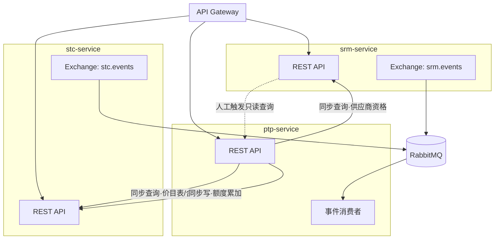

# PTP 与 SRM、STC 模块协作说明

版本：V1.0　日期：2026-09-17

> 本文档回答：**PTP（第三阶段）作为同时依赖 SRM 和 STC 两个上游模块的服务，具体怎么和它们协作？** 结构延续《07-SRM与STC模块协作说明.md》，但PTP的情况更复杂——它不仅要"读"两个上游模块的数据，还有一处需要"写"STC的数据（框架协议额度累加），这是本项目至今唯一的跨服务写操作，本文档第4章专门展开。

---

## 1. 依赖方向与边界原则

**三层依赖链：PTP 依赖 STC，STC 依赖 SRM，依赖单向，不存在反向依赖。**

- SRM：供应商主数据，最底层，不依赖任何模块。
- STC：寻源到合同，依赖SRM（查询、订阅）。
- PTP：采购到付款，依赖SRM（查询供应商资格、订阅冻结/黑名单事件）和STC（查询价目表/框架协议/合同、累加框架协议额度、订阅额度预警/合同到期事件）。

**唯一的例外说明（反向查询，非反向依赖）**：SRM侧的供应商绩效考核单（D8）人工填写"数据来源单号"时，可能需要查询PTP的采购验收单（D21）数据作为参考。这是**人工触发的只读查询**，不是运行时的强制依赖——即使PTP服务当时不可用，SRM的绩效考核单照样可以手工填写单号继续保存，不会被阻断。第6章详细说明。

---

## 2. 协作全景图

---

## 3. 同步调用衔接点清单

### 3.1 PTP 查询 SRM（供应商资格）

| 编号 | PTP侧动作 | 调用接口 | 校验规则 | 失败处理 |
|---|---|---|---|---|
| R1 | D18采购订单"提交" | GET /api/srm/archives/{supplierCode} | 供应商状态非FROZEN/BLACKLIST | 校验不通过：拒绝提交并提示原因；SRM服务不可用：**同样拒绝提交**，不做降级，因为提交后紧接着就是审核环节的跨服务写操作，风险较高 |

### 3.2 PTP 查询 STC（价目表 / 合同 / 框架协议）

| 编号 | PTP侧动作 | 调用接口 | 校验规则 | 失败处理 |
|---|---|---|---|---|
| R2 | D17"提交取价"，优先查框架协议 | GET /api/stc/bpas?supplier_code=&category_code= | 查找EFFECTIVE且额度充足的框架协议 | 查不到或STC不可用：降级走R3，不阻断（取价阶段允许降级） |
| R3 | D17"提交取价"，次优先查价目表 | GET /api/stc/price-lists/effective-price?supplier_code=&item_code= | 查找EFFECTIVE的价目表价格 | 查不到或STC不可用：降级为人工取价（MANUAL），允许人工填价继续 |
| R4 | D18"提交"，来源类型=CONTRACT时 | GET /api/stc/contracts/{id} | 合同状态APPROVED且未过期 | 校验不通过或STC不可用：**均拒绝提交**，不降级 |
| R5 | D18"提交"，来源类型=BPA时 | GET /api/stc/bpas/{id} | 状态EFFECTIVE、未过期、剩余额度≥本单金额 | 校验不通过或STC不可用：**均拒绝提交**，不降级 |

**设计要点**：取价阶段（R2/R3）允许降级，因为此时还没有形成正式的资金承诺，人工兜底完全可以接受；**一旦进入D18订单"提交"这个节点（R1/R4/R5），所有校验都不允许降级**——因为提交之后紧接着就是审核环节的跨服务写操作，必须保证进入这个高风险动作前，所有前提条件都已被验证为最新状态。这种"取价阶段松、下单提交阶段严"的分层设计，AI实现时要保持，不要图省事统一放宽或统一收紧。

---

## 4. 跨服务写操作详解：框架协议（BPA）额度累加

这是本项目唯一一处"服务A的一次业务动作，必须联动服务B也成功写入数据，否则整个动作视为失败"的场景，单独展开说明实现细节。

### 4.1 触发时机

D18采购订单**审核通过**（不是提交，是审核这一步）时，如果来源类型为BPA，触发调用STC的额度累加接口。

### 4.2 具体流程

1. 用户对D18发起"审核"动作。
2. PTP 先同步查询一次STC的框架协议详情，二次确认额度仍然充足（提交到审核之间可能有时间差，做一次二次确认降低竞态风险，但不追求100%杜绝并发问题，demo规模可接受）。
3. 若额度仍充足，PTP 调用STC的额度累加接口（`POST /api/stc/bpas/{id}/accumulate-usage`）。
   - **调用成功**：PTP 本地事务提交，订单状态置为CONFIRMED，审核成功。
   - **调用失败或超时**：PTP 本地事务整体回滚，订单状态保持不变，返回错误"框架协议额度更新失败，请重试"。
4. 若二次确认发现额度已被其他订单占用导致不足：直接拒绝审核，提示"框架协议额度已被其他订单占用，请重新取价"。

**核心原则：PTP订单的审核通过 与 STC框架协议的额度累加，在业务语义上是同一个原子操作，只是物理上拆成两次网络调用。宁可"两边都没成功"，不可以"PTP成功了但STC没扣额度"或反过来。** 实现时把"调用STC累加接口"放在PTP本地事务提交**之前**，接口调用失败直接抛异常触发本地事务回滚，就能满足这个要求（不需要引入分布式事务框架）。

### 4.3 极端情况的兜底：人工对账工具

网络分区等极端情况下，理论上仍可能出现两边状态不一致（例如PTP判断调用失败已回滚，但STC那边实际因为网络延迟还是执行成功了）。本阶段不引入分布式事务框架（如Seata）去彻底杜绝这种情况，而是设计一个轻量的人工核查方式：

- PTP暴露 `GET /api/ptp/orders?priceSourceType=BPA&status=CONFIRMED` 查询所有已确认的BPA订单及其占用金额；
- 对照STC暴露的 `GET /api/stc/bpas/{id}/usage-log` 查询该框架协议的实际使用流水；
- 两者金额加总不一致时，人工介入核实并手动修正STC侧的`used_quota_amount`。

这是有意的简化，作为第7章的待确认事项之一，如果后续这类不一致频繁出现，再考虑引入更严格的分布式事务机制。

---

## 5. 异步事件衔接点

### 5.1 PTP 订阅 SRM 事件

与《07-SRM与STC模块协作说明.md》第4章一致，PTP侧对 `srm.events` 的四个事件（`supplier.frozen`/`supplier.unfrozen`/`supplier.blacklisted`/`supplier.archive.updated`）做同样的"角标提示，不自动撤销在途单据"处理，具体到PTP的D17/D18单据列表与详情页。

### 5.2 PTP 订阅 STC 事件（新增）

STC 侧新增一个事件交换机 `stc.events`（Topic Exchange），补充到《00-技术架构与技术栈说明.md》第4章：

| 事件 routing key | STC侧触发时机 | PTP侧消费动作 |
|---|---|---|
| `bpa.usage.updated` | D15框架协议被累加使用额度后 | 更新PTP侧展示层的"框架协议剩余额度"缓存提示（仅展示用，不影响R5的实时校验，R5永远重新查询） |
| `bpa.exhausted` | 框架协议 `used_quota_amount ≥ total_quota_amount`，状态转为EXHAUSTED | 在PTP采购申请单"提交取价"环节，跳过该已用尽的框架协议，直接走价目表取价 |
| `contract.expiring` | 合同临近到期（到期前30天，定时任务触发） | 在PTP采购订单列表中，对引用了即将过期合同的订单加"合同即将到期"提示 |
| `pricelist.expiring` | 价目表临近到期 | 同上，提示"价格即将失效，建议重新取价" |

> 这四个事件本阶段可以先只做`bpa.usage.updated`和`bpa.exhausted`（与第4章的额度累加直接相关，实现价值最高），`contract.expiring`/`pricelist.expiring`可以作为后续迭代补充，不影响主流程。

---

## 6. 反向查询关系：SRM 查询 PTP 的验收数据

SRM 的供应商绩效考核单（D8）分录里有一个 `source_bill_no` 字段，用于记录"这个考核维度的得分是参考哪张单据得出的"。当考核维度是"交付"或"质量"时，人工填写考核单时可能想引用PTP的采购验收单（D21）编号。

**这不是运行时的服务间调用依赖，而是前端UI层面的"跳转查询"**：SRM前端页面在这个字段旁边提供一个"查询PTP验收单"的辅助按钮，点击后调用PTP暴露的 `GET /api/ptp/acceptances` 只读接口展示列表供人工选择填入。如果PTP服务当时不可用，这个辅助按钮查询失败，但**不影响SRM绩效考核单本身的保存**——用户仍然可以手工输入单号或留空。

这也是为什么第1章说"依赖单向，不存在反向依赖"——因为SRM并不需要PTP服务持续在线才能完成自己的核心业务，这个查询只是一个可选的人工辅助功能。

---

## 7. 待确认事项

1. 第4.3节的"人工对账工具"目前只是一个查询接口组合，没有自动比对告警，是否需要做成定时任务自动比对并发告警？（本阶段先手动核查）
2. D17"提交取价"时如果同时命中多个有效的框架协议（同供应商同品类有多张BPA），当前设计是取第一个查到的，是否需要按到期日期或剩余额度排序选择更优的一个？
3. `contract.expiring`/`pricelist.expiring` 事件的定时任务触发频率与提前预警天数（默认30天）是否需要按品类/金额分级配置？
4. 请款单（D26）的"模拟支付完成"目前是人工点击按钮触发，真实对接TMS后应改为异步回调接口（`POST /api/ptp/payment-requests/{id}/payment-callback`），本阶段先保留Mock按钮，接口路径预留但不实现回调校验逻辑（如签名验证）。
