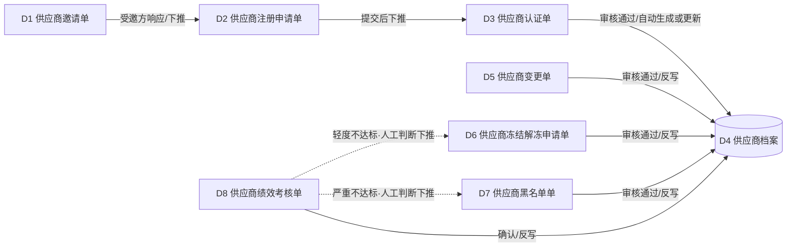

# SRM模块技术方案设计文档

版本：V1.0　日期：2026-09-17　范围：SRM 供应商关系管理 · 第一阶段

> 本文档面向 **AI 辅助开发** 编写，目的是把《供应商协同采购一体化平台业务流程蓝图》中 SRM 阶段的业务描述，转化为可直接编码的单据结构、状态机、单据转换（下推）与反写规则。
>
> 配套文档：
> - 《02-SRM数据模型设计.md》—— 表结构与字段字典，按本文档的单据设计一一对应生成
> - 《03-SRM接口清单.md》—— 每张单据对应的 CRUD / 工作流 / 下推接口
>
> 建议阅读顺序：本文档 → 数据模型 → 接口清单。三份文档中的单据名称、字段名、状态枚举值保持完全一致，AI 开发时应以此为唯一依据，不要重新发明命名。

---

## 0. 设计范式说明（参考金蝶单据架构）

### 0.1 "列表 + 单据（单头 + 分录）"结构

- **列表页**：分页查询、条件过滤、批量操作（批量提交/批量审核）的入口，不承载业务字段本身。
- **单据页**：
  - **单头（Header）**：一条记录，承载单据整体信息——编号、日期、业务主键、状态等。
  - **分录（Entry）**：0~N 条记录，承载明细行；一个单头可以有多个分录页签（例如"证照分录""联系人分录"），互相独立、各自一张表。
- **编号规则**：`单据前缀-YYYYMMDD-序号`，例如 `SRM-REG-20260917-0001`。序号按单据类型+日期维度递增，不跨类型共享。
- **审计字段**：所有单头表默认包含 `created_by / created_at / updated_by / updated_at`，本文档后续不再逐一列出。

### 0.2 通用单据状态机

除"供应商档案"（基础资料，无严格审批流）外，其余 7 张业务单据默认遵循如下状态机：

```
草稿(DRAFT) → 已提交(SUBMITTED) → 审核中(IN_REVIEW) → 已审核(APPROVED)
                                                    └→ 已驳回(REJECTED) → 草稿(DRAFT)  // 可重新编辑再提交
已审核(APPROVED) → 已反审核(UNAPPROVED) → 草稿(DRAFT)  // 审核后允许反审核修正，金蝶惯例
```

规则：
1. 只有 `DRAFT` / `REJECTED` 状态下允许编辑单头与分录；`SUBMITTED` 及之后默认锁定。
2. `APPROVED` 是触发"反写"和"下推"动作的默认节点（见第 5 章）。
3. 已发生下推、且目标单据仍存在的源单据，不允许反审核/删除，需先撤销下游单据的关联关系（防止数据不一致，金蝶惯例）。

### 0.3 单据间转换机制（BOTP 下推）

- **定义**：源单据在满足条件时，通过"下推"操作生成目标单据草稿，并把源单据的部分字段值带到目标单据中，减少重复录入，同时在目标单据上记录"来源单据编号"，形成可追溯链路。
- **触发方式**：
  - **手动下推**：用户在源单据详情页点击"下推"按钮，选择目标单据类型 → 系统按第 5 章的字段映射规则生成目标单据草稿 → 用户补充剩余字段后再提交审核。
  - **自动下推 / 自动生成更新**：源单据到达约定状态节点时，后台自动生成或更新目标单据，不需要人工点击（本项目中"认证单审核通过 → 自动生成/更新供应商档案"即为此类型，语义上更接近"自动下推 + 反写"的合体，因为供应商档案是唯一性主档案而非流水单据）。
- **下推控制策略**（每条转换关系在第 5 章逐一标注）：
  - 是否允许重复下推（如注册单只能下推一次认证单，重复点击提示"已存在下游认证单"）；
  - 下推后源单据是否变更状态（如注册单下推后置为 `CONVERTED` 已下推，不可再次下推，但仍可被查看）；
  - 目标单据生成后的默认状态（草稿，需人工确认后再提交，而非直接审核通过）。

### 0.4 反写机制设计

- **定义**：目标单据的状态或字段变化，反向更新源单据或关联基础资料（供应商档案）的指定字段，保证数据一致。
- **反写策略类型**：
  | 策略 | 说明 | 本模块示例 |
  |---|---|---|
  | 覆盖式 Override | 新值直接覆盖目标字段 | 认证结论覆盖档案 `cert_status` |
  | 累加式 Accumulate | 在原值基础上累加/递减 | 绩效考核确认后 `perf_eval_count + 1` |
  | 状态触发式 Push-back | 仅在特定状态下才触发 | 冻结单**审核通过**才反写档案状态为 `FROZEN`，草稿/驳回不触发 |
- **反写时机**：本项目统一约定在单据到达 `APPROVED`（已审核）或 `CONFIRMED`（已确认，绩效考核单专用）节点时触发反写，其余状态变化不触发，避免中间态污染主数据。
- **反写失败处理**：反写目标记录不存在（如供应商档案尚未建档）时，源单据审核动作应回滚并提示错误，不允许"审核通过但反写失败"的中间态。

---

## 1. SRM模块单据清单与关系全景

### 1.1 单据清单（8张）

| 编号 | 单据名称 | 英文标识 | 单据性质 | 说明 |
|---|---|---|---|---|
| D1 | 供应商邀请单 | SupplierInvitation | 流水单据 | 内部业务人员邀请潜在供应商注册合作 |
| D2 | 供应商注册申请单 | SupplierRegistration | 流水单据 | 供应商自主注册或响应邀请后提交的基础资料 |
| D3 | 供应商认证单 | SupplierCertification | 流水单据 | 资质审查/体系认证/样品测试/现场审核的认证过程与结论 |
| D4 | 供应商档案 | SupplierArchive | **主档案（基础资料）** | 供应商唯一性主数据，认证状态、绩效等级的最终归集地 |
| D5 | 供应商变更单 | SupplierChangeRequest | 流水单据 | 档案基础信息/联系人/银行账户/证照的变更审批 |
| D6 | 供应商冻结/解冻申请单 | SupplierFreezeRequest | 流水单据 | 可恢复性的交易资格暂停与恢复 |
| D7 | 供应商黑名单单 | SupplierBlacklist | 流水单据 | 不可逆（或需高层级审批才能解除）的资格终止处置 |
| D8 | 供应商绩效考核单 | SupplierPerformanceEvaluation | 流水单据 | 周期性质量/成本/交付/服务多维评分 |

> D6（冻结解冻）与 D7（黑名单）的区别：D6 是**可恢复**的临时资格暂停，常见触发为绩效轻度不达标或短期合规问题，解冻只需常规审批；D7 是**原则不可逆**（或需要更高审批层级才能复议解除）的资格终止，触发为绩效持续严重不达标、重大合规违规或欺诈。两者在审批层级、业务影响范围、以及是否允许"恢复"上都不同，因此拆成两张独立单据管理，而不是在同一张单据里加"黑名单"选项。

### 1.2 单据关系图



### 1.3 供应商档案状态优先级说明

`t_srm_supplier_archive_h.cert_status` 是多张单据共同反写的字段，需约定优先级，避免冲突：

```
BLACKLIST（黑名单） > FROZEN（冻结） > QUALIFIED / TEMP_QUALIFIED（合格/临时合格） > POTENTIAL（潜在）
```

规则：档案处于 `BLACKLIST` 状态时，冻结/解冻单不允许对其操作（先拦截提示）；解除冻结只能将状态恢复到冻结前的认证结论状态（`QUALIFIED` 或 `TEMP_QUALIFIED`），需在冻结单里记录"冻结前状态"字段以便恢复。

---

## 2. 单据详细设计

> 字段的完整类型/长度/默认值见《02-SRM数据模型设计.md》，本章只描述业务语义、状态机与操作按钮。

### D1 供应商邀请单
- **编号规则**：`SRM-INV-YYYYMMDD-####`
- **单头要点**：受邀企业名称、联系人/电话/邮箱、邀请人（内部业务员）、邀请日期、邀请有效期、状态。
- **分录**：邀请意向品类分录（品类编码/名称/备注）。
- **状态机**：`待响应 PENDING → 已注册 REGISTERED（下推生成D2后自动置为此状态） / 已拒绝 DECLINED / 已过期 EXPIRED`（超过有效期系统自动置为 EXPIRED，需定时任务扫描）。
- **操作按钮**：新增、编辑、发送邀请（生成邀请链接/邮件通知，占位）、下推生成注册单、作废。
- **业务规则**：同一受邀企业（按统一社会信用代码或手机号判重）存在未过期的 `PENDING` 邀请单时，不允许重复邀请，提示"已有在途邀请"。

### D2 供应商注册申请单
- **编号规则**：`SRM-REG-YYYYMMDD-####`
- **单头要点**：供应商名称、统一社会信用代码、联系人信息、注册地址、意向合作说明、申请日期、来源类型（`SELF_REG` 自主注册 / `INVITED` 内部邀请）、来源邀请单号（可空）。
- **分录**：① 意向品类分录；② 证照分录（营业执照/资质证书/体系认证证书，含有效期与附件）。
- **状态机**：`草稿 DRAFT → 已提交 SUBMITTED → 认证中 IN_CERT（下推生成D3后置为此状态） → 已下推 CONVERTED`。
- **操作按钮**：新增、编辑、提交、下推生成认证单、作废。
- **业务规则**：统一社会信用代码在 `t_srm_supplier_archive_h` 中已存在且状态非 `POTENTIAL` 时，提交阶段应提示"该企业已是合作供应商"，避免重复准入。

### D3 供应商认证单
- **编号规则**：`SRM-CERT-YYYYMMDD-####`
- **单头要点**：来源单据编号与类型（注册单 `REGISTRATION` / 复审 `RENEWAL`，复审场景无来源单）、认证类型、认证发起日期、认证负责人、认证结论（`QUALIFIED` 正式合格 / `TEMP_QUALIFIED` 临时合格 / `UNQUALIFIED` 不通过）、结论有效期至。
- **分录**：认证项分录——认证维度（`QUALIFICATION` 资质审查 / `ISO` 体系认证 / `SAMPLE` 样品测试 / `ONSITE` 现场审核）、单行结果（通过/不通过/待复核）、评分、责任人、附件。
- **状态机**：`草稿 DRAFT → 审核中 IN_REVIEW → 已审核 APPROVED（触发生成/更新档案） / 已驳回 REJECTED`。
- **操作按钮**：新增、编辑、提交、审核、反审核、作废。
- **业务规则**：单头"认证结论"字段应由分录各维度结果汇总建议（如任一维度 `FAIL` 则建议整单 `UNQUALIFIED`），允许人工改写但需留痕改写原因。

### D4 供应商档案（主档案）
- **性质说明**：属于"基础资料"而非流水单据，正常不走提交/审核流程，主要通过 D3/D5/D6/D7/D8 的审核通过动作**反写**生成与更新；系统管理员可有"直接编辑"权限用于紧急修正（需二级审批或操作留痕）。
- **单头要点**：供应商编码（主键，规则 `SUP` + 7位序号）、供应商名称、统一社会信用代码、供应商类型、认证状态 `cert_status`、认证有效期至、综合绩效等级 `perf_grade`、历史考核次数、最近考核日期、开户行信息、来源认证单号。
- **分录**：① 品类分录；② 证照分录；③ 联系人分录（含"是否主联系人"标记，一个供应商仅允许一个主联系人）。
- **状态枚举（cert_status）**：`POTENTIAL 潜在 → TEMP_QUALIFIED 临时合格 / QUALIFIED 正式合格 → FROZEN 冻结 → BLACKLIST 黑名单`（详见 1.3 优先级说明，允许从 FROZEN 恢复到 QUALIFIED/TEMP_QUALIFIED，但从 BLACKLIST 恢复需走独立的黑名单复议流程，本阶段暂不实现自动化，仅保留人工直改权限）。
- **操作按钮**：查询、查看关联单据（认证/变更/冻结/黑名单/绩效历史列表）、（管理员）直接编辑。

### D5 供应商变更单
- **编号规则**：`SRM-CHG-YYYYMMDD-####`
- **单头要点**：关联供应商编码、变更类型（`BASIC` 基础信息 / `CONTACT` 联系人 / `BANK` 银行账户 / `CERT` 证照 / `CATEGORY` 品类）、变更原因、申请人、申请日期。
- **分录**：变更字段分录——字段名、变更前值、变更后值（字段名取值需对应 D4 主表或其分录表的字段，前端做下拉约束）。
- **状态机**：标准 4 态（草稿/已提交/已审核/已驳回）。
- **操作按钮**：新增、编辑、提交、审核（触发反写档案）、反审核、作废。
- **业务规则**：同一供应商存在未审核完成的变更单时，新变更单提交需提示"存在在途变更申请"，避免并发写冲突（简化处理：按供应商编码加乐观锁）。

### D6 供应商冻结/解冻申请单
- **编号规则**：`SRM-FRZ-YYYYMMDD-####`
- **单头要点**：供应商编码、申请类型（`FREEZE` 冻结 / `UNFREEZE` 解冻）、触发来源（`PERF_WARNING` 绩效预警 / `COMPLIANCE` 合规稽核 / `MANUAL` 人工申请 / `SYSTEM_AUTO` 系统自动）、来源绩效考核单号（可空）、冻结/解冻原因、生效日期、**冻结前状态快照**（用于解冻时恢复）、整改说明（解冻场景必填）。
- **分录**：冻结范围分录——`ALL` 全部品类 / `CATEGORY` 指定品类 + 品类编码。
- **状态机**：标准 4 态。
- **操作按钮**：新增、编辑、提交、审核（触发反写档案状态）、反审核、作废。
- **业务规则**：申请类型为 `UNFREEZE` 时，供应商当前档案状态必须为 `FROZEN`，否则拦截提交；审核通过后将档案状态恢复为该单据记录的"冻结前状态快照"。

### D7 供应商黑名单单
- **编号规则**：`SRM-BLK-YYYYMMDD-####`
- **单头要点**：供应商编码、触发来源（`PERF_SEVERE` 绩效严重不达标 / `COMPLIANCE_VIOLATION` 合规重大违规 / `FRAUD` 欺诈 / `MANUAL` 人工提请）、来源绩效考核单号（可空）、详细原因说明（必填，长文本）、申请人、所需审批层级、是否永久性（默认 true）、复议日期（可空）。
- **分录**：证据材料分录——证据类型、说明、附件。
- **状态机**：标准 4 态，审核层级建议在流程引擎层配置多级审批（本阶段先实现单级审核 + 字段记录"所需层级"，多级审批留作后续迭代）。
- **操作按钮**：新增、编辑、提交、审核（触发反写档案状态为 `BLACKLIST`）、反审核（仅限管理员，且需二次确认）、作废。
- **业务规则**：一旦审核通过，档案状态直接覆盖为 `BLACKLIST`（优先级最高，见1.3），此时冻结/解冻单对该供应商的操作应被拦截。

### D8 供应商绩效考核单
- **编号规则**：`SRM-PERF-YYYYMMDD-####`
- **单头要点**：供应商编码、考核周期（如 `2026-Q3`）、考核类型（`MONTHLY`/`QUARTERLY`/`ANNUAL`）、综合得分、评定等级（`A`/`B`/`C`）、考核人、考核日期。
- **分录**：考核维度分录——维度（`QUALITY` 质量 / `COST` 成本 / `DELIVERY` 交付 / `SERVICE` 服务）、权重、本期得分、数据来源单号（暂无上游系统对接时可手工填写或留空）、备注。
- **状态机**：`草稿 DRAFT → 已提交 SUBMITTED → 已确认 CONFIRMED`（绩效考核单不设"驳回"，如有异议走线下沟通后直接编辑草稿重新提交，简化流程）。
- **操作按钮**：新增、编辑、提交、确认（触发反写档案绩效字段）、作废。
- **业务规则**：综合得分 = Σ(维度权重 × 维度得分)，前端/后端均需校验分录权重合计为100；评定等级建议阈值（可配置）：≥85 为 A，60~85 为 B，<60 为 C。等级为 C 或连续两期 C 时，界面提示"建议下推冻结申请单"；出现 `FRAUD`/重大合规问题等场景则由人工直接创建黑名单单，不强制走绩效考核单下推。

---

## 3. 编号规则汇总表

| 单据 | 编号前缀 | 示例 |
|---|---|---|
| 供应商邀请单 | SRM-INV | SRM-INV-20260917-0001 |
| 供应商注册申请单 | SRM-REG | SRM-REG-20260917-0001 |
| 供应商认证单 | SRM-CERT | SRM-CERT-20260917-0001 |
| 供应商档案 | SUP | SUP0000001（无日期段，纯序号） |
| 供应商变更单 | SRM-CHG | SRM-CHG-20260917-0001 |
| 供应商冻结解冻申请单 | SRM-FRZ | SRM-FRZ-20260917-0001 |
| 供应商黑名单单 | SRM-BLK | SRM-BLK-20260917-0001 |
| 供应商绩效考核单 | SRM-PERF | SRM-PERF-20260917-0001 |

---

## 4. 状态枚举字典

| 枚举分组 | 取值 | 说明 | 使用单据 |
|---|---|---|---|
| 通用单据状态 BillStatus | DRAFT / SUBMITTED / IN_REVIEW / APPROVED / REJECTED / UNAPPROVED | 标准审批流 | D2~D7 |
| 绩效单据状态 PerfStatus | DRAFT / SUBMITTED / CONFIRMED | D8 专用（无驳回态） | D8 |
| 邀请单状态 InviteStatus | PENDING / REGISTERED / DECLINED / EXPIRED | D1 专用 | D1 |
| 供应商认证状态 CertStatus | POTENTIAL / TEMP_QUALIFIED / QUALIFIED / FROZEN / BLACKLIST | D4 主字段，多单反写 | D4 |
| 认证结论 CertConclusion | QUALIFIED / TEMP_QUALIFIED / UNQUALIFIED | D3 专用 | D3 |
| 认证维度 CertDimension | QUALIFICATION / ISO / SAMPLE / ONSITE | D3 分录 | D3 |
| 冻结申请类型 FreezeApplyType | FREEZE / UNFREEZE | D6 专用 | D6 |
| 触发来源 TriggerSource | PERF_WARNING / COMPLIANCE / MANUAL / SYSTEM_AUTO（D6）<br>PERF_SEVERE / COMPLIANCE_VIOLATION / FRAUD / MANUAL（D7） | D6 / D7 | D6, D7 |
| 绩效维度 PerfDimension | QUALITY / COST / DELIVERY / SERVICE | D8 分录 | D8 |
| 绩效等级 PerfGrade | A / B / C | D4 / D8 | D4, D8 |

---

## 5. 单据转换（下推）规则设计矩阵

| 序号 | 源单据 | 目标单据 | 触发方式 | 触发条件 | 携带字段映射（源→目标） | 下推后源单状态 | 下推控制 |
|---|---|---|---|---|---|---|---|
| T1 | D1 邀请单 | D2 注册申请单 | 手动（受邀方响应邀请） | D1.status = PENDING 且未过期 | 受邀企业名称→供应商名称；联系人/电话/邮箱→同名字段；邀请品类分录→意向品类分录；D1单号→D2.来源邀请单号；D2.source_type 固定写 `INVITED` | PENDING → REGISTERED | 一张邀请单只能下推一次；已下推后按钮置灰 |
| T2 | D2 注册申请单 | D3 认证单 | 手动（提交后） | D2.status = SUBMITTED | 供应商名称、统一社会信用代码→同名字段；证照分录→D3不直接带（认证单证照结果需重新填写认证结论，仅参考D2证照分录展示）；D2单号→D3.来源单据编号；D3.source_bill_type 固定写 `REGISTRATION` | SUBMITTED → IN_CERT | 一张注册单只能下推一次；重复点击提示已存在下游认证单 |
| T3 | D3 认证单 | D4 供应商档案 | 自动（审核通过时触发，属"自动生成或更新"） | D3.status: IN_REVIEW → APPROVED | 若档案不存在：以D3供应商名称/信用代码新建档案，`cert_status`=D3.conclusion 映射（QUALIFIED→QUALIFIED，TEMP_QUALIFIED→TEMP_QUALIFIED，UNQUALIFIED→不建档，仅记录审核结果，档案状态保持POTENTIAL或不生成）；若档案已存在（复审场景）：覆盖 `cert_status`、`cert_valid_until`、`source_cert_bill_no`；证照分录、品类分录同步覆盖式更新 | APPROVED（不改变，认证单本身无需二次状态） | 同一供应商允许多次认证（复审），不做"只能一次"限制，但每次都是覆盖式反写，只保留最新结论 |
| T4 | D8 绩效考核单 | D6 冻结申请单 | 手动（人工判断，界面按钮提示） | D8.grade = C 或连续两期 C（提示性，非强制拦截） | 供应商编码→同名字段；D8单号→D6.来源绩效考核单号；D6.trigger_source 固定写 `PERF_WARNING`；D6.apply_type 固定写 `FREEZE` | 不变（D8无需变更状态，仅记录已下推标记位，避免重复提示） | 允许多次下推（每次绩效周期都可能触发一次） |
| T5 | D8 绩效考核单 | D7 黑名单单 | 手动（人工判断） | 人工认定绩效严重不达标 | 供应商编码→同名字段；D8单号→D7.来源绩效考核单号；D7.trigger_source 固定写 `PERF_SEVERE` | 同 T4 | 同 T4 |

> 说明：T3 是本模块中唯一的"自动下推 + 覆盖式反写"合体场景，因为供应商档案是唯一性主数据而非流水单据，语义上等价于"认证结果自动同步到主档案"。其余 T1/T2/T4/T5 均为标准的手动下推生成新流水单据草稿。

---

## 6. 反写规则设计矩阵

| 序号 | 触发单据 | 触发动作 | 反写目标 | 反写字段 | 反写策略 | 触发条件 |
|---|---|---|---|---|---|---|
| W1 | D1 邀请单 | 下推生成D2成功 | D1 自身 | status | 覆盖式 → REGISTERED；related_reg_bill_no ← D2单号 | 下推动作成功后立即执行 |
| W2 | D3 认证单 | 审核通过 | D4 供应商档案 | cert_status、cert_valid_until、source_cert_bill_no、品类分录、证照分录 | 覆盖式 | status: IN_REVIEW → APPROVED |
| W3 | D5 变更单 | 审核通过 | D4 供应商档案（对应字段） | 按分录中"字段名"逐行覆盖 | 覆盖式（逐字段） | status → APPROVED |
| W4 | D6 冻结解冻申请单 | 审核通过，apply_type=FREEZE | D4 供应商档案 | cert_status → FROZEN；同时把当前 cert_status 写入D6.冻结前状态快照 | 状态触发式 | status → APPROVED 且当前档案非BLACKLIST |
| W5 | D6 冻结解冻申请单 | 审核通过，apply_type=UNFREEZE | D4 供应商档案 | cert_status ← 恢复为该冻结单记录的"冻结前状态快照" | 状态触发式 | status → APPROVED 且当前档案为FROZEN |
| W6 | D7 黑名单单 | 审核通过 | D4 供应商档案 | cert_status → BLACKLIST | 状态触发式（最高优先级，覆盖一切） | status → APPROVED |
| W7 | D8 绩效考核单 | 确认 | D4 供应商档案 | perf_grade 覆盖；perf_eval_count 累加+1；last_perf_date 覆盖为考核日期 | 覆盖式 + 累加式混合 | status: SUBMITTED → CONFIRMED |

> 反写执行顺序建议：单据审核/确认动作在同一事务内完成"状态变更 + 反写"，反写失败需整体回滚（见 0.4 反写失败处理）。

---

## 7. 与后续模块（STC / PTP）的预留接口说明

本阶段只开发 SRM，但以下字段/规则是 STC、PTP 阶段会直接引用的，开发时需保留：

- `t_srm_supplier_archive_h.supplier_code`：STC寻源立项、PTP采购订单选择供应商时的唯一外键。
- `cert_status`：STC"供应商选择/定标"环节需要校验该字段不为 `FROZEN`/`BLACKLIST` 才允许入围；PTP生成采购订单前同样需要此校验（本阶段仅需预留字段与枚举，校验逻辑留给STC/PTP阶段实现）。
- `perf_grade`：STC"SR配额管理"分配份额时的权重参考字段。
- 品类分录（`t_srm_supplier_archive_e_cat`）：STC"寻源立项"按品类圈定候选供应商时的匹配依据。
