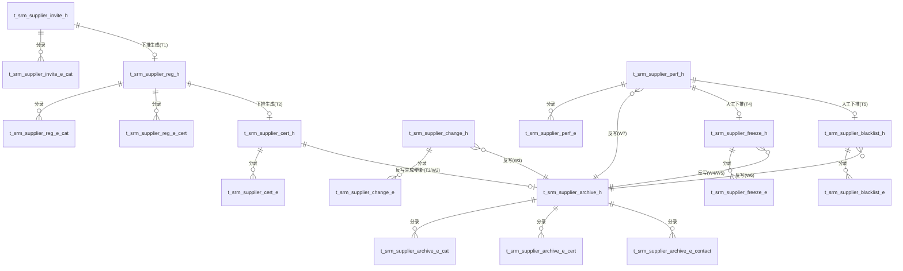

# SRM模块数据模型设计

版本：V1.0　日期：2026-09-17

> 本文档与《01-SRM技术方案设计文档.md》的单据（D1~D8）严格一一对应，命名规则：`t_srm_{单据简称}_h`（单头）、`t_srm_{单据简称}_e_{分录名}`（分录，单头下若只有一个分录则省略后缀）。
> 字段类型采用通用 SQL 类型描述（varchar/int/bigint/decimal/date/datetime/boolean/text），具体落地到 MySQL/PostgreSQL 等可直接映射，无需转换。
> 所有单头表默认包含审计字段 `created_by varchar(32)`、`created_at datetime`、`updated_by varchar(32)`、`updated_at datetime`，下表字段清单中不再重复列出。

---

## 0. 总体 ER 关系图

---

## 1. D1 供应商邀请单

### 1.1 t_srm_supplier_invite_h（单头）

| 字段名 | 中文名 | 类型 | 长度 | 必填 | 默认值 | 说明 |
|---|---|---|---|---|---|---|
| id | 主键 | bigint | - | 是 | 自增 | |
| bill_no | 单据编号 | varchar | 32 | 是 | - | 唯一索引，规则见方案文档第3章 |
| invitee_name | 受邀企业名称 | varchar | 100 | 是 | - | |
| invitee_credit_code | 受邀方统一社会信用代码 | varchar | 32 | 否 | - | |
| invitee_contact | 受邀方联系人 | varchar | 50 | 否 | - | |
| invitee_phone | 受邀方联系电话 | varchar | 20 | 否 | - | |
| invitee_email | 受邀方联系邮箱 | varchar | 100 | 否 | - | |
| invited_by | 邀请人 | varchar | 50 | 是 | - | 内部业务员姓名/工号 |
| invite_date | 邀请日期 | date | - | 是 | 当天 | |
| expire_date | 邀请有效期至 | date | - | 是 | 邀请日期+30天 | |
| status | 状态 | varchar | 20 | 是 | PENDING | 枚举：PENDING/REGISTERED/DECLINED/EXPIRED |
| related_reg_bill_no | 关联注册单号 | varchar | 32 | 否 | - | 下推生成D2后回填（W1） |

### 1.2 t_srm_supplier_invite_e_cat（邀请品类分录）

| 字段名 | 中文名 | 类型 | 长度 | 必填 | 默认值 | 说明 |
|---|---|---|---|---|---|---|
| id | 主键 | bigint | - | 是 | 自增 | |
| header_id | 单头ID | bigint | - | 是 | - | FK → t_srm_supplier_invite_h.id |
| seq | 行号 | int | - | 是 | - | |
| category_code | 品类编码 | varchar | 32 | 是 | - | |
| category_name | 品类名称 | varchar | 100 | 是 | - | |
| remark | 备注 | varchar | 200 | 否 | - | |

---

## 2. D2 供应商注册申请单

### 2.1 t_srm_supplier_reg_h（单头）

| 字段名 | 中文名 | 类型 | 长度 | 必填 | 默认值 | 说明 |
|---|---|---|---|---|---|---|
| id | 主键 | bigint | - | 是 | 自增 | |
| bill_no | 单据编号 | varchar | 32 | 是 | - | 唯一 |
| supplier_name | 供应商名称 | varchar | 100 | 是 | - | |
| unified_credit_code | 统一社会信用代码 | varchar | 32 | 否 | - | |
| contact_name | 联系人 | varchar | 50 | 否 | - | |
| contact_phone | 联系电话 | varchar | 20 | 否 | - | |
| contact_email | 联系邮箱 | varchar | 100 | 否 | - | |
| reg_address | 注册地址 | varchar | 200 | 否 | - | |
| cooperation_note | 意向合作说明 | text | - | 否 | - | |
| apply_date | 申请日期 | date | - | 是 | 当天 | |
| source_type | 来源类型 | varchar | 20 | 是 | SELF_REG | 枚举：SELF_REG / INVITED |
| source_invite_bill_no | 来源邀请单号 | varchar | 32 | 否 | - | source_type=INVITED 时必填 |
| status | 单据状态 | varchar | 20 | 是 | DRAFT | 枚举：DRAFT/SUBMITTED/IN_CERT/CONVERTED |

### 2.2 t_srm_supplier_reg_e_cat（意向品类分录）

| 字段名 | 中文名 | 类型 | 长度 | 必填 | 默认值 | 说明 |
|---|---|---|---|---|---|---|
| id | 主键 | bigint | - | 是 | 自增 | |
| header_id | 单头ID | bigint | - | 是 | - | FK → t_srm_supplier_reg_h.id |
| seq | 行号 | int | - | 是 | - | |
| category_code | 品类编码 | varchar | 32 | 是 | - | |
| category_name | 品类名称 | varchar | 100 | 是 | - | |
| remark | 备注 | varchar | 200 | 否 | - | |

### 2.3 t_srm_supplier_reg_e_cert（证照分录）

| 字段名 | 中文名 | 类型 | 长度 | 必填 | 默认值 | 说明 |
|---|---|---|---|---|---|---|
| id | 主键 | bigint | - | 是 | 自增 | |
| header_id | 单头ID | bigint | - | 是 | - | FK → t_srm_supplier_reg_h.id |
| seq | 行号 | int | - | 是 | - | |
| cert_type | 证照类型 | varchar | 20 | 是 | - | 枚举：BUSINESS_LICENSE/QUALIFICATION/ISO |
| cert_no | 证照编号 | varchar | 50 | 否 | - | |
| issue_org | 发证机关 | varchar | 100 | 否 | - | |
| valid_from | 有效期起 | date | - | 否 | - | |
| valid_to | 有效期止 | date | - | 否 | - | |
| attachment_url | 附件地址 | varchar | 300 | 否 | - | |

---

## 3. D3 供应商认证单

### 3.1 t_srm_supplier_cert_h（单头）

| 字段名 | 中文名 | 类型 | 长度 | 必填 | 默认值 | 说明 |
|---|---|---|---|---|---|---|
| id | 主键 | bigint | - | 是 | 自增 | |
| bill_no | 单据编号 | varchar | 32 | 是 | - | 唯一 |
| source_bill_no | 来源单据编号 | varchar | 32 | 否 | - | 复审场景可空 |
| source_bill_type | 来源单据类型 | varchar | 20 | 否 | - | 枚举：REGISTRATION / RENEWAL |
| supplier_name | 供应商名称 | varchar | 100 | 是 | - | |
| unified_credit_code | 统一社会信用代码 | varchar | 32 | 否 | - | |
| cert_type | 认证类型 | varchar | 20 | 是 | FIRST | 枚举：FIRST / RENEWAL |
| start_date | 认证发起日期 | date | - | 是 | 当天 | |
| responsible_person | 认证负责人 | varchar | 50 | 是 | - | |
| conclusion | 认证结论 | varchar | 20 | 否 | - | 枚举：QUALIFIED/TEMP_QUALIFIED/UNQUALIFIED，未完成时为空 |
| valid_until | 结论有效期至 | date | - | 否 | - | conclusion 非空时必填 |
| status | 单据状态 | varchar | 20 | 是 | DRAFT | 枚举：DRAFT/IN_REVIEW/APPROVED/REJECTED |
| approved_at | 审核通过时间 | datetime | - | 否 | - | |

### 3.2 t_srm_supplier_cert_e（认证项分录）

| 字段名 | 中文名 | 类型 | 长度 | 必填 | 默认值 | 说明 |
|---|---|---|---|---|---|---|
| id | 主键 | bigint | - | 是 | 自增 | |
| header_id | 单头ID | bigint | - | 是 | - | FK → t_srm_supplier_cert_h.id |
| seq | 行号 | int | - | 是 | - | |
| dimension | 认证维度 | varchar | 20 | 是 | - | 枚举：QUALIFICATION/ISO/SAMPLE/ONSITE |
| result | 认证结果 | varchar | 20 | 是 | PENDING | 枚举：PASS/FAIL/PENDING |
| score | 评分 | decimal | 5,2 | 否 | - | |
| responsible_person | 责任人 | varchar | 50 | 否 | - | |
| remark | 备注 | varchar | 200 | 否 | - | |
| attachment_url | 附件地址 | varchar | 300 | 否 | - | |

---

## 4. D4 供应商档案（主档案）

### 4.1 t_srm_supplier_archive_h（单头/基本信息）

| 字段名 | 中文名 | 类型 | 长度 | 必填 | 默认值 | 说明 |
|---|---|---|---|---|---|---|
| id | 主键 | bigint | - | 是 | 自增 | |
| supplier_code | 供应商编码 | varchar | 32 | 是 | - | **唯一**，规则 SUP+7位序号 |
| supplier_name | 供应商名称 | varchar | 100 | 是 | - | |
| unified_credit_code | 统一社会信用代码 | varchar | 32 | 否 | - | 建议唯一索引（同一企业不重复建档） |
| supplier_type | 供应商类型 | varchar | 20 | 否 | - | 枚举：MANUFACTURER/DEALER/SERVICE |
| cert_status | 认证状态 | varchar | 20 | 是 | POTENTIAL | 枚举：POTENTIAL/TEMP_QUALIFIED/QUALIFIED/FROZEN/BLACKLIST |
| cert_valid_until | 认证有效期至 | date | - | 否 | - | |
| perf_grade | 综合绩效等级 | varchar | 5 | 否 | - | 枚举：A/B/C |
| perf_eval_count | 历史考核次数 | int | - | 是 | 0 | 每次D8确认累加+1 |
| last_perf_date | 最近考核日期 | date | - | 否 | - | |
| bank_name | 开户银行 | varchar | 100 | 否 | - | |
| bank_account | 银行账号 | varchar | 50 | 否 | - | |
| bank_account_name | 开户名 | varchar | 100 | 否 | - | |
| source_cert_bill_no | 来源认证单号 | varchar | 32 | 否 | - | 最近一次生效认证单，追溯用 |

### 4.2 t_srm_supplier_archive_e_cat（品类分录）

| 字段名 | 中文名 | 类型 | 长度 | 必填 | 默认值 | 说明 |
|---|---|---|---|---|---|---|
| id | 主键 | bigint | - | 是 | 自增 | |
| header_id | 单头ID | bigint | - | 是 | - | FK → t_srm_supplier_archive_h.id |
| seq | 行号 | int | - | 是 | - | |
| category_code | 品类编码 | varchar | 32 | 是 | - | |
| category_name | 品类名称 | varchar | 100 | 是 | - | |
| capability_level | 供货能力等级 | varchar | 10 | 否 | - | 枚举：HIGH/MID/LOW |
| region_coverage | 区域覆盖 | varchar | 100 | 否 | - | |

### 4.3 t_srm_supplier_archive_e_cert（证照分录）

| 字段名 | 中文名 | 类型 | 长度 | 必填 | 默认值 | 说明 |
|---|---|---|---|---|---|---|
| id | 主键 | bigint | - | 是 | 自增 | |
| header_id | 单头ID | bigint | - | 是 | - | FK → t_srm_supplier_archive_h.id |
| seq | 行号 | int | - | 是 | - | |
| cert_type | 证照类型 | varchar | 20 | 是 | - | 同D2/D3枚举 |
| cert_no | 证照编号 | varchar | 50 | 否 | - | |
| issue_org | 发证机关 | varchar | 100 | 否 | - | |
| valid_from | 有效期起 | date | - | 否 | - | |
| valid_to | 有效期止 | date | - | 否 | - | 到期提醒扫描依据 |
| attachment_url | 附件地址 | varchar | 300 | 否 | - | |

### 4.4 t_srm_supplier_archive_e_contact（联系人分录）

| 字段名 | 中文名 | 类型 | 长度 | 必填 | 默认值 | 说明 |
|---|---|---|---|---|---|---|
| id | 主键 | bigint | - | 是 | 自增 | |
| header_id | 单头ID | bigint | - | 是 | - | FK → t_srm_supplier_archive_h.id |
| seq | 行号 | int | - | 是 | - | |
| contact_name | 姓名 | varchar | 50 | 是 | - | |
| position | 职务 | varchar | 50 | 否 | - | |
| phone | 电话 | varchar | 20 | 否 | - | |
| email | 邮箱 | varchar | 100 | 否 | - | |
| is_primary | 是否主联系人 | boolean | - | 是 | false | 同一header_id下只允许一行为true，应用层校验 |

---

## 5. D5 供应商变更单

### 5.1 t_srm_supplier_change_h（单头）

| 字段名 | 中文名 | 类型 | 长度 | 必填 | 默认值 | 说明 |
|---|---|---|---|---|---|---|
| id | 主键 | bigint | - | 是 | 自增 | |
| bill_no | 单据编号 | varchar | 32 | 是 | - | 唯一 |
| supplier_code | 供应商编码 | varchar | 32 | 是 | - | FK → t_srm_supplier_archive_h.supplier_code |
| change_type | 变更类型 | varchar | 20 | 是 | - | 枚举：BASIC/CONTACT/BANK/CERT/CATEGORY |
| change_reason | 变更原因 | varchar | 200 | 否 | - | |
| applicant | 申请人 | varchar | 50 | 是 | - | |
| apply_date | 申请日期 | date | - | 是 | 当天 | |
| status | 单据状态 | varchar | 20 | 是 | DRAFT | 枚举：DRAFT/SUBMITTED/IN_REVIEW/APPROVED/REJECTED |
| approved_at | 审核通过时间 | datetime | - | 否 | - | |

### 5.2 t_srm_supplier_change_e（变更字段分录）

| 字段名 | 中文名 | 类型 | 长度 | 必填 | 默认值 | 说明 |
|---|---|---|---|---|---|---|
| id | 主键 | bigint | - | 是 | 自增 | |
| header_id | 单头ID | bigint | - | 是 | - | FK → t_srm_supplier_change_h.id |
| seq | 行号 | int | - | 是 | - | |
| field_name | 变更字段名 | varchar | 50 | 是 | - | 对应D4主表或分录表字段名，前端下拉约束 |
| old_value | 变更前值 | varchar | 200 | 否 | - | |
| new_value | 变更后值 | varchar | 200 | 是 | - | |

---

## 6. D6 供应商冻结/解冻申请单

### 6.1 t_srm_supplier_freeze_h（单头）

| 字段名 | 中文名 | 类型 | 长度 | 必填 | 默认值 | 说明 |
|---|---|---|---|---|---|---|
| id | 主键 | bigint | - | 是 | 自增 | |
| bill_no | 单据编号 | varchar | 32 | 是 | - | 唯一 |
| supplier_code | 供应商编码 | varchar | 32 | 是 | - | FK |
| apply_type | 申请类型 | varchar | 10 | 是 | - | 枚举：FREEZE / UNFREEZE |
| trigger_source | 触发来源 | varchar | 20 | 是 | MANUAL | 枚举：PERF_WARNING/COMPLIANCE/MANUAL/SYSTEM_AUTO |
| source_perf_bill_no | 来源绩效考核单号 | varchar | 32 | 否 | - | |
| reason | 原因说明 | text | - | 是 | - | |
| applicant | 申请人 | varchar | 50 | 是 | - | |
| apply_date | 申请日期 | date | - | 是 | 当天 | |
| status | 单据状态 | varchar | 20 | 是 | DRAFT | 标准4态 |
| effective_date | 生效日期 | date | - | 否 | - | |
| pre_status_snapshot | 冻结前状态快照 | varchar | 20 | 否 | - | apply_type=FREEZE审核通过时自动记录当前cert_status，供解冻恢复 |
| rectification_note | 整改说明 | text | - | 否 | - | apply_type=UNFREEZE时必填 |

### 6.2 t_srm_supplier_freeze_e（冻结范围分录）

| 字段名 | 中文名 | 类型 | 长度 | 必填 | 默认值 | 说明 |
|---|---|---|---|---|---|---|
| id | 主键 | bigint | - | 是 | 自增 | |
| header_id | 单头ID | bigint | - | 是 | - | FK → t_srm_supplier_freeze_h.id |
| seq | 行号 | int | - | 是 | - | |
| scope_type | 冻结范围 | varchar | 10 | 是 | ALL | 枚举：ALL / CATEGORY |
| category_code | 品类编码 | varchar | 32 | 否 | - | scope_type=CATEGORY时必填 |
| category_name | 品类名称 | varchar | 100 | 否 | - | |
| remark | 备注 | varchar | 200 | 否 | - | |

---

## 7. D7 供应商黑名单单

### 7.1 t_srm_supplier_blacklist_h（单头）

| 字段名 | 中文名 | 类型 | 长度 | 必填 | 默认值 | 说明 |
|---|---|---|---|---|---|---|
| id | 主键 | bigint | - | 是 | 自增 | |
| bill_no | 单据编号 | varchar | 32 | 是 | - | 唯一 |
| supplier_code | 供应商编码 | varchar | 32 | 是 | - | FK |
| trigger_source | 触发来源 | varchar | 20 | 是 | MANUAL | 枚举：PERF_SEVERE/COMPLIANCE_VIOLATION/FRAUD/MANUAL |
| source_perf_bill_no | 来源绩效考核单号 | varchar | 32 | 否 | - | |
| reason | 详细原因说明 | text | - | 是 | - | |
| applicant | 申请人 | varchar | 50 | 是 | - | |
| apply_date | 申请日期 | date | - | 是 | 当天 | |
| approval_level | 所需审批层级 | varchar | 20 | 否 | - | 文本记录，如"总经理审批"，多级审批留后续迭代 |
| is_permanent | 是否永久性 | boolean | - | 是 | true | |
| review_date | 复议日期 | date | - | 否 | - | |
| status | 单据状态 | varchar | 20 | 是 | DRAFT | 标准4态 |
| effective_date | 生效日期 | date | - | 否 | - | |

### 7.2 t_srm_supplier_blacklist_e（证据材料分录）

| 字段名 | 中文名 | 类型 | 长度 | 必填 | 默认值 | 说明 |
|---|---|---|---|---|---|---|
| id | 主键 | bigint | - | 是 | 自增 | |
| header_id | 单头ID | bigint | - | 是 | - | FK → t_srm_supplier_blacklist_h.id |
| seq | 行号 | int | - | 是 | - | |
| evidence_type | 证据类型 | varchar | 30 | 否 | - | 自由文本或枚举，如合同/邮件/检验报告 |
| evidence_desc | 证据说明 | varchar | 300 | 否 | - | |
| attachment_url | 附件地址 | varchar | 300 | 否 | - | |

---

## 8. D8 供应商绩效考核单

### 8.1 t_srm_supplier_perf_h（单头）

| 字段名 | 中文名 | 类型 | 长度 | 必填 | 默认值 | 说明 |
|---|---|---|---|---|---|---|
| id | 主键 | bigint | - | 是 | 自增 | |
| bill_no | 单据编号 | varchar | 32 | 是 | - | 唯一 |
| supplier_code | 供应商编码 | varchar | 32 | 是 | - | FK |
| period | 考核周期 | varchar | 20 | 是 | - | 如 "2026-Q3" |
| eval_type | 考核类型 | varchar | 10 | 是 | QUARTERLY | 枚举：MONTHLY/QUARTERLY/ANNUAL |
| total_score | 综合得分 | decimal | 5,2 | 否 | - | = Σ(分录权重×得分)，后端计算 |
| grade | 评定等级 | varchar | 5 | 否 | - | 枚举：A/B/C，按total_score阈值自动建议 |
| status | 单据状态 | varchar | 20 | 是 | DRAFT | 枚举：DRAFT/SUBMITTED/CONFIRMED |
| evaluator | 考核人 | varchar | 50 | 是 | - | |
| eval_date | 考核日期 | date | - | 是 | 当天 | |

### 8.2 t_srm_supplier_perf_e（考核维度分录）

| 字段名 | 中文名 | 类型 | 长度 | 必填 | 默认值 | 说明 |
|---|---|---|---|---|---|---|
| id | 主键 | bigint | - | 是 | 自增 | |
| header_id | 单头ID | bigint | - | 是 | - | FK → t_srm_supplier_perf_h.id |
| seq | 行号 | int | - | 是 | - | |
| dimension | 考核维度 | varchar | 10 | 是 | - | 枚举：QUALITY/COST/DELIVERY/SERVICE |
| weight | 权重(%) | decimal | 5,2 | 是 | - | 同一单据下所有行之和应为100 |
| score | 本期得分 | decimal | 5,2 | 是 | - | 0~100 |
| source_bill_no | 数据来源单号 | varchar | 32 | 否 | - | 暂无上游系统对接时可空 |
| remark | 备注 | varchar | 200 | 否 | - | |

---

## 9. 表清单汇总（供AI建表脚本参考）

| # | 表名 | 所属单据 | 类型 |
|---|---|---|---|
| 1 | t_srm_supplier_invite_h | D1 | 单头 |
| 2 | t_srm_supplier_invite_e_cat | D1 | 分录 |
| 3 | t_srm_supplier_reg_h | D2 | 单头 |
| 4 | t_srm_supplier_reg_e_cat | D2 | 分录 |
| 5 | t_srm_supplier_reg_e_cert | D2 | 分录 |
| 6 | t_srm_supplier_cert_h | D3 | 单头 |
| 7 | t_srm_supplier_cert_e | D3 | 分录 |
| 8 | t_srm_supplier_archive_h | D4 | 单头（主档案） |
| 9 | t_srm_supplier_archive_e_cat | D4 | 分录 |
| 10 | t_srm_supplier_archive_e_cert | D4 | 分录 |
| 11 | t_srm_supplier_archive_e_contact | D4 | 分录 |
| 12 | t_srm_supplier_change_h | D5 | 单头 |
| 13 | t_srm_supplier_change_e | D5 | 分录 |
| 14 | t_srm_supplier_freeze_h | D6 | 单头 |
| 15 | t_srm_supplier_freeze_e | D6 | 分录 |
| 16 | t_srm_supplier_blacklist_h | D7 | 单头 |
| 17 | t_srm_supplier_blacklist_e | D7 | 分录 |
| 18 | t_srm_supplier_perf_h | D8 | 单头 |
| 19 | t_srm_supplier_perf_e | D8 | 分录 |
