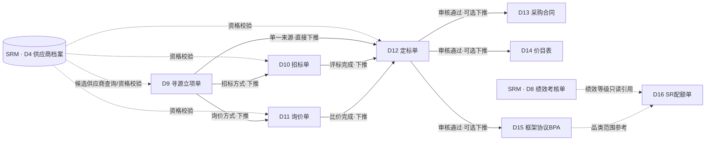

# STC模块技术方案设计文档

版本：V1.0　日期：2026-09-17　范围：STC 寻源到合同 · 第二阶段

> 本文档延续《01-SRM技术方案设计文档.md》的设计范式（列表+单据[单头+分录]、BOTP下推、反写），并大量引用 SRM 阶段产出的**供应商档案（D4）**作为主数据依据。跨模块的具体协作规则不在本文重复展开，统一写在《07-SRM与STC模块协作说明.md》，本文中涉及跨模块的地方会标注"→见07号文档 X.X节"。
>
> 配套文档：
> - 《05-STC数据模型设计.md》—— 表结构与字段字典
> - 《06-STC接口清单.md》—— 接口清单
> - 《07-SRM与STC模块协作说明.md》—— **两阶段如何协作，必读**

---

## 0. 设计范式延续说明

- 单据编号规则、单头/分录结构、通用状态机、下推控制策略、反写策略类型，均沿用 01号文档第0章，不再重复定义。
- 新增一条 STC 专属规则：**任何单据在保存供应商相关分录行时，`supplier_code` 必须真实存在于 `t_srm_supplier_archive_h` 中，且不能是 `FROZEN` / `BLACKLIST` 状态**（除非该行被人工标记为"已知晓风险仍保留仅供查看"，此为例外情况，本阶段不做该例外的界面支持）。校验时机与容错策略见07号文档第3章。

---

## 1. STC模块单据清单与关系全景

### 1.1 单据清单（8张）

| 编号 | 单据名称 | 英文标识 | 单据性质 | 说明 |
|---|---|---|---|---|
| D9 | 寻源立项单 | SourcingProjectRequest | 流水单据 | 发起寻源项目，圈定候选供应商，选定寻源方式 |
| D10 | 招标单 | TenderBill | 流水单据 | 公开/邀请招标全流程：发标→投标→开标→评标 |
| D11 | 询价单 | RFQBill | 流水单据 | 线上多轮询价与比价 |
| D12 | 定标单 | AwardBill | 流水单据 | 汇总招标/询价/单一来源结果，确定中标方 |
| D13 | 采购合同 | PurchaseContract | 流水单据（含到期管理） | 合同起草、审批、履约期管理 |
| D14 | 价目表 | PriceList | 主数据类单据 | 物料/服务的有效期价格，供下游取价 |
| D15 | 框架协议（BPA） | BPABill | 主数据类单据 | 额度/期限约束的一揽子采购协议 |
| D16 | SR配额单 | SupplierRatioBill | 主数据类单据 | 同品类多供应商的份额分配比例 |

### 1.2 单据关系图

### 1.3 与SRM模块的核心依赖（简要，详见07号文档）

- D9候选供应商分录：数据来源 = SRM档案按品类+认证状态筛选查询，**不是本模块维护的数据**。
- D10/D11/D12的供应商相关行：保存与提交时均需实时校验 SRM 档案状态。
- D16的绩效等级列：只读展示 SRM `perf_grade`，STC不存副本，每次查询实时调用SRM接口。

---

## 2. 单据详细设计

### D9 寻源立项单
- **编号规则**：`STC-SRC-YYYYMMDD-####`
- **单头要点**：项目名称、主要品类、预算金额及币种、计划开始/结束日期、寻源方式（`TENDER` 招标 / `RFQ` 询价 / `NEGOTIATION` 竞争性谈判 / `SINGLE_SOURCE` 单一来源）、单一来源理由（`sourcing_method=SINGLE_SOURCE` 时必填，且建议要求上传特批附件）、发起人、申请日期。
- **分录**：候选供应商分录——供应商编码（引用SRM档案）、供应商名称（冗余展示，不作为主数据）、品类匹配结果（只读，由查询接口返回）、备注。
- **状态机**：`草稿 DRAFT → 已提交 SUBMITTED → 已审核 APPROVED（可下推） / 已驳回 REJECTED → 已关闭 CLOSED`（定标完成后关闭）。
- **操作按钮**：新增、编辑、提交、审核、查询候选供应商（调用SRM接口刷新候选供应商分录）、下推生成招标单/询价单/定标单、关闭。
- **业务规则**：`sourcing_method` 决定下推按钮展示哪个目标单据类型（TENDER→只能下推D10；RFQ→只能下推D11；SINGLE_SOURCE→只能下推D12；NEGOTIATION本阶段暂归类到D11询价单处理，不单独建模）。

### D10 招标单
- **编号规则**：`STC-TDR-YYYYMMDD-####`
- **单头要点**：来源寻源立项单号、招标类型（`PUBLIC` 公开 / `INVITED` 邀请）、公告发布日期、投标截止日期、开标日期、是否需要资格预审、评标方法（`LOWEST_PRICE` 最低价法 / `COMPREHENSIVE` 综合评分法）。
- **分录1（投标供应商分录）**：供应商编码、投标报价、投标提交时间、资格预审结果（`PASS`/`FAIL`/`NA`）、是否入围评标。
- **分录2（评标结果分录）**：供应商编码、技术分、商务分、综合得分（系统按权重计算，默认技术60%/商务40%，可配置）、排名（按综合得分降序自动生成）、评委意见。
- **状态机**：`草稿 DRAFT → 已发标 ANNOUNCED → 投标中 BIDDING → 已开标 OPENED → 评标中 EVALUATING → 已定标 AWARDED（可下推） / 已废标 CANCELLED`。
- **操作按钮**：新增、编辑、发布公告（→ANNOUNCED）、开标（→OPENED，**开标后投标供应商分录锁定，禁止新增/修改行**）、录入评标结果、完成评标（→AWARDED）、废标、下推生成定标单。
- **业务规则**：开标前（DRAFT/ANNOUNCED/BIDDING）投标供应商分录允许编辑；`OPENED` 及之后只读。评标结果分录只有在 `is_shortlisted=true` 的供应商才可录入。

### D11 询价单
- **编号规则**：`STC-RFQ-YYYYMMDD-####`
- **单头要点**：来源寻源立项单号、询价轮次上限、报价截止日期。
- **分录（报价分录）**：轮次号、供应商编码、报价金额、报价日期、备注（同一供应商可在不同轮次各占一行，界面按轮次分组对比）。
- **状态机**：`草稿 DRAFT → 已发布 PUBLISHED → 报价中 QUOTING → 比价中 COMPARING → 已关闭 CLOSED（可下推）`。
- **操作按钮**：新增、编辑、发布询价、录入/追加轮次报价、关闭询价（生成比价结论）、下推生成定标单。
- **业务规则**：追加新一轮报价时，`round_no` 自动+1，历史轮次报价保留只读，不可覆盖删除（留痕比价过程）。

### D12 定标单
- **编号规则**：`STC-AWD-YYYYMMDD-####`
- **单头要点**：来源单据类型（`TENDER`/`RFQ`/`SINGLE_SOURCE`）、来源单据编号、中标供应商编码、定标结论说明、中标总金额。
- **分录（中标明细分录）**：品类编码、标的描述、数量、单价、金额。
- **状态机**：标准4态（草稿/已提交/已审核/已驳回）。
- **操作按钮**：新增、编辑、提交、审核（**审核通过前必须再次校验中标供应商SRM状态，见07号文档**）、驳回、下推生成合同/价目表/框架协议（三者可分别选择是否生成，非强制三选三）。
- **业务规则**：审核通过后自动反写来源单据（D10/D11）状态为已使用/关闭；若来源寻源立项单（D9）的所有候选供应商均已处理完毕，同时反写D9状态为 `CLOSED`。

### D13 采购合同
- **编号规则**：`STC-CTR-YYYYMMDD-####`
- **单头要点**：来源定标单号（可空，支持直接起草合同的场景）、供应商编码、合同名称、合同金额、生效/到期日期、合同类型（`FRAMEWORK` 框架性 / `ONE_TIME` 一次性）、签约人、法务审核状态、盖章状态。
- **分录（条款/标的分录）**：条款类型（标的清单/付款条件/质保条款）、品类编码、标的描述、数量、单价、备注。
- **状态机**：`草稿 DRAFT → 审核中 IN_REVIEW → 已审核 APPROVED（履约中） → 已到期 EXPIRED / 已终止 TERMINATED`。
- **操作按钮**：新增、编辑、提交、审核、终止、到期预警查询。
- **业务规则**：`expire_date` 前30天系统预警（复用SRM证照到期提醒的设计模式，定时任务扫描）。合同是STC阶段的终点单据之一，**是PTP阶段生成采购订单的履约依据**（→见07号文档5.1节）。

### D14 价目表
- **编号规则**：`STC-PRC-YYYYMMDD-####`
- **单头要点**：来源定标单号（可空，支持人工直接维护价格）、供应商编码、生效/到期日期。
- **分录（价格明细分录）**：品类编码、物料编码、物料名称、单价、币种、阶梯价说明（可空）、区域价差（可空）。
- **状态机**：`草稿 DRAFT → 生效 EFFECTIVE → 已过期 EXPIRED / 已被替代 SUPERSEDED`。
- **操作按钮**：新增、编辑、提交生效、作废（人工终止生效）。
- **业务规则**：同一供应商同一物料在有效期内不允许存在两条 `EFFECTIVE` 状态的价格记录（新价格生效时，旧记录自动置为 `SUPERSEDED`）。**是PTP阶段"采购申请取价"的首选数据源**（→见07号文档5.2节）。

### D15 框架协议（BPA）
- **编号规则**：`STC-BPA-YYYYMMDD-####`
- **单头要点**：来源定标单号（可空）、供应商编码、总额度、**已使用额度**（`used_quota_amount`，累加式字段，本阶段初始为0，供PTP阶段累加式反写）、生效/到期日期。
- **分录（适用品类明细分录）**：品类编码、物料编码、单价、最大数量（可空）。
- **状态机**：`草稿 DRAFT → 生效 EFFECTIVE → 额度用尽 EXHAUSTED（已使用额度≥总额度时系统自动置为此状态） → 已过期 EXPIRED / 已终止 TERMINATED`。
- **操作按钮**：新增、编辑、提交生效、终止、查询额度使用明细。
- **业务规则**：`used_quota_amount` 字段本阶段仅预留、初始值为0，不在SRM/STC范围内被写入；**PTP阶段生成采购订单引用本协议下单时，需对本字段做累加式反写**，这是明确留给PTP阶段实现的接口契约（→见07号文档5.3节），STC阶段只需要保证字段存在并可查询。

### D16 SR配额单
- **编号规则**：`STC-SR-YYYYMMDD-####`
- **单头要点**：品类编码/名称、配额周期（如"2026年度"）。
- **分录（供应商配额分录）**：供应商编码、配额比例（%）、绩效等级引用（只读，实时查询SRM `perf_grade`，不存本地副本）、备注。
- **状态机**：`草稿 DRAFT → 生效 EFFECTIVE → 已过期 EXPIRED`。
- **操作按钮**：新增、编辑、提交生效、刷新绩效等级（重新调用SRM接口拉取最新`perf_grade`展示）。
- **业务规则**：同一单据下所有供应商配额比例合计必须为100%（校验模式与SRM绩效考核单权重合计校验一致）。**是PTP阶段"采购订单分单"的参考依据**（→见07号文档5.4节）。

---

## 3. 编号规则汇总表

| 单据 | 编号前缀 | 示例 |
|---|---|---|
| 寻源立项单 | STC-SRC | STC-SRC-20260917-0001 |
| 招标单 | STC-TDR | STC-TDR-20260917-0001 |
| 询价单 | STC-RFQ | STC-RFQ-20260917-0001 |
| 定标单 | STC-AWD | STC-AWD-20260917-0001 |
| 采购合同 | STC-CTR | STC-CTR-20260917-0001 |
| 价目表 | STC-PRC | STC-PRC-20260917-0001 |
| 框架协议BPA | STC-BPA | STC-BPA-20260917-0001 |
| SR配额单 | STC-SR | STC-SR-20260917-0001 |

---

## 4. 状态枚举字典

| 枚举分组 | 取值 | 使用单据 |
|---|---|---|
| 通用单据状态 BillStatus | DRAFT / SUBMITTED / IN_REVIEW / APPROVED / REJECTED / UNAPPROVED | D9, D12, D13 |
| 寻源方式 SourcingMethod | TENDER / RFQ / NEGOTIATION / SINGLE_SOURCE | D9 |
| 招标类型 TenderType | PUBLIC / INVITED | D10 |
| 招标单状态 TenderStatus | DRAFT / ANNOUNCED / BIDDING / OPENED / EVALUATING / AWARDED / CANCELLED | D10 |
| 评标方法 EvaluationMethod | LOWEST_PRICE / COMPREHENSIVE | D10 |
| 询价单状态 RFQStatus | DRAFT / PUBLISHED / QUOTING / COMPARING / CLOSED | D11 |
| 定标来源类型 AwardSourceType | TENDER / RFQ / SINGLE_SOURCE | D12 |
| 合同类型 ContractType | FRAMEWORK / ONE_TIME | D13 |
| 合同状态 ContractStatus | DRAFT / IN_REVIEW / APPROVED / EXPIRED / TERMINATED | D13 |
| 价目表状态 PriceListStatus | DRAFT / EFFECTIVE / EXPIRED / SUPERSEDED | D14 |
| BPA状态 BPAStatus | DRAFT / EFFECTIVE / EXHAUSTED / EXPIRED / TERMINATED | D15 |
| SR配额单状态 SRStatus | DRAFT / EFFECTIVE / EXPIRED | D16 |

---

## 5. 单据转换（下推）规则设计矩阵

| 序号 | 源单据 | 目标单据 | 触发方式 | 触发条件 | 携带字段映射（源→目标） | 下推后源单状态 | 下推控制 |
|---|---|---|---|---|---|---|---|
| S1 | D9 寻源立项单 | D10 招标单 | 手动 | D9.status=APPROVED 且 sourcing_method=TENDER | 项目名称→同名；D9单号→D10.来源单据编号；候选供应商分录→投标供应商分录（初始bid_amount为空） | 不变（D9仍为APPROVED，允许后续关闭） | 一个立项单可多次下推（分批招标场景），不强制唯一 |
| S2 | D9 寻源立项单 | D11 询价单 | 手动 | D9.status=APPROVED 且 sourcing_method=RFQ/NEGOTIATION | 同S1，候选供应商分录→报价分录（round_no=1，quote_amount为空） | 不变 | 同S1 |
| S3 | D9 寻源立项单 | D12 定标单 | 手动 | D9.status=APPROVED 且 sourcing_method=SINGLE_SOURCE | 候选供应商分录中唯一一行→award_supplier_code；D9单号→来源单号；source_bill_type固定写SINGLE_SOURCE | 不变 | 候选供应商分录必须且只能有1行，否则拦截下推 |
| S4 | D10 招标单 | D12 定标单 | 手动 | D10.status=AWARDED | 评标结果分录中rank=1的供应商→award_supplier_code；D10单号→来源单号；source_bill_type固定写TENDER | AWARDED（不变） | 一张招标单只能下推一次定标单 |
| S5 | D11 询价单 | D12 定标单 | 手动 | D11.status=COMPARING/CLOSED | 报价分录中最新轮次报价最低（或人工选定）的供应商→award_supplier_code；D11单号→来源单号；source_bill_type固定写RFQ | CLOSED | 同S4 |
| S6 | D12 定标单 | D13 采购合同 | 手动（可选） | D12.status=APPROVED | 中标供应商编码→同名；中标明细分录→合同标的分录；D12单号→来源定标单号 | 不变 | 允许多次下推（分批签约场景） |
| S7 | D12 定标单 | D14 价目表 | 手动（可选） | D12.status=APPROVED | 中标供应商编码→同名；中标明细分录→价格明细分录 | 不变 | 同S6 |
| S8 | D12 定标单 | D15 框架协议BPA | 手动（可选） | D12.status=APPROVED | 中标供应商编码→同名；中标明细分录→适用品类分录；总金额→初始total_quota_amount建议值（可改） | 不变 | 同S6 |

---

## 6. 反写规则设计矩阵

| 序号 | 触发单据 | 触发动作 | 反写目标 | 反写字段 | 反写策略 | 触发条件 |
|---|---|---|---|---|---|---|
| U1 | D12 定标单 | 审核通过 | 来源D10/D11 | status | 状态触发式 → D10置AWARDED（若未处于此状态）/ D11置CLOSED | status: SUBMITTED → APPROVED |
| U2 | D12 定标单 | 审核通过，且来源D9下所有候选供应商均已处理 | D9 寻源立项单 | status | 状态触发式 → CLOSED | 同上，附加"候选供应商全部处理完毕"判断（应用层遍历校验） |
| U3 | D15 框架协议BPA | （预留，本阶段不实现） | D15 自身 | used_quota_amount | 累加式，**由PTP阶段实现** | PTP生成采购订单引用本BPA时 |

> 说明：STC阶段的反写关系明显少于SRM阶段，因为D13/D14/D15三个终点单据是"并列产出物"而非层层递归反写；真正复杂的反写（额度累加）被有意延后到PTP阶段实现，STC阶段只需保证字段就位。

---

## 7. 与SRM、PTP模块的接口依赖说明（简要，详见07号文档）

- **依赖SRM（上游）**：D9候选供应商查询、D10/D11/D12供应商资格校验、D16绩效等级只读引用 —— 均为**只读调用**SRM接口，STC不写入SRM任何数据。
- **预留给PTP（下游）**：D13合同、D14价目表、D15框架协议是PTP"采购需求取价"与"生成采购订单"的输入数据源；D16 SR配额单是PTP"订单分单"的参考依据。这些字段与接口在本阶段已经设计到位，PTP阶段直接调用即可，不需要再回头改STC的表结构。
