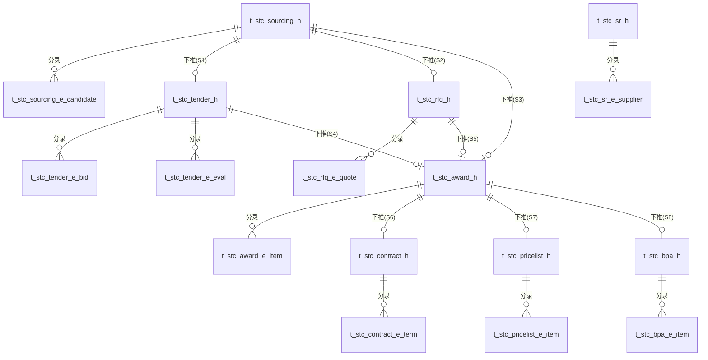

# STC模块数据模型设计

版本：V1.0　日期：2026-09-17

> 与《04-STC技术方案设计文档.md》的单据（D9~D16）严格一一对应。命名规则、审计字段约定与《02-SRM数据模型设计.md》保持一致。
> **跨模块外键**：本文档中所有 `supplier_code` 字段均逻辑关联 `t_srm_supplier_archive_h.supplier_code`（跨库/跨服务场景下不建物理外键，由接口层做存在性与状态校验，详见07号文档）。

---

## 0. 总体 ER 关系图

---

## 1. D9 寻源立项单

### 1.1 t_stc_sourcing_h（单头）

| 字段名 | 中文名 | 类型 | 长度 | 必填 | 默认值 | 说明 |
|---|---|---|---|---|---|---|
| id | 主键 | bigint | - | 是 | 自增 | |
| bill_no | 单据编号 | varchar | 32 | 是 | - | 唯一 |
| project_name | 项目名称 | varchar | 150 | 是 | - | |
| category_code | 主要品类编码 | varchar | 32 | 否 | - | |
| category_name | 主要品类名称 | varchar | 100 | 否 | - | |
| budget_amount | 预算金额 | decimal | 14,2 | 否 | - | |
| budget_currency | 币种 | varchar | 10 | 是 | CNY | |
| planned_start_date | 计划开始日期 | date | - | 否 | - | |
| planned_end_date | 计划结束日期 | date | - | 否 | - | |
| sourcing_method | 寻源方式 | varchar | 20 | 是 | - | 枚举：TENDER/RFQ/NEGOTIATION/SINGLE_SOURCE |
| single_source_reason | 单一来源理由 | text | - | 否 | - | sourcing_method=SINGLE_SOURCE时必填 |
| initiator | 发起人 | varchar | 50 | 是 | - | |
| apply_date | 申请日期 | date | - | 是 | 当天 | |
| status | 单据状态 | varchar | 20 | 是 | DRAFT | 枚举：DRAFT/SUBMITTED/APPROVED/REJECTED/CLOSED |

### 1.2 t_stc_sourcing_e_candidate（候选供应商分录）

| 字段名 | 中文名 | 类型 | 长度 | 必填 | 默认值 | 说明 |
|---|---|---|---|---|---|---|
| id | 主键 | bigint | - | 是 | 自增 | |
| header_id | 单头ID | bigint | - | 是 | - | FK → t_stc_sourcing_h.id |
| seq | 行号 | int | - | 是 | - | |
| supplier_code | 供应商编码 | varchar | 32 | 是 | - | 逻辑关联SRM档案，见07号文档 |
| supplier_name | 供应商名称 | varchar | 100 | 是 | - | 冗余展示字段，保存时从SRM接口回填 |
| category_match | 品类匹配结果 | boolean | - | 否 | - | 查询接口返回，只读 |
| remark | 备注 | varchar | 200 | 否 | - | |

---

## 2. D10 招标单

### 2.1 t_stc_tender_h（单头）

| 字段名 | 中文名 | 类型 | 长度 | 必填 | 默认值 | 说明 |
|---|---|---|---|---|---|---|
| id | 主键 | bigint | - | 是 | 自增 | |
| bill_no | 单据编号 | varchar | 32 | 是 | - | 唯一 |
| source_bill_no | 来源寻源立项单号 | varchar | 32 | 是 | - | |
| project_name | 项目名称 | varchar | 150 | 是 | - | |
| tender_type | 招标类型 | varchar | 20 | 是 | PUBLIC | 枚举：PUBLIC/INVITED |
| announce_date | 公告发布日期 | date | - | 否 | - | |
| bid_deadline | 投标截止日期 | datetime | - | 否 | - | |
| bid_open_date | 开标日期 | datetime | - | 否 | - | |
| qualification_prereview | 是否需资格预审 | boolean | - | 是 | false | |
| evaluation_method | 评标方法 | varchar | 20 | 是 | COMPREHENSIVE | 枚举：LOWEST_PRICE/COMPREHENSIVE |
| tech_weight | 技术分权重(%) | decimal | 5,2 | 否 | 60 | evaluation_method=COMPREHENSIVE时生效 |
| comm_weight | 商务分权重(%) | decimal | 5,2 | 否 | 40 | tech_weight+comm_weight应为100 |
| status | 单据状态 | varchar | 20 | 是 | DRAFT | 枚举：DRAFT/ANNOUNCED/BIDDING/OPENED/EVALUATING/AWARDED/CANCELLED |

### 2.2 t_stc_tender_e_bid（投标供应商分录）

| 字段名 | 中文名 | 类型 | 长度 | 必填 | 默认值 | 说明 |
|---|---|---|---|---|---|---|
| id | 主键 | bigint | - | 是 | 自增 | |
| header_id | 单头ID | bigint | - | 是 | - | FK → t_stc_tender_h.id |
| seq | 行号 | int | - | 是 | - | |
| supplier_code | 供应商编码 | varchar | 32 | 是 | - | |
| supplier_name | 供应商名称 | varchar | 100 | 是 | - | |
| bid_amount | 投标报价 | decimal | 14,2 | 否 | - | status≥OPENED后只读 |
| bid_submit_time | 投标提交时间 | datetime | - | 否 | - | |
| qualification_result | 资格预审结果 | varchar | 10 | 否 | NA | 枚举：PASS/FAIL/NA |
| is_shortlisted | 是否入围评标 | boolean | - | 是 | false | |

### 2.3 t_stc_tender_e_eval（评标结果分录）

| 字段名 | 中文名 | 类型 | 长度 | 必填 | 默认值 | 说明 |
|---|---|---|---|---|---|---|
| id | 主键 | bigint | - | 是 | 自增 | |
| header_id | 单头ID | bigint | - | 是 | - | FK → t_stc_tender_h.id |
| seq | 行号 | int | - | 是 | - | |
| supplier_code | 供应商编码 | varchar | 32 | 是 | - | 须is_shortlisted=true |
| technical_score | 技术分 | decimal | 5,2 | 否 | - | 0~100 |
| commercial_score | 商务分 | decimal | 5,2 | 否 | - | 0~100 |
| total_score | 综合得分 | decimal | 5,2 | 否 | - | 后端计算：技术分×tech_weight+商务分×comm_weight |
| rank | 排名 | int | - | 否 | - | 按total_score降序自动生成 |
| evaluator_comment | 评委意见 | varchar | 300 | 否 | - | |

---

## 3. D11 询价单

### 3.1 t_stc_rfq_h（单头）

| 字段名 | 中文名 | 类型 | 长度 | 必填 | 默认值 | 说明 |
|---|---|---|---|---|---|---|
| id | 主键 | bigint | - | 是 | 自增 | |
| bill_no | 单据编号 | varchar | 32 | 是 | - | 唯一 |
| source_bill_no | 来源寻源立项单号 | varchar | 32 | 是 | - | |
| project_name | 项目名称 | varchar | 150 | 是 | - | |
| max_rounds | 询价轮次上限 | int | - | 否 | 3 | |
| deadline | 报价截止日期 | datetime | - | 否 | - | |
| status | 单据状态 | varchar | 20 | 是 | DRAFT | 枚举：DRAFT/PUBLISHED/QUOTING/COMPARING/CLOSED |

### 3.2 t_stc_rfq_e_quote（报价分录）

| 字段名 | 中文名 | 类型 | 长度 | 必填 | 默认值 | 说明 |
|---|---|---|---|---|---|---|
| id | 主键 | bigint | - | 是 | 自增 | |
| header_id | 单头ID | bigint | - | 是 | - | FK → t_stc_rfq_h.id |
| seq | 行号 | int | - | 是 | - | |
| round_no | 轮次号 | int | - | 是 | 1 | 追加新轮次时自动+1，历史轮次只读 |
| supplier_code | 供应商编码 | varchar | 32 | 是 | - | |
| supplier_name | 供应商名称 | varchar | 100 | 是 | - | |
| quote_amount | 报价金额 | decimal | 14,2 | 否 | - | |
| quote_date | 报价日期 | date | - | 否 | - | |
| remark | 备注 | varchar | 200 | 否 | - | |

---

## 4. D12 定标单

### 4.1 t_stc_award_h（单头）

| 字段名 | 中文名 | 类型 | 长度 | 必填 | 默认值 | 说明 |
|---|---|---|---|---|---|---|
| id | 主键 | bigint | - | 是 | 自增 | |
| bill_no | 单据编号 | varchar | 32 | 是 | - | 唯一 |
| source_bill_type | 来源单据类型 | varchar | 20 | 是 | - | 枚举：TENDER/RFQ/SINGLE_SOURCE |
| source_bill_no | 来源单据编号 | varchar | 32 | 是 | - | |
| project_name | 项目名称 | varchar | 150 | 是 | - | |
| award_supplier_code | 中标供应商编码 | varchar | 32 | 是 | - | |
| award_supplier_name | 中标供应商名称 | varchar | 100 | 是 | - | |
| award_conclusion | 定标结论说明 | text | - | 否 | - | |
| total_award_amount | 中标总金额 | decimal | 14,2 | 否 | - | = Σ分录金额，后端计算 |
| status | 单据状态 | varchar | 20 | 是 | DRAFT | 标准4态 |
| approved_at | 审核通过时间 | datetime | - | 否 | - | |

### 4.2 t_stc_award_e_item（中标明细分录）

| 字段名 | 中文名 | 类型 | 长度 | 必填 | 默认值 | 说明 |
|---|---|---|---|---|---|---|
| id | 主键 | bigint | - | 是 | 自增 | |
| header_id | 单头ID | bigint | - | 是 | - | FK → t_stc_award_h.id |
| seq | 行号 | int | - | 是 | - | |
| category_code | 品类编码 | varchar | 32 | 是 | - | |
| item_desc | 标的描述 | varchar | 200 | 是 | - | |
| quantity | 数量 | decimal | 14,4 | 否 | - | |
| unit_price | 单价 | decimal | 14,4 | 是 | - | |
| amount | 金额 | decimal | 14,2 | 是 | - | = quantity × unit_price |

---

## 5. D13 采购合同

### 5.1 t_stc_contract_h（单头）

| 字段名 | 中文名 | 类型 | 长度 | 必填 | 默认值 | 说明 |
|---|---|---|---|---|---|---|
| id | 主键 | bigint | - | 是 | 自增 | |
| bill_no | 单据编号 | varchar | 32 | 是 | - | 唯一 |
| source_award_bill_no | 来源定标单号 | varchar | 32 | 否 | - | |
| supplier_code | 供应商编码 | varchar | 32 | 是 | - | |
| contract_name | 合同名称 | varchar | 150 | 是 | - | |
| contract_amount | 合同金额 | decimal | 14,2 | 否 | - | |
| effective_date | 生效日期 | date | - | 是 | - | |
| expire_date | 到期日期 | date | - | 是 | - | |
| contract_type | 合同类型 | varchar | 20 | 是 | ONE_TIME | 枚举：FRAMEWORK/ONE_TIME |
| signer | 签约人 | varchar | 50 | 否 | - | |
| legal_review_status | 法务审核状态 | varchar | 10 | 是 | PENDING | 枚举：PENDING/PASSED/REJECTED |
| seal_status | 盖章状态 | varchar | 10 | 是 | PENDING | 枚举：PENDING/SEALED |
| status | 单据状态 | varchar | 20 | 是 | DRAFT | 枚举：DRAFT/IN_REVIEW/APPROVED/EXPIRED/TERMINATED |

### 5.2 t_stc_contract_e_term（条款/标的分录）

| 字段名 | 中文名 | 类型 | 长度 | 必填 | 默认值 | 说明 |
|---|---|---|---|---|---|---|
| id | 主键 | bigint | - | 是 | 自增 | |
| header_id | 单头ID | bigint | - | 是 | - | FK → t_stc_contract_h.id |
| seq | 行号 | int | - | 是 | - | |
| term_type | 条款类型 | varchar | 20 | 是 | - | 枚举：ITEM标的清单/PAYMENT付款条件/WARRANTY质保条款 |
| category_code | 品类编码 | varchar | 32 | 否 | - | term_type=ITEM时填写 |
| item_desc | 标的描述 | varchar | 200 | 否 | - | |
| quantity | 数量 | decimal | 14,4 | 否 | - | |
| unit_price | 单价 | decimal | 14,4 | 否 | - | |
| remark | 备注/条款内容 | text | - | 否 | - | |

---

## 6. D14 价目表

### 6.1 t_stc_pricelist_h（单头）

| 字段名 | 中文名 | 类型 | 长度 | 必填 | 默认值 | 说明 |
|---|---|---|---|---|---|---|
| id | 主键 | bigint | - | 是 | 自增 | |
| bill_no | 单据编号 | varchar | 32 | 是 | - | 唯一 |
| source_award_bill_no | 来源定标单号 | varchar | 32 | 否 | - | 支持人工直接维护 |
| supplier_code | 供应商编码 | varchar | 32 | 是 | - | |
| effective_date | 生效日期 | date | - | 是 | - | |
| expire_date | 到期日期 | date | - | 是 | - | |
| status | 单据状态 | varchar | 20 | 是 | DRAFT | 枚举：DRAFT/EFFECTIVE/EXPIRED/SUPERSEDED |

### 6.2 t_stc_pricelist_e_item（价格明细分录）

| 字段名 | 中文名 | 类型 | 长度 | 必填 | 默认值 | 说明 |
|---|---|---|---|---|---|---|
| id | 主键 | bigint | - | 是 | 自增 | |
| header_id | 单头ID | bigint | - | 是 | - | FK → t_stc_pricelist_h.id |
| seq | 行号 | int | - | 是 | - | |
| category_code | 品类编码 | varchar | 32 | 是 | - | |
| item_code | 物料编码 | varchar | 32 | 是 | - | |
| item_name | 物料名称 | varchar | 100 | 是 | - | |
| unit_price | 单价 | decimal | 14,4 | 是 | - | |
| currency | 币种 | varchar | 10 | 是 | CNY | |
| price_tier | 阶梯价说明 | varchar | 200 | 否 | - | |
| region | 区域价差说明 | varchar | 100 | 否 | - | |

---

## 7. D15 框架协议（BPA）

### 7.1 t_stc_bpa_h（单头）

| 字段名 | 中文名 | 类型 | 长度 | 必填 | 默认值 | 说明 |
|---|---|---|---|---|---|---|
| id | 主键 | bigint | - | 是 | 自增 | |
| bill_no | 单据编号 | varchar | 32 | 是 | - | 唯一 |
| source_award_bill_no | 来源定标单号 | varchar | 32 | 否 | - | |
| supplier_code | 供应商编码 | varchar | 32 | 是 | - | |
| total_quota_amount | 总额度 | decimal | 14,2 | 是 | - | |
| used_quota_amount | 已使用额度 | decimal | 14,2 | 是 | 0 | **PTP阶段累加式反写字段，STC阶段固定为0** |
| effective_date | 生效日期 | date | - | 是 | - | |
| expire_date | 到期日期 | date | - | 是 | - | |
| status | 单据状态 | varchar | 20 | 是 | DRAFT | 枚举：DRAFT/EFFECTIVE/EXHAUSTED/EXPIRED/TERMINATED |

### 7.2 t_stc_bpa_e_item（适用品类明细分录）

| 字段名 | 中文名 | 类型 | 长度 | 必填 | 默认值 | 说明 |
|---|---|---|---|---|---|---|
| id | 主键 | bigint | - | 是 | 自增 | |
| header_id | 单头ID | bigint | - | 是 | - | FK → t_stc_bpa_h.id |
| seq | 行号 | int | - | 是 | - | |
| category_code | 品类编码 | varchar | 32 | 是 | - | |
| item_code | 物料编码 | varchar | 32 | 否 | - | |
| unit_price | 单价 | decimal | 14,4 | 是 | - | |
| max_quantity | 最大数量 | decimal | 14,4 | 否 | - | |

---

## 8. D16 SR配额单

### 8.1 t_stc_sr_h（单头）

| 字段名 | 中文名 | 类型 | 长度 | 必填 | 默认值 | 说明 |
|---|---|---|---|---|---|---|
| id | 主键 | bigint | - | 是 | 自增 | |
| bill_no | 单据编号 | varchar | 32 | 是 | - | 唯一 |
| category_code | 品类编码 | varchar | 32 | 是 | - | |
| category_name | 品类名称 | varchar | 100 | 是 | - | |
| period | 配额周期 | varchar | 20 | 是 | - | 如"2026年度" |
| status | 单据状态 | varchar | 20 | 是 | DRAFT | 枚举：DRAFT/EFFECTIVE/EXPIRED |

### 8.2 t_stc_sr_e_supplier（供应商配额分录）

| 字段名 | 中文名 | 类型 | 长度 | 必填 | 默认值 | 说明 |
|---|---|---|---|---|---|---|
| id | 主键 | bigint | - | 是 | 自增 | |
| header_id | 单头ID | bigint | - | 是 | - | FK → t_stc_sr_h.id |
| seq | 行号 | int | - | 是 | - | |
| supplier_code | 供应商编码 | varchar | 32 | 是 | - | |
| supplier_name | 供应商名称 | varchar | 100 | 是 | - | |
| ratio_percent | 配额比例(%) | decimal | 5,2 | 是 | - | 同单据下所有行合计应为100 |
| perf_grade_ref | 绩效等级引用 | varchar | 5 | 否 | - | 只读，实时查询SRM `perf_grade`，不持久化同步，仅展示时缓存于响应体 |
| remark | 备注 | varchar | 200 | 否 | - | |

---

## 9. 表清单汇总

| # | 表名 | 所属单据 | 类型 |
|---|---|---|---|
| 1 | t_stc_sourcing_h | D9 | 单头 |
| 2 | t_stc_sourcing_e_candidate | D9 | 分录 |
| 3 | t_stc_tender_h | D10 | 单头 |
| 4 | t_stc_tender_e_bid | D10 | 分录 |
| 5 | t_stc_tender_e_eval | D10 | 分录 |
| 6 | t_stc_rfq_h | D11 | 单头 |
| 7 | t_stc_rfq_e_quote | D11 | 分录 |
| 8 | t_stc_award_h | D12 | 单头 |
| 9 | t_stc_award_e_item | D12 | 分录 |
| 10 | t_stc_contract_h | D13 | 单头 |
| 11 | t_stc_contract_e_term | D13 | 分录 |
| 12 | t_stc_pricelist_h | D14 | 单头 |
| 13 | t_stc_pricelist_e_item | D14 | 分录 |
| 14 | t_stc_bpa_h | D15 | 单头 |
| 15 | t_stc_bpa_e_item | D15 | 分录 |
| 16 | t_stc_sr_h | D16 | 单头 |
| 17 | t_stc_sr_e_supplier | D16 | 分录 |

> 注：`perf_grade_ref` 字段虽在分录表中定义了列，但按上面说明属于"展示态缓存"，不作为持久化的强一致字段，AI实现时优先考虑「查询时实时调用SRM接口拼装到响应体」而非「写入时固化到数据库」，避免SRM侧绩效变化后STC侧数据滞后不一致。若性能要求需要落库缓存，需同时设计缓存刷新机制（本阶段不展开，作为待确认事项）。
