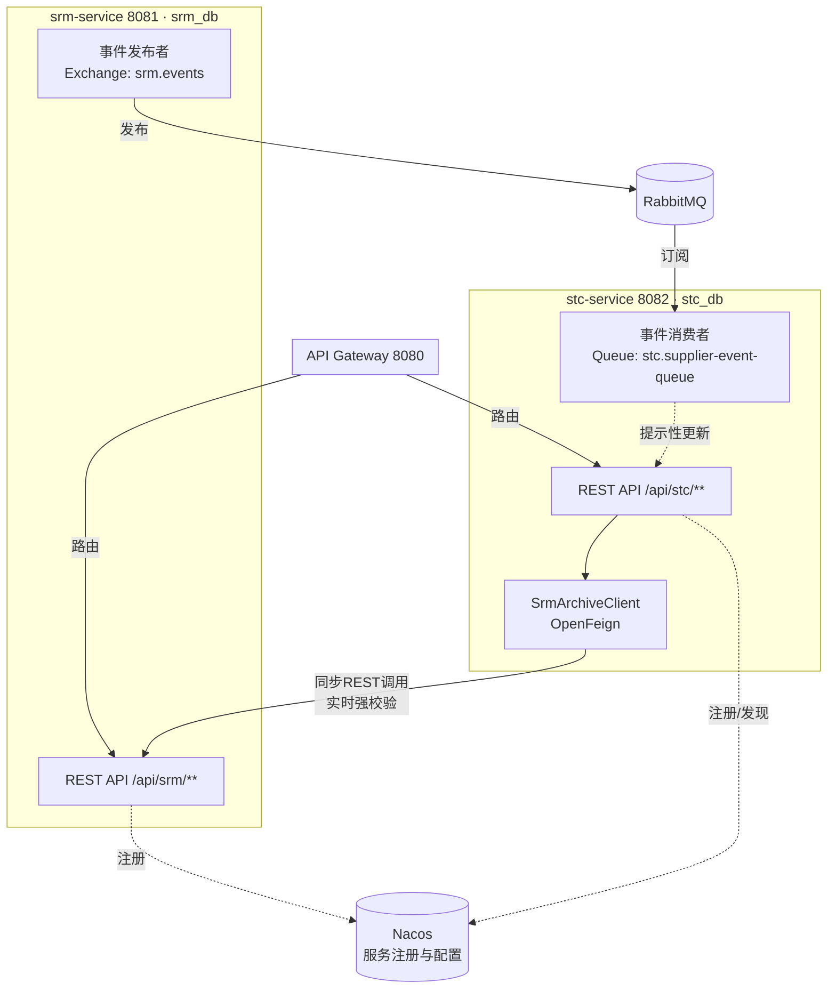

# SRM 与 STC 模块协作说明

版本：V1.0　日期：2026-09-17

> 本文档回答一个问题：**SRM（第一阶段）和STC（第二阶段）这两个独立微服务，具体是怎么"合作"完成一件事的？** 前面6份文档分别定义了各自模块内部的单据、数据模型、接口；本文档专门梳理跨模块/跨服务的调用关系、事件流转、失败处理与主数据一致性原则，是AI在实现STC模块、以及未来实现PTP模块时**必须先读**的一份文档。

---

## 1. 依赖方向与边界原则

**核心原则：STC 单向依赖 SRM，SRM 完全不知道 STC 的存在。**

- SRM 是供应商主数据的"唯一真相来源"（Single Source of Truth）。所有和供应商资格、状态、绩效相关的判断，STC 都必须向 SRM 查询或订阅其事件，**不允许在 STC 侧重新维护一套供应商状态字段并自行判断**。
- SRM 的所有单据设计（01/02/03号文档）中，没有任何字段引用 STC 的单据编号或状态，SRM 服务不需要调用 STC 的任何接口。这保证了 SRM 可以独立开发、独立部署、独立测试，不会因为STC还没开发完成而被阻塞——这也是为什么项目按"先SRM、再STC"的顺序推进是合理的。
- 未来 PTP 模块同理单向依赖 SRM 和 STC，不会反向依赖，详见第8章。

```
SRM（供应商主数据） ← STC（单向依赖，查询+订阅） ← PTP（单向依赖，查询+订阅，未来阶段）
```

---

## 2. 协作全景图



---

## 3. 同步调用衔接点清单（强一致校验，走 Feign）

| 编号 | STC侧动作 | 调用的SRM接口 | 校验规则 | 失败/不满足条件时的处理 |
|---|---|---|---|---|
| C1 | D9寻源立项单"刷新候选供应商" | `GET /api/srm/archives?categoryCode=&certStatus=QUALIFIED,TEMP_QUALIFIED` | 按品类匹配、且状态为合格/临时合格 | SRM服务不可用：返回错误提示"供应商服务暂不可用"，不允许用空列表静默通过 |
| C2 | D9/D10/D11 保存供应商相关分录行时 | `GET /api/srm/archives/{supplierCode}` | 供应商必须存在，且状态非FROZEN/BLACKLIST | 校验不通过：该行保存失败，前端提示"该供应商已被冻结/列入黑名单，无法选用"；SRM服务不可用：允许保存但标记"待复核"角标（这是招投标进行中的非阻断场景，见第6章） |
| C3 | D12定标单"审核通过"（最关键的一次校验） | `GET /api/srm/archives/{supplierCode}` | 中标供应商必须为QUALIFIED/TEMP_QUALIFIED，非FROZEN/BLACKLIST | **校验不通过：拒绝审核，返回明确错误，不允许强行通过**；SRM服务不可用：**同样拒绝审核**（这是唯一不允许降级放行的强阻断点，因为审核通过会连锁下推生成合同/价目表/BPA，一旦生成难以撤销） |
| C4 | D16 SR配额单"刷新绩效等级" | `GET /api/srm/archives/{supplierCode}` | 无阻断校验，仅展示 | SRM服务不可用：展示"暂无法获取最新绩效等级"，不阻塞单据保存/生效 |

**设计要点**：C1/C2/C4 属于"能查则查，查不到就降级提示"，不阻塞用户操作；**只有 C3 是硬性阻断**，因为它是资金/合同风险的最后一道闸门。AI 实现时务必区分这两类校验的严重程度，不要一刀切都做成阻断式或都做成降级式。

---

## 4. 异步事件衔接点清单（最终一致，走 RabbitMQ）

### 4.1 事件与STC侧处理动作

| 事件 | SRM侧触发点 | STC侧消费动作 | 是否影响在途单据 |
|---|---|---|---|
| `supplier.frozen` | D6冻结单审核通过（W4反写） | 在候选供应商分录、投标供应商分录等列表/详情页对该供应商加"风险"角标提示 | 不撤销/不锁定已存在的招标单、询价单，仅提示；到D12审核时由C3同步校验兜底拦截 |
| `supplier.unfrozen` | D6解冻单审核通过（W5反写） | 清除风险角标 | - |
| `supplier.blacklisted` | D7黑名单单审核通过（W6反写） | 加"禁止交易"强提示角标（视觉上比冻结更严重） | 同上，C3同步校验兜底 |
| `supplier.archive.updated` | D3认证通过/D5变更审核通过/D8绩效确认（W2/W3/W7反写） | 若变更字段含`perf_grade`，对已生效的D16单据展示层提示"绩效等级已更新，建议刷新"；若变更字段含供应商名称等基础信息，刷新STC侧冗余展示字段（supplier_name） | 不自动修改STC已保存的历史单据数据（历史单据的supplier_name保留下单时快照，符合"单据留痕"原则） |

### 4.2 为什么冻结/黑名单不自动撤销STC在途单据？

这是一个业务决策，写明供AI理解，不要"自作聪明"改成自动撤销：
- 招标/询价是一个多方参与、有法律和商务影响的过程，某供应商在过程中被冻结，不代表整个招标项目要作废（可能还有其他投标方）。
- 唯一需要强制拦截的节点是**定标单审核通过**这一刻——因为这一刻之后会产生合同/价目表/BPA等有实际约束力的产出物。所以拦截逻辑收敛到 C3 一个点，而不是散落在每个环节都做强制撤销，这样系统行为更可预测，AI实现和测试也更简单。

---

## 5. 供应商主数据的一致性原则

1. **STC 不做供应商主数据的"本地复制持久化"**。所有 `supplier_name`、`perf_grade_ref` 等展示字段，定位为"下单/操作时刻的快照"或"查询时的实时展示"，不是需要长期保持同步的主数据副本。
2. **查询优先，缓存为辅**。默认所有跨模块数据都走实时 Feign 查询；只有在明确的性能问题出现后，才考虑引入本地缓存（如Redis），缓存失效策略以 RabbitMQ 事件驱动（收到`supplier.archive.updated`即失效对应缓存）。本阶段demo规模不需要引入缓存，直接实时查询即可。
3. **历史单据字段不回溯修改**。STC单据一旦保存了某个时刻的供应商名称/状态快照，后续SRM数据变化不会反向修改这些历史记录里的快照字段（只影响新的校验逻辑和提示角标）。

---

## 6. 在途单据遭遇上游状态变化——处理策略汇总表

| STC单据 | 场景 | 处理策略 |
|---|---|---|
| D9 寻源立项单 | 候选供应商在立项审核后被冻结 | 不影响D9本身状态；下推到D10/D11时该供应商仍会带过去，但会被C2标记风险 |
| D10 招标单 | 投标供应商在开标前被冻结 | 允许继续投标流程（真实业务中該供应商可能因冻结解除或申诉恢复资格），评标环节人工决策是否仍选择该供应商，最终由C3在定标环节兜底 |
| D11 询价单 | 报价供应商在比价阶段被列入黑名单 | 同上，人工比价时可看到风险角标自行决策，C3兜底 |
| D12 定标单 | 中标供应商在"提交"和"审核"之间的时间差内被冻结 | **审核环节强制重新查询（C3），不使用提交时缓存的状态**，一旦发现已被冻结/黑名单则拒绝审核，退回修改（更换中标方或走特批） |
| D13/D14/D15（合同/价目表/BPA） | 已生效后，对应供应商后续被冻结 | 本阶段不做自动终止合同/价目表的逻辑（涉及复杂的商务违约判断，超出demo范围），作为**待确认事项**列入第9章 |

---

## 7. 本地联调建议（个人开发顺序）

给个人开发者（配合AI）一个循序渐进、不被相互依赖卡住的建议顺序：

1. **先完整实现并测试 srm-service**（01/02/03号文档），确保8张单据的CRUD、下推、反写全部跑通，可以用 Postman/curl 直接测。
2. **开发 stc-service 时，先用 Mock 代替真实 Feign 调用**：在 `SrmArchiveClient` 接口上做一套本地 Mock 实现（返回固定的几个测试供应商数据），让STC的单据CRUD、下推、反写逻辑先独立跑通，不必等 srm-service 服务真的启动。
3. **Mock 验证通过后，切换到真实 Feign + Nacos**，本地用 Docker Compose 把 srm-service、stc-service、Nacos、RabbitMQ 都启动，做一次端到端联调，重点验证 C3（定标审核强校验）和事件通知（冻结supplier后看STC侧角标是否出现）。
4. 联调顺序建议：先测同步调用（C1~C4），再测异步事件（4.1节四个事件），最后测"在途单据遭遇状态变化"的边界场景（第6章表格逐行过一遍）。

---

## 8. 面向 PTP 模块的预留说明

STC 阶段的以下产出物是 PTP（第三阶段）的直接输入，接口已在06号文档中设计到位，PTP阶段只需要调用，不需要回头改STC：

| STC产出物 | PTP阶段用途 | 已预留的接口 |
|---|---|---|
| D13 采购合同 | PTP生成采购订单时的履约依据引用 | `GET /api/stc/contracts/{id}` |
| D14 价目表 | PTP"采购申请取价"环节自动匹配价格 | `GET /api/stc/price-lists/effective-price?supplier_code=&item_code=` |
| D15 框架协议BPA | PTP生成采购订单时的额度校验与累加式反写 | `GET /api/stc/bpas/{id}`、`POST /api/stc/bpas/{id}/accumulate-usage` |
| D16 SR配额单 | PTP"采购订单分单"时的份额参考 | `GET /api/stc/sr-allocations?category_code=` |

同理，PTP 依赖 STC 和 SRM 的方式，也应遵循本文档确立的原则：强校验走同步Feign（如BPA额度校验），状态通知走RabbitMQ事件（如合同到期、BPA额度用尽）。待正式进入PTP阶段开发时，建议复制本文档结构产出《08-STC与PTP模块协作说明.md》。

---

## 9. 待确认事项（本阶段未展开，需后续评审）

1. D13/D14/D15 生效后，对应供应商被冻结/黑名单，是否需要自动终止或仅提示？（当前策略：仅提示，不自动终止）
2. C2校验在SRM服务不可用时"允许保存但标记待复核"，待复核的数据后续由谁、在什么时机做二次复核确认？（当前未设计复核工作流，建议后续补一张"待复核清单"页面人工处理）
3. RabbitMQ消息的顺序性问题：如果同一供应商短时间内连续触发"冻结"又"解冻"，STC侧消费顺序错乱会导致角标状态错误——本阶段先按"以最新一次同步查询结果为准"兜底（即角标只是提示，C3等关键节点始终重新查询实时状态，不完全依赖事件顺序），暂不引入消息顺序保证机制（如单一供应商分区路由），демo规模概率极低，留待后续观察是否需要加强。
