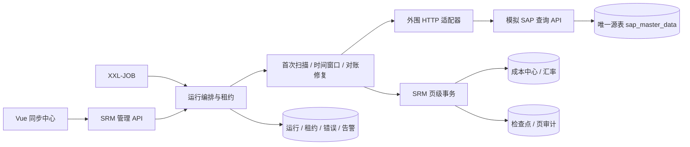
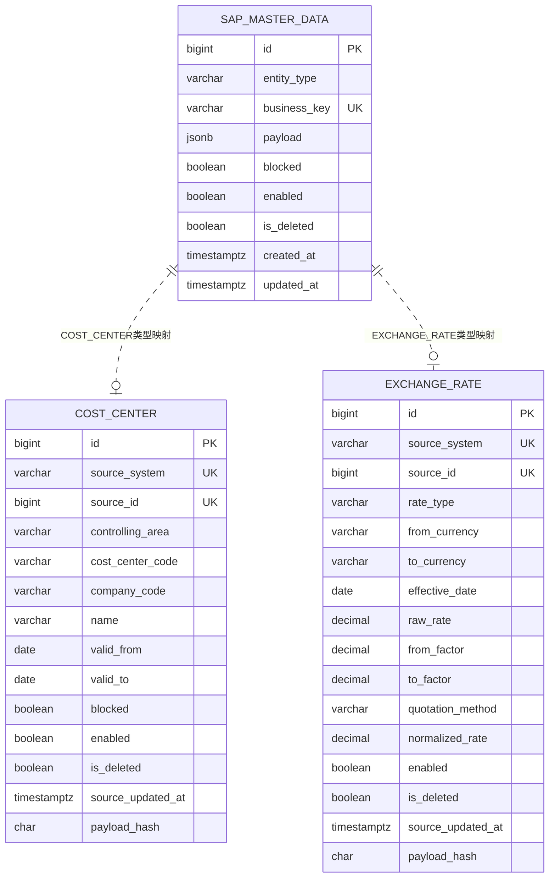
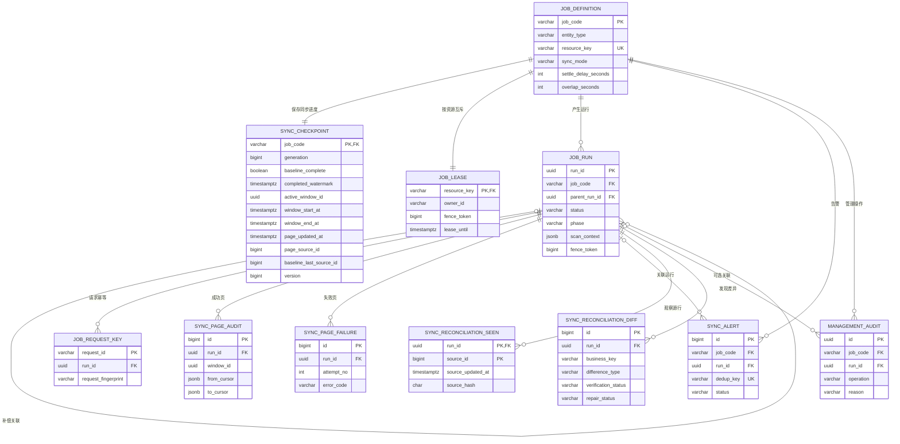
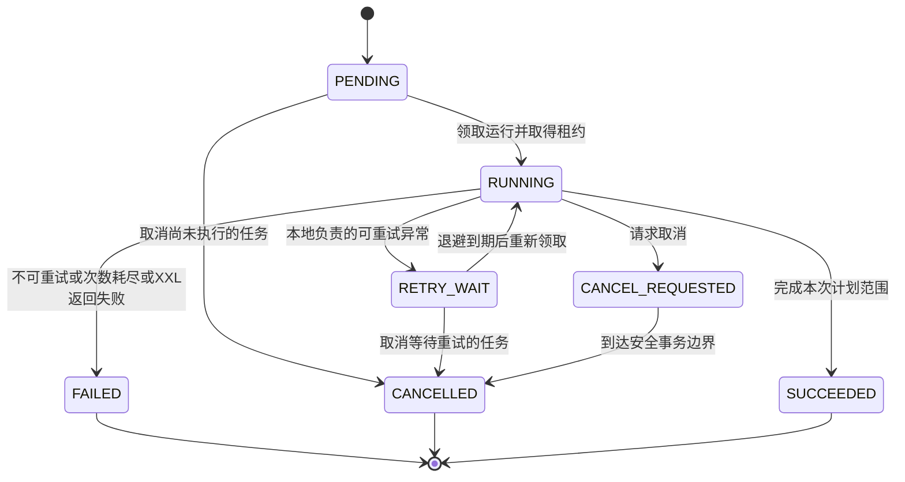

# SRM 主数据同步需求与详细设计：修改时间＋源记录主键组合游标

日期：2026-11-05。状态：新方案设计稿，尚未改造现有代码，尚未执行验证。

本文以成本中心为主要业务案例，兼容已有汇率同步和同步中心页面。旧实现采用稳定变更流、对象版本和源端物化快照；本文定义的 `TIME_WINDOW_V2` 是替代方案，不能将旧实现的验证结果视为新方案已经通过验证。

## 1. 设计结论与范围

### 1.1 必须遵守的约束

1. 模拟源数据库只保留一张业务主数据表 `mock_sap_schema.sap_master_data`，包含自增 `id`、可靠 `updated_at`、业务标识、业务内容和业务状态。
2. 不设置 `source_version`，不创建 `stream_clock`、`change_event`、`snapshot`、`snapshot_item`，不通过其他表变相记录源端同步日志。
3. 自增主键对应的数据库 identity sequence、索引和约束属于表的基础设施，不是另建流时钟或业务事件表。
4. SRM 通过 HTTP 调用外围查询接口。只有模拟源适配器访问源表，SRM 同步服务不直连外围业务库。
5. 检查点、运行记录、租约、失败日志、告警、对账记录全部由 SRM 自己维护；这些表不受“源端只有一张表”的限制。
6. 首次全量采用固定 ID 上界扫描；后续增量采用固定时间窗口内的 `(updated_at, id)` 升序分页；保留批量落库、页级事务、恢复、重试、对账及修复。
7. 本期不引入 CDC、MQ、Canal、Debezium；不要求 SAP 团队建设一套变更日志系统。

### 1.2 一致性目标及不能承诺的内容

目标是让 SRM 的主数据副本最终收敛到源系统的最新状态，允许调度周期内存在同步延迟，不提供跨系统强一致事务。

单张当前状态表有以下天然限制：

- 一条记录在两次读取之间连续“冻结→解冻”，SRM 可能只读到最后的解冻状态。本文不承诺还原每一次中间状态或历史变更。
- 任意长事务、任意时间回拨、修改业务字段却不维护修改时间，不能只靠组合游标保证增量完全不漏。常规变化由安全延迟和重叠回扫覆盖，异常由全量对账发现并修复。
- 源端物理删除后不存在可供增量查询的行。正常删除必须使用保留记录的逻辑删除；越权物理删除只能依靠对账发现，默认不自动删除 SRM 数据。
- 没有物化快照时，多页全量扫描不是同一时刻的数据库快照。对账结论是观察结果，需要对差异逐条复核，不能声称得到某时点的全库精确镜像。

“旧方案功能都保留”指业务和运维能力保留；源端事件历史、可重放快照这些依赖额外源表的保证，在本约束下必须替换，不能同时承诺。

### 1.3 方案比较与本次选择

| 方案 | 源端条件 | 优点 | 代价与适用范围 |
| --- | --- | --- | --- |
| 只按自增 ID 拉取 | 自增且不复用的 ID | 简单 | 无法识别旧记录修改，仅适合新增数据 |
| 修改时间＋ID 组合游标 | 可靠修改时间、稳定 ID、筛选及排序接口 | 支持当前状态的新增和修改，不需事件表 | 需要延迟窗口、回扫及对账，不保留中间历史 |
| 稳定变更日志游标 | 源端原生提供变更流 | 能明确重放变化及接续位置 | 不符合本次单表约束，不作为默认前提 |
| 全量拉取＋差异入库 | 全量查询接口 | 小数据下容易实现 | 网络传输仍为全量，不能称为网络层增量 |

本次按用户指定选择第二种，第四种作为定期对账和异常兜底。Java 17、现有 Spring Boot、MyBatis XML、PostgreSQL、Vue 3 和 Element Plus 沿用项目技术栈，调度继续接入已有 XXL-JOB。

## 2. 业务场景与需求

### 2.1 客户需求

财务人员在 SAP 维护成本中心，例如新增采购部、修改成本中心名称、冻结不再允许分摊费用的部门、停用撤销的部门、调整有效期。SRM 在采购申请、订单费用归属等业务中使用本地主数据，以免每次打开单据都依赖 SAP 在线响应。

SRM 需要周期性获取变化，保证新增单据使用当前有效的成本中心；同步失败后能重试并看见原因；运维人员能核对遗漏并修复。历史订单保留原先的业务引用和必要快照，不因主数据停用而丢失历史信息。

汇率由源系统维护，SRM 同步同一汇率类型、币种对、生效日的最新值。修订主数据不直接重算历史已确认订单；订单使用的币种、汇率、因子和生效日作为订单自己的业务快照。

上述是复现项目采用的业务场景，不表示已经在真实 SAP 上验证这些字段或接口。

### 2.2 角色

| 角色 | 操作 |
| --- | --- |
| 外围主数据维护人员 | 新增、编辑、冻结、解冻、禁用、启用、逻辑删除、恢复 |
| SRM 业务用户 | 查询、选择本地可用成本中心或汇率，无权改写源端权威字段 |
| 集成运维人员 | 触发同步、查看进度、取消、补偿、对账、修复、确认告警 |
| 调度平台 | 按 Cron 触发业务任务，管理自身的调度和失败重试 |
    


ss
### 2.3 需求清单

| 编号 | 需求 | 结果 |
| --- | --- | --- |
| FR-01 | 首次全量 | 分页建立本地副本，扫描完成后补拉期间变化 |
| FR-02 | 增量同步 | 使用时间范围和组合游标，覆盖新增与旧行修改 |
| FR-03 | 状态同步 | 冻结、禁用、逻辑删除及其恢复都进入同步，不过滤掉不可用行 |
| FR-04 | 页级恢复 | 落库与进度一起提交，失败从最后成功页继续 |
| FR-05 | 幂等 | 重复请求、重复页、重叠回扫不产生重复业务行 |
| FR-06 | 失败处理 | 可重试异常退避；不合法数据阻断并告警，不能静默跳过 |
| FR-07 | 任务管理 | 手动、XXL-JOB、启停、租约、取消、失联接管、人工补偿 |
| FR-08 | 对账 | 发现目标缺失、内容不一致、目标较新、源端缺失等差异 |
| FR-09 | 修复 | 经授权补齐或更正允许修复的差异，不无条件覆盖较新值 |
| FR-10 | 可观测 | 展示时间窗口、组合游标、完整水位、运行记录、错误及告警 |
| FR-11 | 故障模拟 | 模拟源 HTTP 503、源端并发编辑冲突，故障控制不增加源表 |
| FR-12 | 汇率能力 | 同生效日修订、精度与因子校验、按业务日期查询汇率 |

## 3. 源端契约与术语

### 3.1 三种“主键”不能混用

| 名称 | 示例 | 用途 |
| --- | --- | --- |
| 源记录 ID `source_id` | 源表自增 `id=120` | 稳定标识源记录；作为组合游标第二项 |
| 业务唯一键 `business_key` | `["A100","CC001"]` | 成本中心控制范围＋编码的业务唯一性 |
| SRM 本地主键 `id` | 本地成本中心 `id=87` | 本地单据引用，不参与源端分页 |

本文的“修改时间＋业务主键组合游标”精确定义为 **`(源表 updated_at, 源表自增 id)`**，不是 `(修改时间, SRM 本地 id)`。业务编码也不要求自增。

### 3.2 时间和标识必须具备的性质

1. `id` 唯一、稳定、不可更改、不可复用。自增 ID 允许空洞，不表示事务提交顺序。
2. 每一次会影响同步内容的变化，包括状态、名称、有效期、金额和因子，必须与 `updated_at` 在同一源事务中提交。
3. 同一行每次实际变更的 `updated_at` 必须严格增加，不能只在新增时填写，不能按日期回填旧值。
4. 模拟源使用数据库生成微秒时间；HTTP 传输采用 UTC ISO-8601，保留六位小数。SRM 用 `Instant`/`timestamptz(6)`，游标序列化不能截断成毫秒。
5. ID 在 JSON 中用十进制字符串传输，避免浏览器 JavaScript Number 精度丢失。浏览器展示时间可以本地化，但回传游标必须使用服务端原始值。
6. 业务唯一键及其组成字段在当前模型中不可直接编辑。业务编码迁移要停用旧行、创建新行并明确业务关联，不能悄悄改变键导致旧行遗留。
7. 接口必须返回冻结、禁用、逻辑删除的行；不同页面的权限过滤规则不能随请求变化。
8. 源端提供数据库时间，不让 SRM 应用服务器自行决定窗口上界。若查询读副本，必须明确复制延迟上界，不能每页随机读取进度不同的副本。

这些是接入时间增量的前提，不是 SRM 能单方保证的能力。真实 SAP 若不满足，需要改为全量比较或协商其他标准接口，不能伪称已经支持时间增量。

### 3.3 安全延迟与重叠窗口

符号：

| 符号 | 含义 | 初始建议值 |
| --- | --- | --- |
| `W` | 上次已完整处理的时间窗口上界，完整水位 | 持久化值 |
| `L` | 安全延迟，避免读取仍可能未提交或未复制的最近变化 | 120 秒 |
| `R` | 重叠回扫长度 | 300 秒 |
| `S` | 本轮下界 `max(epoch, W-R)` | 含边界 |
| `E` | 本轮上界 `sourceNow-L` | 不含边界 |
| `C=(t,id)` | 本轮最后成功页的组合游标 | 初始为空 |

本地模拟源的初始工程假设：从更新时间赋值到主库提交最多 60 秒、查询副本可见延迟最多 30 秒、源时钟误差及时间精度裕量合计不超过 30 秒，因此选择 `L=120s`，并额外保留 `R=300s` 的回扫。它们是设计初值，部署前需要用实际源端行为确认，不是实测指标。

`L` 降低迟提交风险，`R` 让边界附近的记录再次参与读取，组合游标解决窗口内相同修改时间的分页；三个机制承担不同责任。超出延迟假设的事务可能仍被增量漏过，由每日全量对账兜底，不承诺任意迟提交绝不遗漏。

PostgreSQL 的 `CURRENT_TIMESTAMP/now()` 表示事务开始时间，`clock_timestamp()` 才是调用时的时钟时间，因此模拟源维护修改时间使用后者；它仍然不是提交时间。参见 [PostgreSQL 16 时间函数](https://www.postgresql.org/docs/16/functions-datetime.html#FUNCTIONS-DATETIME-CURRENT)。

## 4. 架构及职责



模拟源的读写都只访问唯一主表。故障开关保存在开发进程内存中，进程重启恢复正常，不新增故障配置表；真实故障由网络或上游响应体现。

源端控制器负责可靠查询和源端业务维护，SRM 负责同步编排及本地事务。分页查询 SQL 属于源端适配层，SRM 不发送任意 SQL 给 SAP。

## 5. 源端唯一主表设计

### 5.1 为什么一张表仍能保留两类演示

严格遵守“源端总共只有一张主数据表”，模拟源用 `entity_type` 区分 `COST_CENTER` 与 `EXCHANGE_RATE`，公共标识和状态使用结构化列，各自业务字段放入 `payload jsonb`。

这是本地模拟接口的数据模型，不是声称真实 SAP 的成本中心、汇率存储在同一张表。真实接入由适配器映射已有接口；若只演示成本中心，该表仅存 `COST_CENTER` 即可，不需要第二张表。

### 5.2 源表 DDL

以下 DDL 是未来实现的设计参考，本文不执行 SQL，也不修改已执行的 Flyway 历史迁移。

```sql
create table mock_sap_schema.sap_master_data (
    id bigint generated always as identity primary key,
    entity_type varchar(30) not null,
    business_key varchar(240) not null,
    payload jsonb not null,
    blocked boolean not null default false,
    enabled boolean not null default true,
    is_deleted boolean not null default false,
    created_at timestamptz(6) not null default clock_timestamp(),
    updated_at timestamptz(6) not null default clock_timestamp(),
    unique (entity_type, business_key),
    check (entity_type in ('COST_CENTER', 'EXCHANGE_RATE')),
    check (jsonb_typeof(payload) = 'object'),
    check (updated_at >= created_at)
);

create index idx_sap_master_delta
    on mock_sap_schema.sap_master_data(entity_type, updated_at, id);
create index idx_sap_master_full
    on mock_sap_schema.sap_master_data(entity_type, id);
```

不保存 `source_version`。不把内容哈希放在源表；SRM 自己计算。源表中 `blocked/enabled/is_deleted` 属于业务状态，不是新增同步日志。

### 5.3 业务内容及状态

| 类型 | business_key 规范 | payload 主要字段 |
| --- | --- | --- |
| 成本中心 | 对 `[controllingArea,costCenterCode]` 做规范 JSON 数组编码 | controllingArea、costCenterCode、companyCode、name、validFrom、validTo |
| 汇率 | 对 `[rateType,fromCurrency,toCurrency,effectiveDate]` 做规范 JSON 数组编码 | rateType、fromCurrency、toCurrency、effectiveDate、rawRate、fromFactor、toFactor、quotationMethod |

使用明确的数组编码，避免直接拼接分隔符造成歧义。业务键由源服务从内容生成并校验，不能让浏览器随意填写不匹配的键。

| 字段 | 含义 | SRM 新单据能否使用 |
| --- | --- | --- |
| blocked=true | 暂时冻结，可解冻 | 否 |
| enabled=false | 业务禁用，可重新启用 | 否 |
| is_deleted=true | 逻辑删除，行仍保留；恢复需要授权 | 否 |
| 三项均正常且在有效期内 | 可用 | 是 |

这些状态相互独立，解冻不代表重新启用，重新启用也不能自动清除逻辑删除标记。汇率沿用 enabled/is_deleted；blocked 默认 false，若业务未定义冻结则界面不提供该操作。

### 5.4 源端写入及并发编辑

模拟源只需在现有保存逻辑中可靠维护修改时间，不再额外写日志表：

```sql
update mock_sap_schema.sap_master_data
set payload = :payload,
    blocked = :blocked,
    enabled = :enabled,
    is_deleted = :isDeleted,
    updated_at = greatest(clock_timestamp(), updated_at + interval '1 microsecond')
where id = :id
  and updated_at = :expectedUpdatedAt;
```

- `expectedUpdatedAt` 来自用户读取的原始六位精度时间，受影响行数为 0 时区分不存在与并发冲突，分别返回 404/409。
- 发生真实内容或状态变化才执行上述更新；无变化保存可以直接返回原记录。
- 源表更新后返回数据库实际保存的 `updated_at`；不能由浏览器计算时间。
- 其他源端写入路径也必须遵守相同契约。若使用数据库触发器统一维护时间，它不增加源表，但仍属于源端能力建设，需要对接双方确认。
- 这并不意味着 SRM 可以要求真实 SAP 改保存代码：模拟器演示的是“上游已有可靠修改时间”这一接入条件。

逻辑删除行本期不物理清理，ID 和业务键均不复用。若未来清理，必须另行设计消费确认及离线恢复期限，不能直接按天删除。

## 6. HTTP 接口契约

### 6.1 源端接口

统一前缀示例：`/api/integration/mock-sap/v2/master-data/{entityType}`，真实外围地址由 HTTP 适配器配置。

| 方法与路径 | 请求 | 返回及规则 |
| --- | --- | --- |
| GET `/anchor` | 无 | sourceNow、maxSourceId、timestampPrecision；普通查询，不创建快照 |
| GET `/records` | afterId、maxId、limit | 按 ID 升序全量扫描，包含所有状态 |
| GET `/changes` | fromTime、toTime、afterTime、afterId、limit | 固定窗口＋组合游标增量 |
| GET `/records/{id}` | ID | 当前已提交记录；对账及修复复核 |
| GET `/records`（管理查询） | page/size/keyword，与提取接口参数明确区分 | 前端源端列表，允许普通展示分页 |
| POST `/records` | 类型对应的业务内容及状态 | 新增，ID 与时间由数据库生成 |
| PATCH `/records/{id}` | expectedUpdatedAt、内容及状态 | 编辑、冻结、禁用及逻辑删除；409 表示并发修改 |
| POST `/fault` | unavailable | 开发内存故障开关，开启后提取返回 503 |

实现时可将管理列表另设 `/management/records`，避免同路径参数歧义；提取接口固定使用游标，不用 offset。

`/anchor` 在一次短查询中返回数据库当前时间与该类型当前可见最大 ID，不开启长事务、不锁住全表、不分配 snapshotId。最大 ID 仅限制扫描范围，不代表捕获了源端时点快照或已提交序列。

增量请求示例：

```http
GET /changes?fromTime=2026-11-05T01:55:00.000000Z&toTime=2026-11-05T02:08:00.000000Z&afterTime=2026-11-05T02:01:00.123456Z&afterId=120&limit=500
```

```json
{
  "entityType": "COST_CENTER",
  "fromTime": "2026-11-05T01:55:00.000000Z",
  "toTime": "2026-11-05T02:08:00.000000Z",
  "records": [
    {
      "sourceId": "121",
      "businessKey": "[\"A100\",\"CC001\"]",
      "updatedAt": "2026-11-05T02:01:00.123456Z",
      "blocked": true,
      "enabled": true,
      "isDeleted": false,
      "payload": {
        "controllingArea": "A100",
        "costCenterCode": "CC001",
        "companyCode": "C001",
        "name": "采购部",
        "validFrom": "2026-01-01",
        "validTo": "2099-12-31"
      }
    }
  ],
  "nextCursor": {"updatedAt": "2026-11-05T02:01:00.123456Z", "sourceId": "121"},
  "hasMore": false
}
```

源接口可以查询 `limit+1` 行判断 hasMore，但只返回并推进前 limit 行，不能把探测行当作已消费。返回的游标必须等于最后返回行的组合键；空页不能虚构一条记录的游标。

SRM 校验窗口回显一致、类型一致、记录严格升序、ID 正数、时间落在窗口内、页大小不超限、游标有进展。afterTime/afterId 必须一起传或一起为空。调用方不能在重试时替换原窗口。

### 6.2 源端分页 SQL

首次或对账的 ID 扫描：

```sql
select id, entity_type, business_key, payload,
       blocked, enabled, is_deleted, updated_at
from mock_sap_schema.sap_master_data
where entity_type = :entityType
  and id > :afterId
  and id <= :maxId
order by id
limit :limitPlusOne;
```

增量第一页：

```sql
select id, entity_type, business_key, payload,
       blocked, enabled, is_deleted, updated_at
from mock_sap_schema.sap_master_data
where entity_type = :entityType
  and updated_at >= :fromTime
  and updated_at < :toTime
order by updated_at, id
limit :limitPlusOne;
```

后续增量页：

```sql
select id, entity_type, business_key, payload,
       blocked, enabled, is_deleted, updated_at
from mock_sap_schema.sap_master_data
where entity_type = :entityType
  and updated_at >= :fromTime
  and updated_at < :toTime
  and (updated_at, id) > (:afterTime, :afterId)
order by updated_at, id
limit :limitPlusOne;
```

组合条件等价于 `updated_at > :afterTime OR (updated_at = :afterTime AND id > :afterId)`，需要放在括号内再与时间范围相与。固定使用 `[S,E)`，下一轮通过 `W-R` 回扫。边界恰好等于 E 的记录进入后续窗口。

### 6.3 SRM 管理接口

沿用 `/api/integration` 及既有的管理鉴权边界：

| 路径 | 新方案要求 |
| --- | --- |
| GET `/overview`、`/jobs` | 展示 TIME_WINDOW_V2、安全延迟、重叠长度和业务开关 |
| GET `/jobs/{jobCode}/checkpoint` | 返回 W、活动窗口、页游标、基线进度和代次 |
| POST `/jobs/{jobCode}/runs` | AUTO/RECONCILE/REPAIR；要求 Idempotency-Key 和操作原因 |
| POST `/job-runs/{id}/retry` | 新建关联补偿运行，从持久化进度恢复 |
| POST `/job-runs/{id}/cancel` | 请求安全取消，不删除已成功页 |
| POST `/jobs/{jobCode}/reset-incomplete-baseline` | 无活动任务且基线未完成时允许重建 |
| GET `/job-runs`、`/job-runs/{id}` | 展示页事务、窗口、错误、差异及修复结果 |
| PATCH `/jobs/{jobCode}` | 业务执行开关；Cron 仍由 XXL-JOB Admin 管理 |
| GET `/alerts`、POST `/alerts/{id}/acknowledge` | 告警查询和确认 |
| GET `/cost-centers`、`/exchange-rates`、`/exchange-rates/resolve` | 保留原查询并返回新状态和源 ID/修改时间 |

复用接口路径不等于旧 DTO 可以不变。前后端同时移除对 sourceVersion、snapshotId、baselineCursor 的依赖。

## 7. SRM 主要库表

### 7.1 表清单

| 表 | 职责 | 新旧关系 |
| --- | --- | --- |
| cost_center | 本地成本中心副本 | 改为源 ID＋源修改时间保护，增加独立状态 |
| exchange_rate | 本地汇率副本 | 同上，保留精确数值和唯一键 |
| job_definition | 类型、业务开关、处理器、窗口配置 | 复用并增加参数 |
| sync_checkpoint | AUTO 同步的完整水位和活动进度 | 重构，不再保存源变更流游标 |
| job_run | 一次运行、调度元数据、状态和统计 | 复用，增加扫描上下文和追赶状态 |
| job_lease | 按数据集互斥、心跳与 fencing token | 复用 |
| job_request_key | 请求幂等映射 | 复用 |
| sync_page_audit | 成功页、游标和事务结果 | 复用并记录 window_id/generation |
| sync_page_failure | 失败页、错误分类和重试轨迹 | 复用 |
| sync_alert | 连续失败、数据契约、滞后等去重告警 | 复用并扩展分类 |
| sync_reconciliation_seen | SRM 本次全量扫描观察到的源行 | 复用，增加源 ID/时间/哈希 |
| sync_reconciliation_diff | 差异、复核和修复结果 | 移除版本比较，改为时间和内容比较 |
| management_audit | 人工操作的理由和操作者 | 复用并补充身份、前后上下文 |

### 7.2 本地成本中心

目标表保留自己的主键，源端停用或重建基线不修改本地主键，不破坏已有引用。

```sql
create table integration_schema.cost_center (
    id bigserial primary key,
    source_system varchar(40) not null,
    source_id bigint not null,
    controlling_area varchar(20) not null,
    cost_center_code varchar(40) not null,
    company_code varchar(20) not null,
    name varchar(200) not null,
    valid_from date not null,
    valid_to date not null,
    blocked boolean not null default false,
    enabled boolean not null default true,
    is_deleted boolean not null default false,
    source_updated_at timestamptz(6) not null,
    payload_hash char(64) not null,
    synced_at timestamptz not null default clock_timestamp(),
    unique (source_system, source_id),
    unique (source_system, controlling_area, cost_center_code),
    check (valid_from <= valid_to)
);
```

本期一个业务键对应当前有效期信息的一行，不支持同一成本中心多个有效期切片独立建行；真实接口如返回时间切片，需要另行扩展业务唯一键，不能直接丢弃切片。

源 ID 对应身份，业务键对应业务防重复。两者冲突时阻断并报告 `SOURCE_IDENTITY_CONFLICT`，不能任意选择一个唯一约束覆盖其他记录。

### 7.3 本地汇率

```sql
create table integration_schema.exchange_rate (
    id bigserial primary key,
    source_system varchar(40) not null,
    source_id bigint not null,
    rate_type varchar(20) not null,
    from_currency varchar(10) not null,
    to_currency varchar(10) not null,
    effective_date date not null,
    raw_rate numeric(28,12) not null,
    from_factor numeric(19,4) not null check (from_factor > 0),
    to_factor numeric(19,4) not null check (to_factor > 0),
    quotation_method varchar(20) not null,
    normalized_rate numeric(28,12) not null check (normalized_rate > 0),
    blocked boolean not null default false,
    enabled boolean not null default true,
    is_deleted boolean not null default false,
    source_updated_at timestamptz(6) not null,
    payload_hash char(64) not null,
    synced_at timestamptz not null default clock_timestamp(),
    unique (source_system, source_id),
    unique (source_system, rate_type, from_currency, to_currency, effective_date),
    check (quotation_method in ('DIRECT', 'INDIRECT'))
);
```

使用 BigDecimal 规范化；沿用模拟接口约定：DIRECT 为 `rawRate×toFactor/fromFactor`，INDIRECT 为 `toFactor/(rawRate×fromFactor)`。必须校验有效值并规定舍入策略，不能使用 JavaScript 浮点运算作为入库依据。真实 SAP 数值及因子语义需单独映射。

### 7.4 任务定义、检查点与租约

以下是新建环境的核心结构示例；既有环境须以新增 Flyway 迁移演进，不能直接重复 CREATE。

```sql
create table integration_schema.job_definition (
    job_code varchar(80) primary key,
    source_system varchar(40) not null,
    entity_type varchar(30) not null,
    name varchar(100) not null,
    enabled boolean not null default true,
    handler_code varchar(100) not null,
    resource_key varchar(100) not null unique,
    sync_mode varchar(30) not null default 'TIME_WINDOW_V2',
    cron_expression varchar(100) not null,
    zone_id varchar(40) not null default 'Asia/Shanghai',
    page_size int not null default 500 check (page_size between 1 and 1000),
    write_batch_size int not null default 200 check (write_batch_size between 1 and 500),
    settle_delay_seconds int not null default 120 check (settle_delay_seconds >= 0),
    overlap_seconds int not null default 300 check (overlap_seconds >= 0),
    max_attempts int not null default 5 check (max_attempts >= 1),
    unique (source_system, entity_type)
);

create table integration_schema.sync_checkpoint (
    job_code varchar(80) primary key references integration_schema.job_definition(job_code),
    mode varchar(30) not null default 'TIME_WINDOW_V2',
    generation bigint not null default 1,
    baseline_complete boolean not null default false,
    baseline_anchor_at timestamptz(6),
    baseline_max_source_id bigint,
    baseline_last_source_id bigint not null default 0,
    completed_watermark timestamptz(6),
    source_time_highwater timestamptz(6),
    active_window_id uuid,
    window_start_at timestamptz(6),
    window_end_at timestamptz(6),
    page_updated_at timestamptz(6),
    page_source_id bigint,
    page_sequence bigint not null default 0,
    version bigint not null default 0,
    last_success_at timestamptz,
    updated_at timestamptz not null default clock_timestamp(),
    check ((page_updated_at is null) = (page_source_id is null)),
    check (window_start_at is null or window_start_at < window_end_at)
);

create table integration_schema.job_lease (
    resource_key varchar(100) primary key references integration_schema.job_definition(resource_key),
    owner_id varchar(100),
    fence_token bigint not null default 0,
    lease_until timestamptz not null default '-infinity',
    heartbeat_at timestamptz
);
```

补充不变量由服务层校验：baseline_max_source_id 与 baseline_anchor_at 同时存在；活动窗口 ID/起止同时存在；page 游标属于活动窗口；baseline 完成前不允许凭空推进完整水位。版本 `version` 仅是 SRM 检查点 CAS 版本，不能解释为源记录版本。

`generation` 是检查点重建代次，重建时递增；旧代次的进度或响应不得写入新基线。租约续租 15 秒，租约有效期 60 秒，页事务锁定并校验执行权，续租失败后停止提交。

### 7.5 运行与请求幂等

| job_run 字段 | 类型 | 用途 |
| --- | --- | --- |
| run_id | uuid PK | 一次业务运行 |
| job_code | varchar(80) FK | 所属任务 |
| parent_run_id | uuid nullable FK→job_run | 人工补偿关联原运行 |
| mode | varchar(20) | AUTO / RECONCILE / REPAIR |
| trigger_type | varchar(20) | MANUAL / RETRY / XXL |
| request_id | varchar(180) UNIQUE | 主请求幂等标识 |
| status | varchar(30) | PENDING/RUNNING/RETRY_WAIT/CANCEL_REQUESTED/CANCELLED/FAILED/SUCCEEDED |
| phase | varchar(30) | BASELINE_SCAN/DELTA_WINDOW/RECONCILE_SCAN/REPAIR_VERIFY |
| checkpoint_generation | bigint | 运行读取的检查点代次 |
| attempt_no、max_attempts | int | 本运行执行次数及其上限快照 |
| next_retry_at | timestamptz | 本地重试时刻，仅本地负责重试时使用 |
| owner_id、fence_token | varchar/bigint | 运行执行权 |
| scan_context | jsonb | 对账/修复自己的扫描锚点及页进度，不污染 AUTO 检查点 |
| initial_watermark、target_watermark | timestamptz(6) | 本次运行起点与计划追赶到的位置 |
| window_id | uuid nullable | 当前 AUTO 绑定的窗口，写入时与检查点一并确认 |
| caught_up | boolean | 是否已完整处理到本次计划上界，不表示等于源端实时状态 |
| fetched/applied/ignored/repaired_count | bigint | 已提交页累计数，读取量可能含重复读取 |
| error_code、error_summary | varchar | 当前错误摘要 |
| reason、actor | varchar | 操作原因与身份 |
| xxl_job_id、xxl_log_key、xxl_shard_index/total、executor_address | 原有类型 | 保留调度追踪信息 |
| created_at、started_at、finished_at | timestamptz | 生命周期 |

`job_request_key(request_id PK, run_id FK, job_code, mode, request_fingerprint)` 保存重复或合并请求的映射。相同 key 与不同任务/模式/参数指纹冲突返回 409；网络超时后复用 key 返回同一运行，不新建重复任务。

同一数据集最多一个非终态运行（含 RETRY_WAIT）。AUTO、RECONCILE、REPAIR 使用同一个 resource_key。相同模式的可合并触发返回当前运行，不同模式返回 JOB_BUSY，避免修复与增量同时写同一数据集。

### 7.6 页审计、错误、告警和管理审计

| 表 | 主要字段与约束 |
| --- | --- |
| sync_page_audit | id PK、run_id FK、generation、window_id、page_no、phase、from_cursor/to_cursor JSONB、fetched/applied/ignored/repaired_count、committed_at；UNIQUE(run_id,page_no) |
| sync_page_failure | id PK、run_id FK、attempt_no、generation、window_id、from_cursor JSONB、error_code、error_summary、retryable、occurred_at |
| sync_alert | id PK、job_code FK、run_id nullable FK、category、severity、dedup_key UNIQUE、first/last_seen_at、occurrence_count、status、summary |
| management_audit | id UUID PK、job_code FK、run_id nullable FK、operation、actor、reason、before_context/after_context JSONB、created_at |

window_id 是 SRM 一轮窗口的标识，没有对应源端窗口表；页号在 run 内递增，检查点 page_sequence 则表示活动窗口已提交页序号。重试时同一成功页不能重复累计统计。

错误日志在失败业务事务回滚后另开短事务记录。若数据库本身不可用，先写应用结构化日志，不能声称失败一定已经入库；数据库恢复后由失联恢复和运行日志补充处理。

告警状态 OPEN/ACKNOWLEDGED/RESOLVED，确认收到不等于故障解决。分类至少包括连续失败、同步滞后、源时间回退、相同时间内容冲突、身份冲突、对账差异、租约失联。

### 7.7 对账观察表与差异表

```sql
create table integration_schema.sync_reconciliation_seen (
    run_id uuid not null references integration_schema.job_run(run_id),
    source_id bigint not null,
    business_key varchar(240) not null,
    source_updated_at timestamptz(6) not null,
    source_hash char(64) not null,
    observed_at timestamptz not null default clock_timestamp(),
    primary key (run_id, source_id),
    unique (run_id, business_key)
);

create table integration_schema.sync_reconciliation_diff (
    id bigserial primary key,
    run_id uuid not null references integration_schema.job_run(run_id),
    source_id bigint,
    business_key varchar(240) not null,
    difference_type varchar(40) not null,
    source_updated_at timestamptz(6),
    target_updated_at timestamptz(6),
    source_hash char(64),
    target_hash char(64),
    verification_status varchar(30) not null,
    repair_status varchar(30) not null default 'NOT_REQUESTED',
    detail varchar(1000),
    created_at timestamptz not null default clock_timestamp(),
    verified_at timestamptz,
    repaired_at timestamptz,
    unique (run_id, business_key)
);
```

verification_status：OBSERVED/CONFIRMED/RESOLVED_BY_RECHECK/CHANGED_DURING_CHECK；repair_status：NOT_REQUESTED/REPAIRED/SKIPPED_LOCAL_NEWER/SKIPPED_MISSING_SOURCE/CONFLICT/FAILED。

观察表只保留本次实际看到的键和时间/哈希，不是源端快照，也不用于对外提供历史源数据。它可以在 SRM 保留最近 30 天后清理；清理与业务表删除是不同操作。

## 8. ER 图

### 8.1 跨系统业务数据关系

虚线表示 HTTP 同步产生的逻辑映射，跨库不建立物理外键。source_system＋source_id 负责记录身份；一个源行只属于一种 entity_type，因此不会同时映射到成本中心和汇率两张表。



图中 UK 标注为组合唯一约束成员，具体组合以第 5、7 节 DDL 为准，不表示 source_system 或 business_key 在全库单列唯一。源业务键实际唯一范围为 entity_type；跨图实体不属于同一 schema。

### 8.2 SRM 运行、恢复与审计关系



图展示核心关系，完整字段以字段表和 DDL 为准。一个任务配置初始化时同时创建唯一检查点和资源租约；RECONCILE/REPAIR 的进度放在 job_run.scan_context。

## 9. 首次全量与期间变化接续

### 9.1 初始化

1. 取得数据集租约，锁定运行、租约和检查点，确认模式为 TIME_WINDOW_V2。
2. 在事务外调用 `/anchor`，获得源时间 `T0` 和可见最大源 ID `M`。
3. 在带执行权校验的 SRM 短事务中保存 `baseline_anchor_at=T0`、`baseline_max_source_id=M`、`baseline_last_source_id=0`；已有初始化信息则继续使用，不能每次失败重取锚点。
4. 按 `id > lastId AND id <= M ORDER BY id` 拉取。源表为空时 M=0，允许空基线。

### 9.2 全量扫描

- 每页按第 11 节提交业务数据、基线 lastId 和页审计；页失败整体回滚。
- 不加 `updated_at < T0` 过滤，读取这一页时的最新状态，包括扫描期间发生的修改。
- 不要求 ID 连续，不用“最后 ID / 最大 ID”作为精确完成百分比。
- M 之后新增的数据留给增量；原先分配但迟提交、ID 小于 M 的行可能没被扫描到，靠时间接续和回扫捕获，超出延迟契约则由全量对账补齐。

### 9.3 接续增量

全量扫描结束后，在同一带校验事务中设置 `baseline_complete=true`、`completed_watermark=T0`，随后计算第一轮 `S=T0-R`、`E=sourceNow-L` 并补拉。

全量期间被修改的旧 ID 也按修改时间进入增量；已经在全量页读取过的新状态会被幂等忽略。若 E≤T0，不倒退水位，也不创建空反向窗口，等待源安全时间推进后再执行。

baseline_complete 仅表示初始 ID 扫描完成；只有完成接续窗口后，前端才显示“已追赶至某时间”。不能刚结束扫描就宣称与源端实时一致。

### 9.4 基线失败和重建

普通失败继续原锚点、M 和 lastId；没有 24 小时快照过期问题。长期恢复仍可先完成旧扫描，再接续到新的时间上界。

人工“重建未完成基线”要求：任务未完成基线、无非终态运行、取得同一资源锁、填写原因；generation 递增，清空未完成扫描进度，保留已有本地业务行。新的扫描以幂等方式重新覆盖，旧代次响应不得提交。

完整基线不能通过此入口随意清空。模式迁移或源系统身份变更必须走第 17 节的受控重建流程。

## 10. 增量窗口与组合游标算法

### 10.1 持久化示例

```json
{
  "mode": "TIME_WINDOW_V2",
  "generation": 2,
  "baselineComplete": true,
  "completedWatermark": "2026-11-05T02:00:00.000000Z",
  "activeWindowId": "9b49a87e-10ae-4a68-8cec-1b6a6f3a346a",
  "windowStartAt": "2026-11-05T01:55:00.000000Z",
  "windowEndAt": "2026-11-05T02:08:00.000000Z",
  "pageCursor": {
    "updatedAt": "2026-11-05T02:01:00.123456Z",
    "sourceId": "120"
  }
}
```

W 表示上一轮完整完成到 02:00；当前页已处理到 02:01 的某行，但当前窗口未结束，所以 W 仍不能更新成页时间或 02:08。

### 10.2 算法

```text
执行 AUTO：
  获取该数据集执行权，读取并校验 checkpoint
  若基线未完成：按第 9 节继续首次全量
  若已有活动窗口：使用其 S/E/C，不重新计算 E
  否则：
    从源接口读取 sourceNow
    E = sourceNow - L
    若 E <= W：不改 W，记录没有可推进的安全窗口后结束
    S = max(epoch, W - R)
    持久化新的 windowId/S/E/C=null 和本次配置快照
  循环：
    事务外按固定 S/E/C 拉取一页
    校验响应，标准化业务内容与哈希
    SRM 页事务提交数据、C、审计和统计
    若 hasMore=false：
      在最后页事务中将 W=E，并清空活动窗口及页游标
      标记本次窗口完整完成
      结束
```

若最后一页为空，同样要在执行权和检查点 CAS 校验下提交完成事务。W 必须推进到 E，而不是最后一条记录时间，否则无变化时水位会停住。

创建或接续活动窗口时，同时把 window_id 和 target_watermark=E 绑定到当前 job_run。最后页事务除更新 W 外，必须一并设置该 run 的 caught_up=true、phase=WINDOW_COMPLETE。若此后进程退出，恢复器先检查这个持久化完成标记，直接补齐运行终态，不为同一个已完成 run 创建新窗口。初次全量后没有可推进窗口的情况，记录专门的 NO_SAFE_WINDOW 结束原因，不声称已经补拉完源端最新数据。

同一窗口的 S/E/L/R 及模式配置固定，运行中修改配置只作用于下一新窗口。完成旧失败窗口后如还滞后，可由后续调度继续追赶；SUCCEEDED 代表本次窗口成功，不代表处理到了当前源时间。

### 10.3 并发修改时如何处理

| 变化 | 结果 |
| --- | --- |
| 未读取的行被更新到 E 之后 | 本窗口不再返回，下一窗口按新时间捕获 |
| 已读取的行再次更新但时间仍小于 E | 可能在后页再次返回；按较新时间更新同一目标行 |
| 多条行的修改时间相同 | 用 id 继续分页，避免只按时间过滤漏掉同时间的后续行 |
| 源记录在本页请求后改变 | 本页提交观察到的状态，后续增量或对账再收敛 |
| 已提交但本页读取未可见的变化 | 在约定迟延内由安全延迟和回扫处理；超约定依靠对账 |
| 行长时间频繁更新，持续超出固定上界 | 可能持续滞后；显示滞后并告警，不能承诺每一中间状态可见 |

每页是独立读请求。PostgreSQL READ COMMITTED 下，连续查询可能看到不同的已提交状态，固定 E 也不会把源表变成快照。参见 [PostgreSQL 16 事务隔离](https://www.postgresql.org/docs/16/transaction-iso.html#XACT-READ-COMMITTED)。

### 10.4 长时间中断后的处理

普通恢复继续固定窗口和最后成功页。若中断超过 30 分钟（设计初值），在取得执行权后清空当前页游标并从原 S 重扫该窗口，保留 W，不跳过未完成范围；已成功数据由幂等保护。

重扫仍不等于能够覆盖“更新时间早于 S、但极晚才提交”的异常行。该类情况由独立全量对账补齐，并记录迟延契约异常。源时钟明显倒退、ID 复用或源数据恢复到旧备份时暂停增量，报告数据契约问题，不能偷偷回退完整水位。

每次 anchor 返回的 sourceNow 与 checkpoint.source_time_highwater 比较。回退超过允许的源时钟误差（初值 5 秒）时暂停并告警；容差内也不降低 highwater 或 W。正常 E≤W 只表示尚无新的安全窗口，与“时间明显倒退”分开处理。持久化比较基准可避免应用重启后丢失时钟异常线索。

## 11. 幂等、批量写入与页级事务

### 11.1 内容哈希

SRM 对业务字段、业务键及 blocked/enabled/is_deleted 做规范化后计算 SHA-256；排除抓取时刻、本地主键等技术字段。Decimal 去除无意义尾零，日期采用固定格式，字段顺序固定，空值有固定表示。

不能把哈希当作新旧顺序。比较新旧使用源 updated_at；哈希判断内容是否相同。对账必须从目标实际字段重算哈希，不能仅相信目标已保存的 payload_hash，否则发现不了目标字段被误改但哈希没更新的情况。

### 11.2 普通同步判定

| 目标情况 | 动作 |
| --- | --- |
| 无目标行 | 校验业务键不冲突后新增 |
| 源时间 > 目标源时间 | 更新业务字段、状态、时间与哈希；即使内容相同也推进源时间 |
| 源时间 = 目标源时间，实际内容相同 | 忽略重复读取 |
| 源时间 = 目标源时间，实际内容不同 | 整页失败，SOURCE_TIMESTAMP_CONFLICT 告警，不随意覆盖 |
| 源时间 < 目标源时间 | 忽略陈旧响应；持续存在则对账复核 |
| ID 与业务键映射冲突 | 整页失败，SOURCE_IDENTITY_CONFLICT 告警 |

同时间内容冲突可能是源端未维护时间，也可能是本地内容被误改；进入对账复核后区分处理。

### 11.3 参数化批量 Upsert

默认每源页 500 行、每条多 VALUES SQL 最多 200 行。一个源页可拆成 3 条写入 SQL，但三条都属于同一个目标事务，不能把检查点提前推进到第一小批。

成本中心核心条件示意：

```sql
insert into integration_schema.cost_center as target (
    source_system, source_id, controlling_area, cost_center_code,
    company_code, name, valid_from, valid_to, blocked, enabled,
    is_deleted, source_updated_at, payload_hash
) values
    (:sourceSystem, :sourceId, :area, :code,
     :company, :name, :validFrom, :validTo, :blocked, :enabled,
     :isDeleted, :sourceUpdatedAt, :hash)
-- 实际使用 MyBatis foreach 生成多 VALUES 参数，禁止字符串拼接参数。
on conflict (source_system, source_id) do update set
    company_code = excluded.company_code,
    name = excluded.name,
    valid_from = excluded.valid_from,
    valid_to = excluded.valid_to,
    blocked = excluded.blocked,
    enabled = excluded.enabled,
    is_deleted = excluded.is_deleted,
    source_updated_at = excluded.source_updated_at,
    payload_hash = excluded.payload_hash,
    synced_at = clock_timestamp()
where target.source_updated_at < excluded.source_updated_at;
```

SQL 前按本页源 ID 批量读取目标，校验业务身份及等时间冲突，避免 N+1 查询。若同一响应内出现相同源 ID 的不同修改时间，先按 ID 合并保留较新状态，避免 PostgreSQL 同条 Upsert 重复影响同一行；但检查点必须基于原始响应最后一行，而不是合并后最后一行。

本地源权威字段不提供普通编辑接口。需要人工修复时必须使用相同数据集租约，禁止另一个通道绕过执行权写入。

### 11.4 一页的原子边界

```text
事务外：HTTP 获取 + 解析 + 纯数据校验

BEGIN
  依次锁定 job_run → job_lease → sync_checkpoint
  校验 run 状态、owner、fenceToken、租约未过期、generation、checkpoint version
  校验本次请求对应的 fromCursor 与库中最后成功游标一致
  批量校验目标身份及同时间内容冲突
  执行本页所有 Upsert
  写本页成功审计
  更新本页统计和检查点，version 加 1
  若是最后一页：一起推进 W=E、清空活动窗口
COMMIT
```

任何一步失败，整个页事务回滚。网络调用不能放在此事务中。取消与接管也遵循锁序，避免死锁；已被新执行者接管的旧 HTTP 响应即便晚到，也因 token 不符而不能写库。

## 12. 失败、重试、取消与调度

### 12.1 状态机



人工补偿不是把 FAILED 强制改回 RUNNING，而是创建 parent_run_id 关联的新运行。AUTO 恢复共享检查点；RECONCILE/REPAIR 的补偿复制允许恢复的 scan_context，并重做未完成差异的当前状态复核。

### 12.2 失败位置与恢复行为

| 失败位置 | 目标数据/检查点 | 恢复 |
| --- | --- | --- |
| HTTP 超时、503、429 | 尚未发生页写入 | 用原 S/E/C 重新读取；遵守有限 Retry-After |
| 响应格式或排序非法 | 不提交本页 | 非重试错误，告警并等待修复接口契约 |
| 第 2 条 SQL 失败 | 本页所有 SQL、统计、检查点回滚 | 从上一个成功 C 重新抓取本页 |
| 本页提交成功，进程在收到确认前退出 | 数据、审计、检查点均已提交 | 新执行者先读持久化进度，不依赖内存判断 |
| 最后页完成事务提交后，运行成功状态写入失败 | W 已推进，run 可能仍 RUNNING | 接管时识别窗口已完成，不重算旧统计，补齐运行终态 |
| 租约失效后旧请求返回 | 新执行者可能已提交新进度 | 旧 token 提交被拒绝，不覆盖新状态 |
| 取消发生在页事务期间 | 事务锁决定先后，已提交页保留 | 下一安全边界终止，不回滚全部历史成功页 |
| 源行含非法金额/缺少关键字段 | 整页不提交，C 不推进 | 修复源行后重读；若更新时间变到 E 之外，后续窗口获取修复值 |
| 目标库不可用 | 当前页不提交，失败日志可能也暂不可落库 | 应用日志留痕；库恢复后通过租约过期和持久化进度接管 |

不采用“整次同步失败就把所有历史页回滚”。已提交页保留，业务数据与进度始终一同前进。

### 12.3 重试规则

- 人工任务/本地补偿：最多 5 次执行，间隔 30、60、120、240 秒并加小幅随机抖动，上限 300 秒；持久化 next_retry_at，不靠线程长时间 sleep。
- 可重试：连接异常、读取超时、429、5xx、数据库死锁和短暂连接故障。数据库约束冲突、无权限、字段不合法不能一概按数据库异常无限重试。
- 不可重试：参数错误、未配置源、401/403、业务身份冲突、同修改时间不同内容、游标响应非法。立即 FAILED 并产生对应告警。
- 本地连续失败第 3 次创建或更新去重告警，达到最大次数标记失败；不可重试异常首次即告警。
- 错误处理不能推进 W，也不能覆盖已提交 C。重试读取的是源当前行，内容可能与上一次失败读取不同，不承诺重放完全相同的数据页。

### 12.4 XXL-JOB 与本地重试只能有一个负责人

保留项目目前已接入的 XXL-JOB 处理器及调度元数据。XXL 触发的业务执行失败返回失败结果，由 XXL-JOB 的失败重试配置决定是否再次触发；该 run 不再进入本地 RETRY_WAIT 队列，防止两套机制同时执行。

XXL 回调的同一调度日志/分片身份用于幂等。新的调度重试有新的调用身份时创建关联运行并恢复同一检查点；同一回调身份重复到达则复用原运行结果，不能重复落库。告警连续失败次数按 job_code 聚合，不能每创建一个 run 就归零。

本期同一实体顺序分页，不启用 XXL 同一实体多分片并行；不同实体使用不同 resource_key，可并行。线程池最多同时执行两个数据集，队列与并发受限。

### 12.5 失联恢复与业务开关

周期性扫描过期 RUNNING/失效租约，只有取得新 token 的执行者可以接管。取消中的运行回收为 CANCELLED；XXL 与本地任务按各自重试归属处理，绝不让两个恢复器同时拥有执行权。

关闭 SRM 业务开关只阻止新执行，不自动中断已运行任务；若需中断，另发取消请求。XXL Cron、调度启停由 Admin 管理，前端明确区分两种开关。

## 13. 修改、冻结、禁用等业务情形

| 场景 | 源端动作 | 同步及业务行为 |
| --- | --- | --- |
| 新增成本中心 | 新 ID、业务键、updated_at | 首次全量或增量新增本地行 |
| 修改旧 ID 名称/公司/有效期 | 同一 ID，更新时间严格增加 | 更新同一本地行，不因 ID 小于历史最大 ID 而遗漏 |
| 冻结 | blocked=true，更新时间增加 | 保留记录，阻止新增业务选择 |
| 解冻 | blocked=false，更新时间增加 | 仅在 enabled 且未删除且有效期内才恢复可用 |
| 禁用 | enabled=false，更新时间增加 | 保留历史引用，新业务不能选择 |
| 重新启用 | enabled=true，更新时间增加 | 不自动清除 blocked/is_deleted |
| 逻辑删除 | is_deleted=true，更新时间增加 | 增量照常返回；本地保留墓碑和历史引用 |
| 恢复逻辑删除 | is_deleted=false，更新时间增加 | 校验其他状态后决定可用性 |
| 源端物理删除 | 非正常业务路径 | 增量无法得知；全量对账 MISSING_SOURCE，复核后报告，不自动物理删除目标 |
| 有效期到期 | 可以没有任何数据库更新 | 本地按业务日期判断有效性，不依赖同步“到期事件” |
| 未来有效期 | 存在但尚未到生效日 | 同步保存，在生效日前不可选；到期自动按日期可选 |
| 业务编码更换 | 当前模型禁止原地改键 | 旧行停用＋新行新增；历史引用继续指向旧行 |
| 同一记录连续修改 | 多次覆盖同一源行 | 同步最终读到的最新状态，不记录所有中间状态 |
| 相同修改时间的多条记录 | 不同 ID | 组合游标全部分页覆盖 |
| 源端两人同时编辑 | expectedUpdatedAt 条件更新 | 后提交的陈旧编辑收到 409，刷新后处理 |
| 同生效日汇率修订 | 同源 ID、同汇率业务键，时间增加 | 更新本地当前主数据，不增加重复行，不重算历史订单 |
| 汇率冻结/禁用 | 按业务支持范围设置状态 | resolve 排除不可用记录，无法找到时返回明确业务错误 |
| 源 ID 复用或业务键撞车 | 违反契约 | 阻断并告警，不能当作普通新增覆盖 |
| 业务字段变了但更新时间不变 | 违反时间契约 | 普通读取若遇到则报同时间冲突；全量对账可发现并授权修复 |

成本中心可用条件：`enabled AND NOT blocked AND NOT is_deleted AND valid_from <= businessDate AND valid_to >= businessDate`。实际采购单提交时也要再次校验，不能只在下拉列表过滤。对既有业务模块增加提交校验属于后续代码实施范围，本文未声称已经接入。

## 14. 全量对账与人工修复

### 14.1 调度与进度隔离

建议每日执行一次只读全量对账，时间可设为业务低峰 03:30，按实体配置 XXL-JOB；普通增量仍可保持成本中心每 10 分钟、汇率每日 02:10，具体以业务时效要求为准。

对账/修复与 AUTO 使用同一数据集资源租约，避免本地并发修改。其 ID 扫描锚点和进度保存在自己的 job_run.scan_context；不能推进或回退普通同步的 completed_watermark，也不清空正在等待恢复的 AUTO 窗口。

### 14.2 对账步骤

1. 取得源 anchor，保存本次 maxSourceId=M 与开始时间。按 ID 稳定扫描 `0 < id <= M`，不按修改时间过滤。
2. 每页在 SRM 写入 seen 观察记录，并批量读取本地实际字段重新算哈希，形成初步差异。只读对账允许写运维表，不修改本地主数据。
3. 所有页成功后，检查本地相同源系统中 `source_id <= M` 且未出现在 seen 的行，作为 MISSING_SOURCE 候选。ID>M 的目标记录不在本次核对范围，不得误判缺失。
4. 对初步差异通过 GET `/records/{id}` 读取最新源行，并重新检查目标。瞬时差异已经消失则 RESOLVED_BY_RECHECK；读取期间继续变化则标记 CHANGED_DURING_CHECK，留待后续复核，不硬称一致。
5. GET 404 在两次间隔至少 30 秒的有效权限查询中都确认不存在，才将 MISSING_SOURCE 标为 CONFIRMED。不能用网络超时或被权限过滤代替“不存在”。
6. 结束时报告已扫描数量、确认差异、动态变化待复核数量及扫描范围；源仍在修改时不得只用一句“全库完全一致”。

失败或取消的全量扫描不能生成“扫描完成后缺失”结论。补偿运行恢复扫描时必须复制已提交 seen/差异观察数据到新 run_id，或明确重新从 0 全量扫描；本方案选择后者，简化正确性，保留原运行记录用于审计。

### 14.3 差异及修复规则

| 差异类型 | 含义 | REPAIR 行为 |
| --- | --- | --- |
| MISSING_TARGET | 源存在，本地缺失 | 最新源行复核后补齐 |
| TARGET_STALE | 源更新时间更新 | 更新为最新源行 |
| CONTENT_DIFFERENT | 时间相同但实际内容不同 | 授权修复可按最新复核源值更正；保留冲突原因和审计 |
| LOCAL_NEWER | 本地记录的源时间比最新可见源更大 | 不自动覆盖，报告源时间回退/本地污染等可能性 |
| MISSING_SOURCE | 本地存在，源确认不存在 | 只报告，默认不删除、不自动禁用；业务处置需另行审批 |
| SOURCE_IDENTITY_CONFLICT | 同业务键映射不同源 ID 等 | 不自动合并，人工解决 |
| CHANGED_DURING_CHECK | 复核期间源变化 | 重新读取有限次数，仍变化则待下次，不用旧值修复 |

### 14.4 修复事务

REPAIR 重新执行全量观察，不能直接使用旧对账报告中的旧 payload 覆盖目标。修复前在事务外读取最新源行，在事务内校验执行权及目标未改变；更新条件包含目标原先观察到的源时间和实际内容哈希/字段比较。

允许“相同时间修复不同内容”仅限显式 REPAIR，并记录 actor/reason 和修复前后哈希。若普通源时间契约本身被破坏，修复一次当前状态不代表以后增量已可靠，相关告警须保持到接口原因被纠正并完成复核。

源在复核后再次修改仍可能发生，因为不能用一个事务锁住两个系统。较新时间保护、后续增量与再次对账让最终状态收敛；不能承诺修复操作瞬间具有跨系统强一致。

每页修复数据、差异状态、页审计和 scan_context 同一个 SRM 事务提交。REPAIR 成功只表示本次允许修复的内容已处理，不能自动清除尚未修复的 MISSING_SOURCE/LOCAL_NEWER 告警。

## 15. 前端交互与可观测性

页面继续使用 `/integration/sync`，保留任务卡、源端模拟、本地数据、运行记录、差异和告警。

### 15.1 任务卡

- 展示“时间窗口增量”，不再显示 cc:123 之类源变更流游标。
- 显示首次扫描 lastId/M、完整水位 W、当前 `[S,E)`、页游标 `(time,id)`、最近完整成功时间和当前积压时长。
- 完整水位与页游标分开展示，避免将“处理到某一页”误认为整轮完成。
- 按钮保留：首次同步/拉取增量、只读对账、对账修复、业务开关、未完成基线重建。
- 取消和补偿在运行详情中操作。REPAIR 必填原因并展示会修复及不会自动处理的差异类型。

### 15.2 源端及目标列表

- 源端展示 sourceId、businessKey、updatedAt 和业务内容；移除版本号编辑或版本号提示。
- 编辑请求带原始 expectedUpdatedAt。409 时保留用户输入并提示刷新对比，不能自动覆盖他人修改。
- 冻结、启用、逻辑删除分别显示，不再用 deleted 一个字段混淆禁用和删除。
- 本地展示 sourceId、sourceUpdatedAt、syncedAt 和可用状态；默认业务选择列表排除不可用数据，运维列表可查看全部。
- 开发 503 开关明确标注“进程内临时故障，重启恢复”，不宣称配置持久化。

### 15.3 运行和告警

详情展示：运行模式、阶段、窗口、页前后游标、读取数、实际应用数、忽略数、修复数、尝试次数、下次重试时间和错误分类。读取数可能包含重叠回扫及同 ID 重复出现，不等于最终业务行数。

没有源快照总数，不显示伪精确进度百分比；展示已成功页数和已处理记录数。轮询沿用页面约 5 秒、运行抽屉约 2 秒，切换页面或后台状态时暂停并清理定时器。

滞后指标优先使用 `sourceNow-L-W`，不能只看 last_success_at：一个长期成功执行但水位不前进的任务也可能已经积压。基线期单独展示扫描耗时，不把不存在的 W 当作正常水位。

告警同类别按 job_code 去重。普通同步完整成功后只自动恢复已满足恢复条件的失败/滞后告警；数据契约和对账差异按各自复核结果关闭。邮件能力仍未接入，不能在页面提示“已发送邮件”。

## 16. 旧方案能力对应表

| 旧方案能力 | 新方案实现 | 差异 |
| --- | --- | --- |
| 首次全量 | 固定 ID 上界扫描 | 无源端快照，不提供同一时点镜像 |
| 基线期间变化接续 | T0 锚点后的时间窗口＋回扫 | 依赖可靠更新时间与迟延边界 |
| 稳定源游标 | `(updated_at,id)`＋固定窗口 | 是当前状态分页，不是历史事件重放 |
| 源对象版本保护 | 较新 updated_at 更新、等时间比内容 | 无 source_version；时间契约更重要 |
| 源端乐观锁 | expectedUpdatedAt 条件更新 | 原始微秒时间不截断 |
| 分页、批量入库 | 500/200，可配置 | 页内 SQL 同事务 |
| 页级恢复 | 本地数据＋组合游标＋审计原子提交 | 重读页可变化，仍能幂等处理 |
| 运行请求幂等 | request key＋参数指纹 | 保留并补充冲突校验 |
| 租约、心跳、防旧执行者写入 | 同 resource_key、fenceToken、generation | 保留 |
| XXL-JOB 与人工调度 | 延续已有执行器和重试归属 | 不退回旧版单进程 Cron |
| 失败补偿、取消、失联恢复 | 持久化恢复和安全页边界 | 保留 |
| 冻结、停用、恢复 | 独立状态字段＋时间更新 | 语义比旧 deleted 字段更清楚 |
| 汇率修订及 resolve | 同源 ID 更新，按币种日期查询 | 保留 BigDecimal 与历史单据快照边界 |
| 只读对账 | ID 全扫＋差异点查复核 | 观察一致性，不冒充快照一致性 |
| 对账修复 | 最新源值复核＋目标条件更新 | 不自动覆盖较新目标或删除缺失源记录 |
| 源快照过期重建 | 无快照 TTL；未完成基线可重建 | 仍保留操作原因和代次隔离 |
| 503 故障演示 | 进程内开关 | 重启不保留故障设置 |
| 告警、确认、自动恢复 | 分类去重与有条件关闭 | 保留 |
| CDC/MQ/Canal、邮件 | 后续练习/未接入 | 不混入本期完成范围 |

## 17. 从当前代码迁移的实施边界

### 17.1 改造位置

| 层 | 改造 |
| --- | --- |
| mock Mapper/Service | 改用唯一 sap_master_data 表，移除流锁、事件写入和物化快照 |
| SapMasterDataClient | 改为 anchor/records/changes/getById；区分真实适配器和模拟路径 |
| SourceRecordDTO | sourceVersion/changedAt 替换为 sourceId/updatedAt，增加独立状态 |
| SyncCheckpoint | 更换为 TIME_WINDOW_V2 结构和完整水位/页游标双层进度 |
| MasterDataSyncService | 首次 ID 扫描、固定时间窗口、长中断重扫与点查复核 |
| Persistence Mapper/Service | 源 ID 唯一性、源时间保护、等时间冲突和修复分支 |
| Job/Lease/Coordinator | 复用执行权与重试机制，适配新检查点和 phase |
| Query/RespDTO/前端 | 展示新时间语义、独立状态和当前扫描范围 |
| 对账 Mapper/Service | 源 ID 扫描、seen、最新点查与差异条件修复 |
| 文档和验证脚本 | 另行适配，旧断言不能作为新方案已通过的证据 |

### 17.2 安全迁移顺序

1. 停止该数据集新的调度，等待或取消活动运行，备份源模拟数据、SRM 副本及运维记录。
2. 使用新的 Flyway 迁移创建唯一新源表并迁移当前主数据，分配新的稳定源 ID。旧源 source_version 不转换成时间或 ID，旧变更流游标也不能转换成新水位。
3. 新增目标 source_id 等字段，通过已校验业务键映射回填，保留本地主键；旧 blocked/deleted 的语义由数据及历史接口确认，不能未经确认一律解释为禁用或逻辑删除。
4. 旧运行与历史审计保留，可增加 legacy_mode 标记；旧游标只作历史文本展示，不送入新引擎。
5. 新建 TIME_WINDOW_V2 检查点或受控提升 generation，执行新的首次扫描和接续增量。禁止新旧引擎同时写同一数据集。
6. 用户批准验证后，核对结果并完成对账，再重新启用调度。
7. 只有完成数据迁移、确认回退策略且取得删除授权后，才移除旧源端五张表，使最终源 schema 仅剩 sap_master_data。不能因“方案要求一张表”而未经授权删除现有数据。

本文只生成设计，不执行上述数据库迁移和删除。新旧源表在迁移过程可能短暂共存；“唯一源表”要求的是最终运行形态，不假装已有数据库已经完成替换。

### 17.3 回退

保留迁移前备份、旧代码与检查点副本。新方案运行后不把新源 ID/时间窗口游标塞回旧变更流；需要回退时先停止所有写入，再恢复匹配版本的源数据、目标及检查点，不能只切换程序版本。实际迁移脚本另行评审。

## 18. 非功能要求及参数

| 项目 | 设计要求 |
| --- | --- |
| 源端表数量 | 最终严格 1 张业务主数据表，含两类模拟数据 |
| 网络 | 分页 HTTP；超时初值连接 3 秒、读取 15 秒 |
| 内存 | 只保留当前页及有限批量目标数据，禁止一次性把全表载入内存 |
| 数据库 | 组合索引支持范围扫描；批量 Upsert，避免每行 HTTP/SQL |
| 事务 | 页级短事务，网络在事务外；同数据集单写者 |
| 并发 | 不同实体并行，同实体不做无序多线程翻页 |
| 精度 | 时间微秒原样保存；金额 BigDecimal，ID 字符串传输 |
| 状态保留 | 源逻辑删除行本期长期保留；目标不物理删除历史引用 |
| 日志保留 | 运行、审计和观察记录建议至少 30 天，错误及管理审计按项目要求延长 |
| 认证 | 本地复用管理密钥及独立提取凭证；生产需要接企业认证及最小权限 |
| 密钥日志 | 不记录 Authorization、管理密钥或完整敏感业务 payload |
| 性能指标 | 不预设未经测量的吞吐量、并发量或同步成功率 |

## 19. 验收场景清单（待用户批准后执行）

本节定义未来验收标准，不代表已经执行测试；文档编写过程中不启动应用、不写演示数据、不执行构建或测试。

| 编号 | 情形 | 预期 |
| --- | --- | --- |
| AC-01 | 检查最终模拟源 schema | 仅一张主数据表，无事件/流时钟/快照/版本字段 |
| AC-02 | 空源首次同步 | 基线可完成，无反向窗口，无除零进度 |
| AC-03 | 多页首次全量、ID 有空洞 | 全部当前行被扫描，目标无重复 |
| AC-04 | 旧 ID 修改名称 | 即使小于历史最大 ID 也能增量更新 |
| AC-05 | 超过一页记录拥有相同 updated_at | 组合游标覆盖所有 ID，不因同时间丢行 |
| AC-06 | 时间恰在 S/E 边界 | S 包含、E 留到下一窗口，回扫无重复业务行 |
| AC-07 | 首次扫描期间新增及修改 | 扫描＋接续后收敛到当前状态 |
| AC-08 | 冻结/解冻/禁用/启用/删除/恢复 | 状态独立、同一目标行、历史引用保留 |
| AC-09 | 有效期自然到期 | 无源更新也会按业务日期不可用 |
| AC-10 | 同生效日汇率修订与因子 | 更新同一主数据、精度正确、历史快照不重算 |
| AC-11 | 重叠窗口重复读取 | 目标行唯一，等时间同内容忽略 |
| AC-12 | 修改时间相同但内容冲突 | 普通同步整页失败，不推进进度，产生告警 |
| AC-13 | HTTP 503/超时/429 | 持久化有限重试，恢复使用原固定窗口 |
| AC-14 | 本页第二条 SQL 失败 | 本页全部回滚，前面成功页保留 |
| AC-15 | 提交成功但运行进程退出 | 根据数据库进度恢复，不重复累计成功页 |
| AC-16 | 双实例抢占及旧响应晚到 | 只有有效 token 可提交 |
| AC-17 | 取消、补偿、相同请求 key | 安全边界取消，补偿关联原运行，重复请求复用结果 |
| AC-18 | 源端两个编辑者 | 较旧 expectedUpdatedAt 返回 409 |
| AC-19 | 常规迟提交、读取延迟 | 在约定 L/R 范围内后续同步捕获 |
| AC-20 | 超出约定的长事务或不改时间 | 明确增量边界，全量对账发现并授权修复 |
| AC-21 | 目标缺行/字段被误改但哈希未改 | 重算实际内容哈希后发现，允许的修复成功 |
| AC-22 | 对账期间源继续变化 | 差异经点查复核，不误称时点快照一致 |
| AC-23 | 源物理删除/目标较新/身份冲突 | 分类报告，不自动删除或覆盖 |
| AC-24 | 对账失败及补偿 | 不用不完整 seen 判断源缺失，新补偿重新全扫 |
| AC-25 | XXL 与本地任务失败 | 每个 run 只有一方负责重试，告警按任务聚合 |
| AC-26 | 页面时间和大 ID | 微秒游标无截断，ID 大于安全整数仍精确 |
| AC-27 | 基线重建与模式迁移 | generation 隔离旧响应，业务引用主键不变 |
| AC-28 | 停用业务开关、503进程重启 | 新任务受开关约束；临时503开关重启恢复正常 |

## 20. 面试叙述参考

可以先讲业务：SAP 是成本中心和汇率的权威维护方，SRM 为采购流程维护本地副本，新增部门、信息调整、冻结和禁用都需要同步，否则会选到失效主数据。

再讲约束：外围只提供带源 ID 和可靠修改时间的当前主数据查询，不要求外围新增事件表，也不直接访问其业务数据库。采用 SRM 定时拉取，由消费方控制进度、限流和失败恢复。

最后讲方案：首次按固定 ID 上界扫描，后续按固定时间窗口内的修改时间＋ID 组合游标分页，用安全延迟和重叠回扫处理边界及常规迟延；每页批量写入和检查点同事务提交，配合幂等、租约、有限重试、告警和全量对账修复。

说明边界：这是最终状态同步，不保留每次中间变化；源端物理删除和超出迟延约定的异常依靠对账处理。CDC 和消息队列作为后续独立练习，不写入本期已实现内容。

## 21. 参考与项目关联

- [旧方案技术设计](../简历五大功能技术实现方案/01-SAP主数据增量同步技术方案.md)：用于核对保留的业务与运维能力，不能混用检查点。
- [当前实现与演示指南](../简历五大功能技术实现方案/01-主数据同步实现与演示指南.md)：记录当前旧引擎实际实现情况。
- [调度与失败补偿方案](../简历五大功能技术实现方案/02-分布式调度与失败补偿技术方案.md)：调度平台与业务执行器职责。
- [PostgreSQL 16 时间函数](https://www.postgresql.org/docs/16/functions-datetime.html#FUNCTIONS-DATETIME-CURRENT)：数据库时间和事务起始时间的区别。
- [PostgreSQL 16 READ COMMITTED](https://www.postgresql.org/docs/16/transaction-iso.html#XACT-READ-COMMITTED)：连续分页不能自动形成跨请求固定快照。

以上数据库语义用于说明设计约束；窗口大小、业务状态、恢复流程和表模型属于本项目的设计选择，未借此声称真实 SAP 已具备相同接口。
