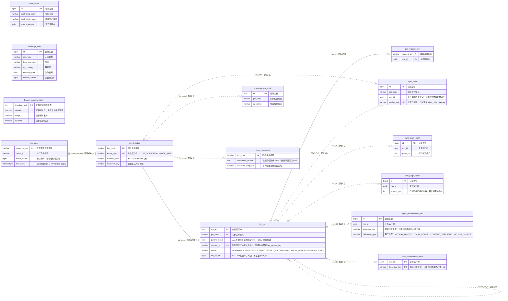

# integration_schema 全表 ER 模型

日期：2026-10-18。模型来自本机运行中的 PostgreSQL 16 数据库元数据，只读查询了表、列、约束与索引，未读取业务记录，也未修改数据库。

- 数据库：`procurement`。
- Schema：`integration_schema`，它是数据库中的命名空间，不是独立数据库。
- 范围：**14 张表、130 个字段**，其中 13 张业务表、1 张 Flyway 迁移历史表。
- 实际外键：**2 条**。其余关联由业务代码维护，本文不把它们标成数据库外键。
- 当前实际字段包含 V3 的 Handler、resource_key、XXL 诊断字段与 180 字符请求ID。
- 不包含 `mock_sap_schema`、XXL-JOB 专用 MySQL 或其他业务 schema。

直接看图（PNG，4100 × 3000，可用系统图片查看器打开并放大）：

- [关系总览图片](integration_schema-ER模型-关系总览.png)：蓝色实线表示实际外键，灰色虚线表示未建外键的业务关联。
- [全字段模型图片](integration_schema-ER模型-全字段模型.png)：包含全部 14 张表、130 个字段，仅绘制 2 条实际外键。

浏览器查看：[关系总览 SVG](integration_schema-ER模型-关系总览.svg)、[全字段模型 SVG](integration_schema-ER模型-全字段模型.svg)。SVG 可用 Edge / Chrome 打开，放大仍保持清晰。

可编辑模型：[integration_schema-ER模型.drawio](integration_schema-ER模型.drawio)。该文件包含“关系总览”和“全字段模型”两个页面，可用 draw.io / diagrams.net 或对应IDE插件打开。

独立 Mermaid 源：[integration_schema-ER模型.mmd](integration_schema-ER模型.mmd)。以下关系总览为学习用途，完整字段和数据库约束以第4节为准。

## 1. 表清单

| 表 | 中文含义 | 字段数 | 主键 | 用途 |
| --- | --- | ---: | --- | --- |
| `cost_center` | 成本中心 | 13 | `id` | SRM本地成本中心主数据。通过控制范围与成本中心编码确定业务唯一性；保留源版本、停用/冻结状态及有效期。 |
| `exchange_rate` | 汇率 | 15 | `id` | SRM本地汇率主数据。按汇率类型、原币、目标币、生效日期唯一；同一生效日的修订通过源版本覆盖。 |
| `flyway_schema_history` | Flyway迁移历史 | 10 | `installed_rank` | Flyway自动维护的迁移元数据，不属于采购业务表，也不属于同步运行日志。 |
| `job_definition` | 任务定义 | 8 | `job_code` | 同步任务配置。保存主数据类型、业务执行开关、Handler与资源键；此处Cron是本地展示配置，实际触发由XXL-JOB Admin管理。 |
| `job_lease` | 资源租约 | 5 | `resource_key` | 按资源键协调并发执行，记录持有者、栅栏令牌、到期时间与心跳。V3新增资源键，并保留V2旧job_code租约行以兼容历史。 |
| `job_request_key` | 请求幂等键 | 4 | `request_id` | 请求幂等映射。多个不同请求可复用同一活动运行，因此一个run_id可以对应多个request_id。 |
| `job_run` | 任务运行 | 27 | `run_id` | 一次业务运行的状态、进度、执行权信息、人工补偿父运行与XXL身份。同一运行在本地退避重试时可以增加执行次数。 |
| `management_audit` | 管理操作审计 | 5 | `id` | 敏感管理操作的原因与时间，当前用于重建未完成基线等操作。 |
| `sync_alert` | 同步告警 | 11 | `id` | 去重后的告警待办。按dedup_key合并重复告警，run_id可以为空；已读与故障恢复是不同状态。 |
| `sync_checkpoint` | 同步检查点 | 5 | `job_code` | 每个同步任务的成功进度。text中保存JSON，记录源游标、快照与本次上界；与页数据一同提交。 |
| `sync_page_audit` | 成功页审计 | 10 | `id` | 已成功提交的页记录，包含起止游标和拉取/应用/忽略数量。用于追踪处理进度，不保存每条主数据的完整历史。 |
| `sync_page_failure` | 失败页记录 | 7 | `id` | 某次执行遇到的失败页位置及错误摘要。一次运行可以包含多次失败记录。 |
| `sync_reconciliation_diff` | 对账差异 | 8 | `id` | 某次对账发现的缺失、版本或内容差异，以及是否修复。源端缺失只报告，不自动删除本地主数据。 |
| `sync_reconciliation_seen` | 对账已见记录 | 2 | `run_id, business_key` | 某次对账在源快照中已见过的业务键集合，用于最后识别MISSING_SOURCE。 |

## 2. ER 关系总览

图例：PK为主键；FK只标数据库实际外键；UK只标单列唯一约束，联合唯一约束详见字段字典。本文图中实线为实际外键，虚线且标“逻辑关联”的边仅表示业务联系；这属于本文展示约定，不代表数据库已经建立约束。乌鸦脚表示“多”，圆圈表示“可无”，短竖线表示“一”。

成本中心、汇率、Flyway表在图中独立列出：它们没有到运行表的直接外键。



## 3. 关系与建模说明

| 引用侧 | 被引用侧 | 业务含义 | 约束性质 |
| --- | --- | --- | --- |
| job_run.job_code | job_definition.job_code | 多次运行对应一个任务定义 | 数据库外键 |
| job_request_key.run_id | job_run.run_id | 多个幂等键可复用一次运行 | 数据库外键 |
| sync_checkpoint.job_code | job_definition.job_code | 一个任务最多一条检查点；正常初始化后为一条 | 逻辑关联，无FK |
| job_definition.resource_key | job_lease.resource_key | 同一资源可供多个任务定义使用；租约表可以有历史闲置行 | 逻辑关联，无FK |
| job_run.parent_run_id | job_run.run_id | 运行可有一个原运行，原运行可关联多次人工补偿 | 逻辑关联，无FK |
| sync_page_audit.run_id | job_run.run_id | 一次运行对应多条成功页记录 | 逻辑关联，无FK |
| sync_page_failure.run_id | job_run.run_id | 一次运行对应多条失败页记录 | 逻辑关联，无FK |
| sync_reconciliation_seen.run_id | job_run.run_id | 一次对账运行对应多个已见业务键 | 逻辑关联，无FK |
| sync_reconciliation_diff.run_id | job_run.run_id | 一次对账运行对应多条差异 | 逻辑关联，无FK |
| sync_alert.job_code / run_id | job_definition.job_code / job_run.run_id | 告警按任务去重；关联运行可空并可被后续告警更新 | 逻辑关联，无FK |
| management_audit.job_code | job_definition.job_code | 一个任务对应多条管理审计记录 | 逻辑关联，无FK |
| job_request_key.job_code / mode | 关联job_run中的同名字段 | 应用层写入时保持语义一致，数据库没有跨表一致性约束 | 冗余字段，无FK |

### 3.1 两条数据库外键

```sql
job_run.job_code REFERENCES integration_schema.job_definition(job_code)
job_request_key.run_id REFERENCES integration_schema.job_run(run_id)
```

两条外键均未配置ON DELETE CASCADE。删除仍被引用的任务运行或任务定义会被数据库拒绝，例如需先处理job_request_key对该运行的引用；本模型不修改删除策略。

### 3.2 主数据与任务如何联系

`job_definition.entity_type`决定同步成本中心还是汇率，Service据此选择目标表。两张主数据表没有run_id或job_code字段，因此不能画成“某条主数据永久属于某次运行”的外键关系。同一条主数据会在不同运行中多次更新。

对账的`business_key`是业务编码串：成本中心采用`controlling_area|cost_center_code`，汇率采用`rate_type|from_currency|to_currency|effective_date`。它没有到某张固定表的物理外键。

### 3.3 两种请求标识

`job_run.request_id`保存创建运行的原始请求标识；`job_request_key`可以为同一run_id保存多个幂等请求别名。两张表的request_id之间没有直接外键，也不是一对一关系。

### 3.4 部分唯一索引与“唯一约束”的区别

`uk_job_run_xxl_log_shard`是一个部分唯一索引：在xxl_log_key不为空时约束`(job_code, xxl_job_id, xxl_log_key, xxl_shard_index)`。它不是额外的外键，也不等同于整个表每一行都必须具有完整XXL身份；人工和历史运行允许这些字段为空。当前索引沿用PostgreSQL默认NULL比较语义，应用需保证新XXL身份字段完整。

## 4. 全部字段与数据库约束

“可空”取自实际数据库；主键字段不可空。“无默认值”表示数据库未声明DEFAULT，不表示该列不能写入NULL。bigserial在系统目录中显示为bigint，其自增由nextval默认值体现。下面将timestamp with time zone简写为timestamptz。

### 4.1 cost_center（成本中心）

SRM本地成本中心主数据。通过控制范围与成本中心编码确定业务唯一性；保留源版本、停用/冻结状态及有效期。

| 字段 | PostgreSQL类型 | 可空 | 键标记 | 数据库默认值 | 含义 |
| --- | --- | --- | --- | --- | --- |
| `id` | `bigint` | 否 | PK | `nextval('integration_schema.cost_center_id_seq'::regclass)` | 记录主键 |
| `controlling_area` | `varchar(20)` | 否 | — | 无默认值 | 控制范围 |
| `cost_center_code` | `varchar(40)` | 否 | — | 无默认值 | 成本中心编码 |
| `company_code` | `varchar(20)` | 否 | — | 无默认值 | 公司编码 |
| `name` | `varchar(200)` | 否 | — | 无默认值 | 名称 |
| `valid_from` | `date` | 否 | — | 无默认值 | 有效期起始日 |
| `valid_to` | `date` | 否 | — | 无默认值 | 有效期截止日 |
| `blocked` | `boolean` | 否 | — | 无默认值 | 是否冻结/禁止业务使用 |
| `deleted` | `boolean` | 否 | — | `false` | 源端是否停用或逻辑删除 |
| `source_version` | `bigint` | 否 | — | 无默认值 | 源记录版本 |
| `source_changed_at` | `timestamptz` | 否 | — | 无默认值 | 源记录变更时间 |
| `payload_hash` | `varchar(64)` | 否 | — | 无默认值 | 业务内容哈希摘要 |
| `synced_at` | `timestamptz` | 否 | — | `clock_timestamp()` | 本地同步落库时间 |

数据库约束：

- `cost_center_check`：`CHECK ((valid_from <= valid_to))`。
- `cost_center_controlling_area_cost_center_code_key`：`UNIQUE (controlling_area, cost_center_code)`。
- `cost_center_pkey`：`PRIMARY KEY (id)`。

### 4.2 exchange_rate（汇率）

SRM本地汇率主数据。按汇率类型、原币、目标币、生效日期唯一；同一生效日的修订通过源版本覆盖。

| 字段 | PostgreSQL类型 | 可空 | 键标记 | 数据库默认值 | 含义 |
| --- | --- | --- | --- | --- | --- |
| `id` | `bigint` | 否 | PK | `nextval('integration_schema.exchange_rate_id_seq'::regclass)` | 记录主键 |
| `rate_type` | `varchar(20)` | 否 | — | 无默认值 | 汇率类型 |
| `from_currency` | `varchar(10)` | 否 | — | 无默认值 | 原币 |
| `to_currency` | `varchar(10)` | 否 | — | 无默认值 | 目标币 |
| `effective_date` | `date` | 否 | — | 无默认值 | 生效日期 |
| `raw_rate` | `numeric(28,12)` | 否 | — | 无默认值 | 源端原始汇率 |
| `from_factor` | `numeric(19,4)` | 否 | — | 无默认值 | 原币换算因子 |
| `to_factor` | `numeric(19,4)` | 否 | — | 无默认值 | 目标币换算因子 |
| `quotation_method` | `varchar(20)` | 否 | — | 无默认值 | 报价方式：DIRECT或INDIRECT，应用层校验 |
| `normalized_rate` | `numeric(28,12)` | 否 | — | 无默认值 | 规范化汇率：1单位原币对应的目标币数量 |
| `deleted` | `boolean` | 否 | — | `false` | 源端是否停用或逻辑删除 |
| `source_version` | `bigint` | 否 | — | 无默认值 | 源记录版本 |
| `source_changed_at` | `timestamptz` | 否 | — | 无默认值 | 源记录变更时间 |
| `payload_hash` | `varchar(64)` | 否 | — | 无默认值 | 业务内容哈希摘要 |
| `synced_at` | `timestamptz` | 否 | — | `clock_timestamp()` | 本地同步落库时间 |

数据库约束：

- `exchange_rate_from_factor_check`：`CHECK ((from_factor > (0)::numeric))`。
- `exchange_rate_normalized_rate_check`：`CHECK ((normalized_rate > (0)::numeric))`。
- `exchange_rate_pkey`：`PRIMARY KEY (id)`。
- `exchange_rate_rate_type_from_currency_to_currency_effective_key`：`UNIQUE (rate_type, from_currency, to_currency, effective_date)`。
- `exchange_rate_to_factor_check`：`CHECK ((to_factor > (0)::numeric))`。

### 4.3 flyway_schema_history（Flyway迁移历史）

Flyway自动维护的迁移元数据，不属于采购业务表，也不属于同步运行日志。

| 字段 | PostgreSQL类型 | 可空 | 键标记 | 数据库默认值 | 含义 |
| --- | --- | --- | --- | --- | --- |
| `installed_rank` | `int` | 否 | PK | 无默认值 | 迁移安装顺序主键 |
| `version` | `varchar(50)` | 是 | — | 无默认值 | 迁移版本号；非版本化条目可空 |
| `description` | `varchar(200)` | 否 | — | 无默认值 | 迁移说明 |
| `type` | `varchar(20)` | 否 | — | 无默认值 | 迁移类型 |
| `script` | `varchar(1000)` | 否 | — | 无默认值 | 迁移脚本名称 |
| `checksum` | `int` | 是 | — | 无默认值 | 脚本校验值 |
| `installed_by` | `varchar(100)` | 否 | — | 无默认值 | 执行迁移的数据库用户 |
| `installed_on` | `timestamp` | 否 | — | `now()` | 迁移安装时间 |
| `execution_time` | `int` | 否 | — | 无默认值 | 迁移耗时（毫秒） |
| `success` | `boolean` | 否 | — | 无默认值 | 迁移是否成功 |

数据库约束：

- `flyway_schema_history_pk`：`PRIMARY KEY (installed_rank)`。

额外索引（不重复列主键/唯一约束自动建立的索引）：

- `flyway_schema_history_s_idx`：`CREATE INDEX flyway_schema_history_s_idx ON integration_schema.flyway_schema_history USING btree (success)`。

### 4.4 job_definition（任务定义）

同步任务配置。保存主数据类型、业务执行开关、Handler与资源键；此处Cron是本地展示配置，实际触发由XXL-JOB Admin管理。

| 字段 | PostgreSQL类型 | 可空 | 键标记 | 数据库默认值 | 含义 |
| --- | --- | --- | --- | --- | --- |
| `job_code` | `varchar(80)` | 否 | PK | 无默认值 | 同步任务编码 |
| `entity_type` | `varchar(30)` | 否 | UK | 无默认值 | 主数据类型：COST_CENTER/EXCHANGE_RATE |
| `name` | `varchar(100)` | 否 | — | 无默认值 | 名称 |
| `enabled` | `boolean` | 否 | — | `true` | SRM业务执行开关，不等同于XXL Cron启停 |
| `cron_expression` | `varchar(100)` | 否 | — | 无默认值 | 本地展示的Cron配置 |
| `zone_id` | `varchar(40)` | 否 | — | `'Asia/Shanghai'::character varying` | 时区 |
| `handler_code` | `varchar(100)` | 否 | — | 无默认值 | XXL-JOB Handler名称 |
| `resource_key` | `varchar(100)` | 否 | — | 无默认值 | 数据集写入资源键 |

数据库约束：

- `job_definition_entity_type_key`：`UNIQUE (entity_type)`。
- `job_definition_pkey`：`PRIMARY KEY (job_code)`。

### 4.5 job_lease（资源租约）

按资源键协调并发执行，记录持有者、栅栏令牌、到期时间与心跳。V3新增资源键，并保留V2旧job_code租约行以兼容历史。

| 字段 | PostgreSQL类型 | 可空 | 键标记 | 数据库默认值 | 含义 |
| --- | --- | --- | --- | --- | --- |
| `resource_key` | `varchar(80)` | 否 | PK | 无默认值 | 数据集写入资源键 |
| `owner_id` | `varchar(100)` | 是 | — | 无默认值 | 执行实例标识 |
| `fence_token` | `bigint` | 否 | — | `0` | 栅栏令牌，领取租约时递增 |
| `lease_until` | `timestamptz` | 否 | — | `'-infinity'::timestamp with time zone` | 租约到期时间；-infinity表示可领取 |
| `heartbeat_at` | `timestamptz` | 是 | — | 无默认值 | 最近续租心跳时间 |

数据库约束：

- `job_lease_pkey`：`PRIMARY KEY (resource_key)`。

### 4.6 job_request_key（请求幂等键）

请求幂等映射。多个不同请求可复用同一活动运行，因此一个run_id可以对应多个request_id。

| 字段 | PostgreSQL类型 | 可空 | 键标记 | 数据库默认值 | 含义 |
| --- | --- | --- | --- | --- | --- |
| `request_id` | `varchar(180)` | 否 | PK | 无默认值 | 幂等请求标识 |
| `run_id` | `uuid` | 否 | FK | 无默认值 | 业务运行ID |
| `job_code` | `varchar(80)` | 否 | — | 无默认值 | 同步任务编码 |
| `mode` | `varchar(20)` | 否 | — | 无默认值 | AUTO / RECONCILE / REPAIR |

数据库约束：

- `job_request_key_pkey`：`PRIMARY KEY (request_id)`。
- `job_request_key_run_id_fkey`：`FOREIGN KEY (run_id) REFERENCES integration_schema.job_run(run_id)`。

### 4.7 job_run（任务运行）

一次业务运行的状态、进度、执行权信息、人工补偿父运行与XXL身份。同一运行在本地退避重试时可以增加执行次数。

| 字段 | PostgreSQL类型 | 可空 | 键标记 | 数据库默认值 | 含义 |
| --- | --- | --- | --- | --- | --- |
| `run_id` | `uuid` | 否 | PK | 无默认值 | 业务运行ID |
| `job_code` | `varchar(80)` | 否 | FK | 无默认值 | 同步任务编码 |
| `mode` | `varchar(20)` | 否 | — | 无默认值 | AUTO / RECONCILE / REPAIR |
| `trigger_type` | `varchar(20)` | 否 | — | 无默认值 | 触发来源：MANUAL、RETRY、XXL等；无数据库枚举约束 |
| `parent_run_id` | `uuid` | 是 | — | 无默认值 | 人工补偿所关联的原运行ID，可空，未建外键 |
| `request_id` | `varchar(180)` | 否 | UK | 无默认值 | 创建该运行的原始请求ID；幂等别名另存job_request_key |
| `reason` | `varchar(500)` | 否 | — | 无默认值 | 操作或触发原因 |
| `status` | `varchar(30)` | 否 | — | 无默认值 | PENDING / RUNNING / SUCCEEDED / RETRY_WAIT / FAILED / CANCEL_REQUESTED / CANCELLED |
| `attempt_no` | `int` | 否 | — | `0` | 已领取执行权的次数，首次领取前为0 |
| `next_retry_at` | `timestamptz` | 是 | — | 无默认值 | 本地任务下次允许重试的时间 |
| `owner_id` | `varchar(100)` | 是 | — | 无默认值 | 执行实例标识 |
| `fence_token` | `bigint` | 是 | — | 无默认值 | 栅栏令牌，领取租约时递增 |
| `phase` | `varchar(30)` | 是 | — | 无默认值 | 处理阶段，如BASELINE、DELTA、RECONCILE、COMPLETED |
| `fetched_count` | `bigint` | 否 | — | `0` | 拉取数量 |
| `applied_count` | `bigint` | 否 | — | `0` | 实际应用数量 |
| `ignored_count` | `bigint` | 否 | — | `0` | 忽略数量 |
| `total_count` | `bigint` | 否 | — | `0` | 本次已知处理总量 |
| `error_code` | `varchar(60)` | 是 | — | 无默认值 | 错误码 |
| `error_summary` | `varchar(500)` | 是 | — | 无默认值 | 错误摘要 |
| `started_at` | `timestamptz` | 是 | — | 无默认值 | 首次开始时间 |
| `finished_at` | `timestamptz` | 是 | — | 无默认值 | 终态结束时间 |
| `created_at` | `timestamptz` | 否 | — | `clock_timestamp()` | 创建时间 |
| `xxl_job_id` | `bigint` | 是 | — | 无默认值 | XXL-JOB任务ID，可空，不是业务run_id |
| `xxl_log_key` | `varchar(64)` | 是 | — | 无默认值 | XXL日志文件标识的SHA-256摘要，不保存绝对路径 |
| `xxl_shard_index` | `int` | 是 | — | 无默认值 | XXL分片索引，通常从0开始 |
| `xxl_shard_total` | `int` | 是 | — | 无默认值 | XXL分片总数 |
| `executor_address` | `varchar(255)` | 是 | — | 无默认值 | 执行器注册地址 |

数据库约束：

- `job_run_job_code_fkey`：`FOREIGN KEY (job_code) REFERENCES integration_schema.job_definition(job_code)`。
- `job_run_mode_check`：`CHECK (((mode)::text = ANY ((ARRAY['AUTO'::character varying, 'RECONCILE'::character varying, 'REPAIR'::character varying])::text[])))`。
- `job_run_pkey`：`PRIMARY KEY (run_id)`。
- `job_run_request_id_key`：`UNIQUE (request_id)`。
- `job_run_status_check`：`CHECK (((status)::text = ANY ((ARRAY['PENDING'::character varying, 'RUNNING'::character varying, 'SUCCEEDED'::character varying, 'RETRY_WAIT'::character varying, 'FAILED'::character varying, 'CANCEL_REQUESTED'::character varying, 'CANCELLED'::character varying])::text[])))`。

额外索引（不重复列主键/唯一约束自动建立的索引）：

- `idx_job_run_due`：`CREATE INDEX idx_job_run_due ON integration_schema.job_run USING btree (status, next_retry_at, created_at)`。
- `idx_job_run_local_due`：`CREATE INDEX idx_job_run_local_due ON integration_schema.job_run USING btree (status, next_retry_at, created_at) WHERE ((trigger_type)::text <> 'XXL'::text)`。
- `idx_job_run_xxl_identity`：`CREATE INDEX idx_job_run_xxl_identity ON integration_schema.job_run USING btree (job_code, xxl_job_id, xxl_log_key, xxl_shard_index) WHERE ((trigger_type)::text = 'XXL'::text)`。
- `uk_job_run_xxl_log_shard`：`CREATE UNIQUE INDEX uk_job_run_xxl_log_shard ON integration_schema.job_run USING btree (job_code, xxl_job_id, xxl_log_key, xxl_shard_index) WHERE (xxl_log_key IS NOT NULL)`。

### 4.8 management_audit（管理操作审计）

敏感管理操作的原因与时间，当前用于重建未完成基线等操作。

| 字段 | PostgreSQL类型 | 可空 | 键标记 | 数据库默认值 | 含义 |
| --- | --- | --- | --- | --- | --- |
| `id` | `uuid` | 否 | PK | 无默认值 | 记录主键 |
| `job_code` | `varchar(80)` | 否 | — | 无默认值 | 同步任务编码 |
| `operation` | `varchar(60)` | 否 | — | 无默认值 | 管理操作编码 |
| `reason` | `varchar(500)` | 否 | — | 无默认值 | 操作或触发原因 |
| `created_at` | `timestamptz` | 否 | — | `clock_timestamp()` | 创建时间 |

数据库约束：

- `management_audit_pkey`：`PRIMARY KEY (id)`。

### 4.9 sync_alert（同步告警）

去重后的告警待办。按dedup_key合并重复告警，run_id可以为空；已读与故障恢复是不同状态。

| 字段 | PostgreSQL类型 | 可空 | 键标记 | 数据库默认值 | 含义 |
| --- | --- | --- | --- | --- | --- |
| `id` | `bigint` | 否 | PK | `nextval('integration_schema.sync_alert_id_seq'::regclass)` | 记录主键 |
| `job_code` | `varchar(80)` | 否 | — | 无默认值 | 同步任务编码 |
| `run_id` | `uuid` | 是 | — | 无默认值 | 最近关联的业务运行；滞后告警等场景可空 |
| `category` | `varchar(60)` | 否 | — | 无默认值 | 告警类别，如SYNC_FAILURE、STALE、RECONCILIATION |
| `severity` | `varchar(20)` | 否 | — | 无默认值 | 告警级别 |
| `dedup_key` | `varchar(180)` | 否 | UK | 无默认值 | 告警去重键，当前通常为job_code:category |
| `first_seen_at` | `timestamptz` | 否 | — | `clock_timestamp()` | 本轮告警首次出现时间 |
| `last_seen_at` | `timestamptz` | 否 | — | `clock_timestamp()` | 最近出现时间 |
| `occurrence_count` | `bigint` | 否 | — | `1` | 本轮告警累计次数 |
| `status` | `varchar(20)` | 否 | — | `'OPEN'::character varying` | OPEN / ACKNOWLEDGED / RESOLVED |
| `summary` | `varchar(500)` | 否 | — | 无默认值 | 告警摘要 |

数据库约束：

- `sync_alert_dedup_key_key`：`UNIQUE (dedup_key)`。
- `sync_alert_pkey`：`PRIMARY KEY (id)`。
- `sync_alert_status_check`：`CHECK (((status)::text = ANY ((ARRAY['OPEN'::character varying, 'ACKNOWLEDGED'::character varying, 'RESOLVED'::character varying])::text[])))`。

### 4.10 sync_checkpoint（同步检查点）

每个同步任务的成功进度。text中保存JSON，记录源游标、快照与本次上界；与页数据一同提交。

| 字段 | PostgreSQL类型 | 可空 | 键标记 | 数据库默认值 | 含义 |
| --- | --- | --- | --- | --- | --- |
| `job_code` | `varchar(80)` | 否 | PK | 无默认值 | 同步任务编码 |
| `committed_cursor` | `text` | 是 | — | 无默认值 | 已提交检查点JSON（数据库类型为text） |
| `baseline_complete` | `boolean` | 否 | — | `false` | 首次全量基线是否完成 |
| `last_success_at` | `timestamptz` | 是 | — | 无默认值 | 最近一次AUTO运行完整成功时间 |
| `version` | `bigint` | 否 | — | `0` | 检查点更新版本 |

数据库约束：

- `sync_checkpoint_pkey`：`PRIMARY KEY (job_code)`。

### 4.11 sync_page_audit（成功页审计）

已成功提交的页记录，包含起止游标和拉取/应用/忽略数量。用于追踪处理进度，不保存每条主数据的完整历史。

| 字段 | PostgreSQL类型 | 可空 | 键标记 | 数据库默认值 | 含义 |
| --- | --- | --- | --- | --- | --- |
| `id` | `bigint` | 否 | PK | `nextval('integration_schema.sync_page_audit_id_seq'::regclass)` | 记录主键 |
| `run_id` | `uuid` | 否 | — | 无默认值 | 业务运行ID |
| `page_no` | `int` | 否 | — | 无默认值 | 运行内页编号 |
| `phase` | `varchar(30)` | 否 | — | 无默认值 | 处理阶段，如BASELINE、DELTA、RECONCILE、COMPLETED |
| `from_cursor` | `text` | 是 | — | 无默认值 | 本页起点/此前检查点 |
| `to_cursor` | `text` | 是 | — | 无默认值 | 本页成功提交后的检查点 |
| `fetched_count` | `int` | 否 | — | 无默认值 | 拉取数量 |
| `applied_count` | `int` | 否 | — | 无默认值 | 实际应用数量 |
| `ignored_count` | `int` | 否 | — | 无默认值 | 忽略数量 |
| `committed_at` | `timestamptz` | 否 | — | `clock_timestamp()` | 成功页提交记录时间 |

数据库约束：

- `sync_page_audit_pkey`：`PRIMARY KEY (id)`。
- `sync_page_audit_run_id_page_no_key`：`UNIQUE (run_id, page_no)`。

### 4.12 sync_page_failure（失败页记录）

某次执行遇到的失败页位置及错误摘要。一次运行可以包含多次失败记录。

| 字段 | PostgreSQL类型 | 可空 | 键标记 | 数据库默认值 | 含义 |
| --- | --- | --- | --- | --- | --- |
| `id` | `bigint` | 否 | PK | `nextval('integration_schema.sync_page_failure_id_seq'::regclass)` | 记录主键 |
| `run_id` | `uuid` | 否 | — | 无默认值 | 业务运行ID |
| `attempt_no` | `int` | 否 | — | 无默认值 | 已领取执行权的次数，首次领取前为0 |
| `from_cursor` | `text` | 是 | — | 无默认值 | 本页起点/此前检查点 |
| `error_code` | `varchar(60)` | 否 | — | 无默认值 | 错误码 |
| `error_summary` | `varchar(500)` | 否 | — | 无默认值 | 错误摘要 |
| `occurred_at` | `timestamptz` | 否 | — | `clock_timestamp()` | 错误记录时间 |

数据库约束：

- `sync_page_failure_pkey`：`PRIMARY KEY (id)`。

### 4.13 sync_reconciliation_diff（对账差异）

某次对账发现的缺失、版本或内容差异，以及是否修复。源端缺失只报告，不自动删除本地主数据。

| 字段 | PostgreSQL类型 | 可空 | 键标记 | 数据库默认值 | 含义 |
| --- | --- | --- | --- | --- | --- |
| `id` | `bigint` | 否 | PK | `nextval('integration_schema.sync_reconciliation_diff_id_seq'::regclass)` | 记录主键 |
| `run_id` | `uuid` | 否 | — | 无默认值 | 业务运行ID |
| `business_key` | `varchar(240)` | 否 | — | 无默认值 | 规范化业务键，可能对应成本中心或汇率 |
| `difference_type` | `varchar(30)` | 否 | — | 无默认值 | 差异类型：MISSING_TARGET、LOCAL_NEWER、CONTENT_DIFFERENT、MISSING_SOURCE |
| `source_version` | `bigint` | 是 | — | 无默认值 | 源记录版本 |
| `target_version` | `bigint` | 是 | — | 无默认值 | 目标记录版本；目标缺失时可空 |
| `repaired` | `boolean` | 否 | — | `false` | 该差异是否已修复 |
| `created_at` | `timestamptz` | 否 | — | `clock_timestamp()` | 创建时间 |

数据库约束：

- `sync_reconciliation_diff_pkey`：`PRIMARY KEY (id)`。
- `sync_reconciliation_diff_run_id_business_key_key`：`UNIQUE (run_id, business_key)`。

### 4.14 sync_reconciliation_seen（对账已见记录）

某次对账在源快照中已见过的业务键集合，用于最后识别MISSING_SOURCE。

| 字段 | PostgreSQL类型 | 可空 | 键标记 | 数据库默认值 | 含义 |
| --- | --- | --- | --- | --- | --- |
| `run_id` | `uuid` | 否 | PK | 无默认值 | 业务运行ID |
| `business_key` | `varchar(240)` | 否 | PK | 无默认值 | 规范化业务键，可能对应成本中心或汇率 |

数据库约束：

- `sync_reconciliation_seen_pkey`：`PRIMARY KEY (run_id, business_key)`。

## 5. 按同步流程理解这些表

1. `job_definition`描述“同步什么”，`job_request_key`判断“这个请求是否处理过”，`job_run`记录“本次运行是什么”。
2. `job_lease`决定“当前谁有写权限”，`sync_checkpoint`记录“此前成功到哪里”。
3. 成本中心或汇率与`sync_checkpoint`、`sync_page_audit`在页事务中共同提交。
4. 失败时写入`sync_page_failure`，按入口决定本地退避或交回XXL重试，必要时更新`sync_alert`。
5. 对账时用`sync_reconciliation_seen`收集源业务键，再用`sync_reconciliation_diff`记录缺失或内容差异。
6. `management_audit`记录敏感管理动作；`flyway_schema_history`仅记录表结构迁移。

## 6. 与项目代码的对应

- 主数据表：`CostCenterMapper`、`ExchangeRateMapper`。
- 任务与请求：`JobDefinitionMapper`、`JobRunMapper`、`JobRequestKeyMapper`。
- 执行权：`JobLeaseMapper`与`SyncLeaseServiceImpl`。
- 检查点和页记录：`SyncCheckpointMapper`、`SyncAuditMapper`。
- 告警：`SyncAlertMapper`。
- 对账：`SyncReconciliationMapper`。
- 管理审计：当前由`JobDefinitionMapper.insertManagementAudit`写入。
- Flyway历史：由Flyway管理，不需要业务Mapper。

DDL参考：`backend/integration-service/src/main/resources/db/integration/migration/V1__master_data_sync.sql`、`V2__job_scheduler.sql`、`V3__xxl_job_scheduler.sql`。本文描述的是本次查询时的实际数据库，后续迁移后应重新生成。
