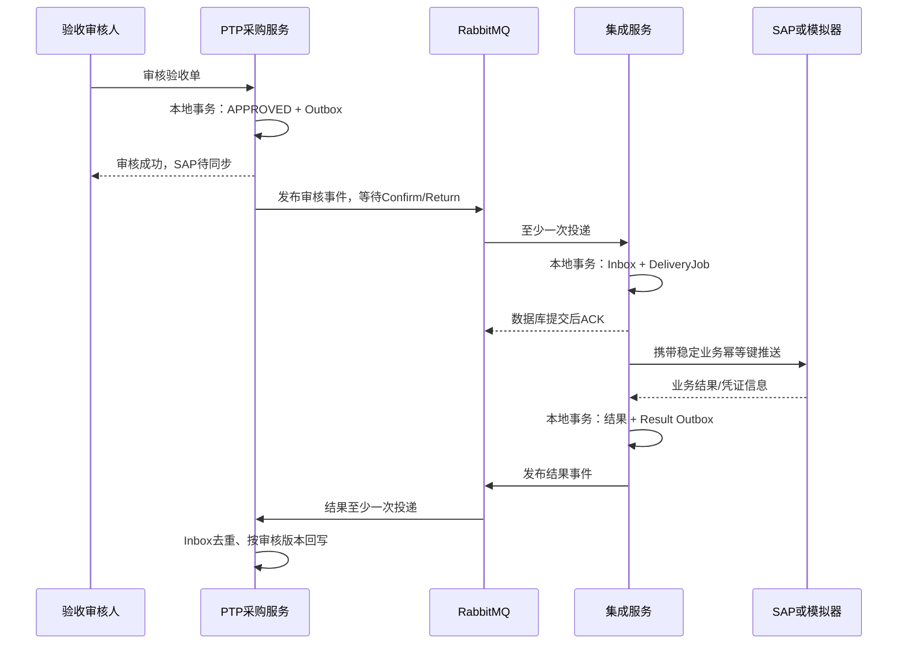

# 采购验收可靠异步推送SAP技术方案

> 日期：2026-10-17。性质：待复现设计。
> 目标：验收审核快速完成，SAP短暂故障不阻塞审核；接口投递、凭证结果与异常处理可恢复、可追溯。
> 架构：PTP验收与Outbox同事务，RabbitMQ投递事件，集成服务持久化待推送任务，再异步调用SAP；结果事件可靠回写PTP。
> 技术基线：Java 17、Spring Boot 3.0.7、PostgreSQL、RabbitMQ、MyBatis-Plus；不引入跨数据库大事务。
> 实施约束：本轮不实施代码、不运行测试；后续联调、测试和压测由用户批准后执行。

## 1. 客户需求与业务背景

工厂在SRM发起采购订单，供应商交付设备或服务后，业务人员录入采购验收单。审核通过说明SRM已经确认本次交付，后续SAP需要生成相应物料或财务业务记录，并将SAP凭证号回写到验收单。

月末可能集中审核大量验收单。如果每次审核都同步等待SAP，SAP变慢会拖长用户等待；SAP停机期间甚至不能完成正常验收。另一方面，“审核成功但SAP永远没收到”也会造成账务衔接问题。

客户要求：

- 审核结果与SAP同步状态分别展示，审核成功不等于SAP已成功入账。
- 审核事务提交后，待推送事实不会丢失；数据库回滚时不得推送。
- 网络抖动、MQ重投、重复点击不能产生重复SAP凭证。
- SAP返回的物料凭证号、会计年度、分录号可查询、可追溯。
- 明确区分业务拒绝、可重试故障和“请求是否成功未知”。
- 支持故障恢复、人工重试和定期对账。

首期业务只处理审核后正向推送；审核撤销或红字冲销必须走独立冲销业务，不能简单删除已生成的SAP凭证。

## 2. 实习依据与复现范围

源码根目录：`E:/Intern_workspace_26y/cosmic_project/project4demo/code/esc/sshh-pro44-esc-app44/src/main/java/sshh/pro44/esc/app44/`。

| 文件 | 已观察到的行为 |
| --- | --- |
| `plugin/operate/PurAcceptBillAuditOpPlugin.java` | 验收审核后调用`ZFFI42`，按资产类型筛选分录并写`sien_sappushlog` |
| `plugin/operate/PurAcceptBillMm80AuditOpPlugin.java` | 调用`ZFMM80`，按正向/冲销组装101/102类业务字段，回写物料凭证信息 |
| `utils/PurAcceptBillSapUtil.java` | SAP调用适配 |
| `utils/PurAcceptBillMm80SapUtil.java` | 物料凭证接口适配 |

这些自定义接口字段及101/102在具体项目中的适用范围，以SAP方确认的接口契约为准，不把复现文档当成会计过账规范。

原项目已有调用与日志，但不能据此声称已经实现Outbox、可靠重投和端到端幂等。当前工程`procurement-service`也尚未具备完整验收单，必须先补验收业务基础。

首期先打通`ZFMM80`对应的物料验收模拟链路，再复用投递框架增加`ZFFI42`适配器。两个接口各自有投递任务、幂等键和结果，不使用一条“成功”记录掩盖其中一个失败。

## 3. 服务职责与数据流



消费者先持久化待办再ACK，网络调用交给集成服务工作器。这样SAP宕机时不会长期占用MQ未确认消息和消费者线程。

## 4. 验收状态与可见行为

PTP保存两种独立状态：

- 业务审核：DRAFT → APPROVED。审核后核心字段冻结。
- 每个SAP接口投递：PENDING → PROCESSING → SUCCESS / RETRY_WAIT / UNKNOWN / MANUAL_REQUIRED / BUSINESS_REJECTED。

多接口汇总状态为ALL_SUCCESS/PARTIAL/FAILED/PENDING，仅由各接口结果计算。SAP成功后不得因为迟到失败消息把同审核版本改回失败。

同一验收单每次合法重新审核生成新的`audit_version`；如果先前审核已经在SAP生成凭证，必须先完成SAP冲销或业务授权流程，再允许新的正向审核。不能依靠提升版本绕过重复过账限制。

## 5. 事件与幂等键

```json
{
  "eventId": "302cfb2c-3e29-4e67-8753-a0fa683873c1",
  "eventType": "AcceptanceApproved",
  "schemaVersion": 1,
  "aggregateId": "c875ce6d-f4ba-4d39-8c77-8c57f740b1f2",
  "aggregateVersion": 3,
  "occurredAt": "2026-10-17T02:00:00Z",
  "traceId": "trace-demo-001",
  "payload": {
    "acceptanceNo": "AC202610170001",
    "auditVersion": 3,
    "supplierCode": "SUP-A",
    "companyCode": "1000",
    "businessDate": "2026-10-17",
    "lines": [{
      "lineNo": 1,
      "poNo": "PO202610170001",
      "poLineNo": 1,
      "itemCode": "CTRL-001",
      "quantity": "10.0000",
      "unit": "EA",
      "costCenterCode": "RD002"
    }]
  }
}
```

消息保存审核时快照，不在消费时重新读取可能已变更的单据来组装历史请求。金额、数量采用十进制定点；必填公司、业务日期、单位及订单引用在审核前校验。

两层幂等必须区分：

| 键 | 防止的问题 |
| --- | --- |
| `consumer_name + event_id` | 同一条MQ消息重复消费 |
| `acceptance_id + audit_version + interface_code + operation` | 同一业务因补发、不同事件ID或网络重试重复推送 |

外部业务键示例：`SRM:AC202610170001:3:ZFMM80:POST`。自动和人工重试都沿用原键，不能通过重新生成UUID制造第二笔SAP业务。

## 6. 数据模型

### 6.1 PTP业务表

在03建立的`ptp_schema`与消息基础上增加：

| 表 | 主要字段 |
| --- | --- |
| `acceptance_h` | id、bill_no唯一、po_id、business_status、audit_version、approved_by、approved_at、version |
| `acceptance_line` | header_id、line_no唯一、po_line_id、item_code、qty、unit、cost_center_code、公司/仓库等快照 |
| `acceptance_sap_result` | acceptance_id、audit_version、interface_code、operation唯一，sync_status、sap_document_no、sap_year、result_version、error_code |

`outbox_event`在业务事务中插入；PTP的结果消费者也使用自己的inbox。未审核数据不生成投递任务。

### 6.2 集成投递任务

```sql
create table integration_schema.sap_delivery_job (
  id uuid primary key,
  acceptance_id uuid not null,
  audit_version bigint not null,
  interface_code varchar(40) not null,
  operation varchar(20) not null,
  business_key varchar(180) not null unique,
  request_hash varchar(64) not null,
  request_payload jsonb not null,
  state varchar(30) not null,
  attempt_count int not null default 0,
  next_attempt_at timestamptz,
  lease_owner varchar(100),
  lease_token bigint not null default 0,
  lease_until timestamptz,
  sap_document_no varchar(80),
  sap_year varchar(4),
  result_version bigint not null default 0,
  last_error_code varchar(60),
  updated_at timestamptz not null default clock_timestamp(),
  unique (acceptance_id, audit_version, interface_code, operation)
);

create table integration_schema.sap_delivery_attempt (
  id bigserial primary key,
  delivery_job_id uuid not null references integration_schema.sap_delivery_job(id),
  attempt_no int not null,
  started_at timestamptz not null,
  finished_at timestamptz,
  outcome varchar(30),
  error_code varchar(60),
  response_summary jsonb,
  unique (delivery_job_id, attempt_no)
);
```

集成服务另建`inbox_event`与`outbox_event`。每次可见任务结果变化时递增`result_version`并写结果Outbox，同事务提交；PTP据此拒绝旧结果。投递日志只保存必要脱敏摘要；生产完整报文按权限、加密和保留期另行存储，不在日志输出SAP凭证密码、人员敏感信息和访问token。

消息基础表采用统一字段，STC、PTP和integration分别在自己的schema建立，不共享一张跨服务表。以integration为例：

```sql
create table integration_schema.outbox_event (
  event_id uuid primary key,
  aggregate_id varchar(80) not null,
  aggregate_version bigint not null,
  event_type varchar(100) not null,
  routing_key varchar(160) not null,
  payload jsonb not null,
  state varchar(20) not null default 'PENDING',
  attempt_count int not null default 0,
  next_attempt_at timestamptz not null default clock_timestamp(),
  lease_owner varchar(100),
  lease_token bigint not null default 0,
  lease_until timestamptz,
  created_at timestamptz not null default clock_timestamp(),
  published_at timestamptz,
  check (state in ('PENDING','SENDING','SENT','MANUAL_REQUIRED'))
);

create index idx_outbox_due
  on integration_schema.outbox_event(state, next_attempt_at);

create table integration_schema.inbox_event (
  consumer_name varchar(100) not null,
  event_id uuid not null,
  received_at timestamptz not null default clock_timestamp(),
  primary key (consumer_name, event_id)
);
```

inbox与业务落库同事务：业务失败则inbox也回滚。历史清理必须覆盖上游最大重放期限，且业务级幂等记录不能随短期日志一起清除。STC/PTP如果已经存在同名不同结构的表，使用新增迁移补字段，不直接覆盖。

## 7. Outbox发布协议

各服务拥有自己的Outbox，发布器采用相同算法、独立表，不读取其他服务schema：

1. 短事务使用`FOR UPDATE SKIP LOCKED`领取到期事件，标记SENDING并保存owner/token/lease_until，提交后再发MQ。
2. 消息持久化，Exchange和队列持久化；需要节点故障容错时选择并正确部署quorum队列。单节点本地环境不宣称具备集群容灾。
3. 开启publisher confirm与mandatory return；同时确认broker接收且未发生不可路由退回，才标记SENT。
4. Nack、Return或等待超时后保留事件并退避重发。未确定结果的消息可能已经到broker，因此必须允许重复。
5. 发布成功但本地SENT更新前进程退出，租约超时后重发，消费者依靠inbox和业务键去重。

不在发送网络请求期间持有数据库行锁，也不因为“发送方法没抛异常”直接标记成功。工程需要新增投递器，当前已有的表和Exchange配置不足以证明此协议已经实现。

## 8. RabbitMQ拓扑与ACK

| 名称 | 类型/用途 |
| --- | --- |
| `procurement.domain.v1` | 复用现有Topic Exchange |
| `ptp.acceptance.approved.v1` | 审核事件路由键 |
| `integration.sap.acceptance.v1` | 集成接收队列 |
| `integration.sap.acceptance.result.v1` | 结果路由键 |
| `ptp.sap.acceptance.result.v1` | PTP接收结果队列 |
| `procurement.dead.v1` | 无法解析或基础设施投递失败的死信Exchange |

监听器手动ACK。集成接收事务提交DeliveryJob和inbox后ACK；数据库失败则拒绝本次处理并进入受控重试。结构错误、未知schemaVersion或同业务键不同请求摘要进入隔离记录/死信，不无限`requeue=true`热循环。

SAP业务调用失败主要在DeliveryJob重试，避免消息重试与业务任务重试相乘。MQ监听器只负责把请求可靠移交给任务库。

## 9. SAP超时：不能只靠本地幂等

关键故障是：SAP已经过账，响应在网络中丢失。SRM只知道超时，如果简单重发，可能生成第二张凭证。本地inbox只能防止重复接收事件，无法撤销SAP已经发生的副作用。

正式接口接入至少确认一种能力：

| SAP能力 | SRM策略 |
| --- | --- |
| 支持业务键唯一且重复请求返回原结果 | 使用稳定businessKey重试，相同请求幂等 |
| 支持按外部业务参考号查询凭证 | 超时转UNKNOWN，先查询，再按明确的未处理结果决定重试 |
| 两者都没有 | UNKNOWN进入人工核对，不承诺端到端不重、不无脑自动重投 |

源端“暂时查不到”不能直接等于“没有成功”：原请求可能仍在执行。契约需说明查询是否能区分PROCESSING/NOT_FOUND/SUCCESS以及什么时候NOT_FOUND可作为可重试证据。

本地模拟SAP提供：

```http
POST /mock/sap/v1/material-postings
Idempotency-Key: SRM:AC202610170001:3:ZFMM80:POST

GET /mock/sap/v1/material-postings/by-reference/{businessKey}
```

模拟器用唯一businessKey、请求摘要与凭证写入同一事务；同键不同摘要返回409，相同请求返回原凭证。可以模拟“成功后丢响应”和“长时间处理中”，使故障语义具体可复现。

## 10. 工作器、失败分类与结果回写

工作器领取任务后提交租约，事务外调用SAP；写结果时校验leaseToken。旧worker迟到的结果不能覆盖新worker终态。即使本地token失效，远端请求仍可能完成，因此外部业务幂等仍不可省略。

| 结果 | 任务状态与处理 |
| --- | --- |
| 明确成功 | SUCCESS，保存凭证与结果Outbox，同事务 |
| SAP明确业务拒绝，例如成本中心不合法 | BUSINESS_REJECTED，人工更正后重提；原审核快照不可静默修改 |
| 请求明确未送达或上游明确可重试 | RETRY_WAIT，持久化下次执行时间 |
| 超时、连接中断且可能已过账 | UNKNOWN，先查原businessKey |
| 超过自动恢复次数 | MANUAL_REQUIRED，进入运维待办 |

初始业务重试5次，间隔30秒、2分钟、10分钟、30分钟、2小时并加抖动；实际策略按SAP窗口调整。消费者并发初始2，SAP工作器并发2、限速5次/秒，参数是练习起点。数据库持久化排队，不能通过增加并发压垮SAP。

结果事件携带deliveryJobId、businessKey、auditVersion、interfaceCode、resultVersion和凭证。PTP在inbox事务中按审核版本和结果版本更新对应结果行，不覆盖其他接口和新审核版本。结果事件丢失可由集成Outbox重投，PTP还可按businessKey查询对账恢复。

## 11. 管理接口与权限

| 接口 | 用途 |
| --- | --- |
| `POST /api/ptp/acceptances/{id}/approve` | 审核并生成Outbox，返回审核状态和待同步状态 |
| `GET /api/ptp/acceptances/{id}` | 展示各接口同步状态和凭证 |
| `GET /api/integration/sap-deliveries` | 按状态、日期、接口过滤待办 |
| `GET /api/integration/sap-deliveries/{id}` | 查看脱敏调用历史与源业务引用 |
| `POST /api/integration/sap-deliveries/{id}/retry` | 管理员重试，原因必填，不改变businessKey |
| `POST /api/integration/sap-deliveries/{id}/reconcile` | 查询SAP处理状态，不无条件重发 |

成功任务不提供普通“再次推送”按钮；UNKNOWN只提供核对入口。涉及修正已审核业务快照时走业务版本/冲销流程，保留原失败原因和操作记录。

## 12. 当前工程落点与实施顺序

| 路径 | 职责 |
| --- | --- |
| `backend/procurement-service/src/main/java/com/example/procurement/purchasing/acceptance/` | 验收单聚合、审核、结果消费者 |
| `backend/procurement-service/src/main/resources/db/ptp/migration/V2__acceptance_and_sap_result.sql` | 验收及结果表，复用03建立的消息基础 |
| `backend/integration-service/src/main/java/com/example/procurement/integration/sapdelivery/` | 接收、任务库、worker、查询、状态机、适配器与结果事件 |
| `backend/integration-service/src/main/java/com/example/procurement/integration/messaging/` | 集成Outbox发布器与Inbox |
| `backend/integration-service/src/main/java/com/example/procurement/integration/mock/` | 幂等SAP凭证模拟接口 |
| `backend/integration-service/src/main/resources/db/integration/migration/V3__sap_delivery.sql` | DeliveryJob、Attempt、集成消息表 |
| `backend/procurement-service/pom.xml` | 持久化、Validation、AMQP，承接03依赖 |
| `web/src/views/ptp/` | 验收详情与SAP状态 |
| `web/src/views/integration/SapDeliveryList.vue` | 异常队列、核对、重试 |

- [ ] 建验收单和审核快照，审核与事件同事务。
- [ ] 实现Outbox发布协议、MQ拓扑与持久化接收ACK。
- [ ] 实现模拟SAP幂等创建和参考号查询，再接投递worker。
- [ ] 实现UNKNOWN恢复、业务错误处理和结果Outbox。
- [ ] 实现PTP结果幂等回写、管理员核对和周期性差异报告。
- [ ] 增加第二接口适配器与部分成功展示；冲销作为独立扩展需求。

迁移位置由聚合入口分别注册`db/ptp/migration`与`db/integration/migration`；所有Service只修改自己拥有的数据。03和本方案共享消息基础，不重复定义第二套事件信封和PTP Outbox。

## 13. 待批准的验收与观测

| 故障/并发场景 | 预期 |
| --- | --- |
| 审核事务回滚 | 无有效Outbox，不调用SAP |
| 审核提交后进程退出 | 重启仍能发出事件 |
| MQ发送成功但SENT未写回 | 可重复投递，只创建一笔DeliveryJob |
| SAP成功后响应丢失 | UNKNOWN核对原键，不重复生成凭证 |
| 两个worker因超时接管重叠 | SAP按原业务键返回同一结果 |
| 一个接口成功另一个失败 | 页面PARTIAL，重试只作用于失败接口 |
| 结果事件重复或旧审核版本迟到 | 幂等，不覆盖新版本 |
| SAP长时间不可用 | 验收仍可审核，待推送积压可见并限速恢复 |

观察审核P95/P99、Outbox最老未投递年龄、任务积压、SAP调用时延、UNKNOWN数量、自动恢复时长、重复消费数与对账差异。性能提升比例只有获批实测后才填写。

## 14. 面试讲解与简历口径

“验收审核后要把结果传给SAP，月末集中审核时同步调用会受SAP时延影响。我把审核与待发送事件写在同一个本地事务，消息到集成服务后先落待办再ACK，然后限速调用SAP。投递至少一次，靠业务键幂等产生一次业务效果；对SAP已成功但响应丢失的情况，用参考号查询和UNKNOWN状态恢复。”

复现完成后可写：“基于Transactional Outbox和RabbitMQ实现采购验收异步集成，支持接口级幂等、未知结果核对、持久化重试及凭证回写，隔离SAP故障对审核主流程的影响。”没有SAP幂等或查询能力时，不承诺Exactly Once。

## 15. 技术参考与关联

发布Confirm与消费ACK保障的是不同阶段，确认及持久性语义参考[RabbitMQ官方说明](https://www.rabbitmq.com/docs/confirms)；重复投递及恢复边界参考[RabbitMQ可靠性指南](https://www.rabbitmq.com/docs/reliability)。本方案以至少一次交付和业务幂等实现目标，不宣称消息中间件自动保证跨系统事务。

关联：[02-任务恢复与补偿](./02-分布式调度与失败补偿技术方案.md)、[03-订单与消息基础](./03-BPA合同额度并发控制技术方案.md)。
